# Research: How to build and show the topic graph of a loaded course (S-02, FR-003)

**Date**: 2026-11-25T17:01:31+01:00
**Researcher**: Claude Code
**Git Commit**: 83056f07e73b4c34eab2e978f809ff9305c226b9
**Branch**: course-topic-graph
**Repository**: plancys/rubber-duck-on-steroids

## Research Question

Roadmap item S-02 says: "Learner can see a loaded course as a graph of its topics and how they relate" (`context/foundation/roadmap.md:113`, PRD FR-003 at `context/foundation/prd.md:113`).

The command gave no other question. So this research answers four questions for the plan of S-02:

1. What does S-02 build on in the code that S-01 and F-01 left?
2. Which earlier decisions and open questions bind S-02?
3. Which options exist to extract topics and their relations with a language model, and what do they cost?
4. Which options exist to show the graph in the web app?

## Summary

- **The input is ready.** Each lesson is one row in `lessons` with its text in `markdown` (`supabase/migrations/20261124200800_create_courses.sql:34-53`). S-01 stored Markdown for this purpose (`context/archive/2026-11-24-load-course-from-url/plan.md:5`).
- **S-02 needs its own job type.** The site of the PRD example course answers 403 to automated clients, so that course loads through the browser extension (`context/archive/2026-11-24-load-course-from-url/plan.md:15`, `plan-brief.md:21-22`). An extension course has no `load_course` job (`src/pages/dashboard/courses/[id].astro:53`, `supabase/migrations/20261125120000_harden_course_load.sql:40-48`). So the topic work cannot be a step of the load job alone.
- **A new job type touches four places:** the type check, an optional payload trigger, one handler, and one insert path in the web app (`worker/handlers/index.ts:1`, `supabase/migrations/20261124200800_create_courses.sql:115-116`).
- **A job cannot start a second job for the same learner while it runs.** One unique index allows one job in progress for each learner, for all job types (`supabase/migrations/20261124123303_create_jobs.sql:30-33`).
- **No real model call ran in this repository yet.** In the local database, the 14 `load_course` jobs with status `done` record `finder: rule`, and 0 record `model`. Plan rows 5.5 and 5.6 of S-01 are open.
- **The service and the cheap model are chosen.** S-01 uses Anthropic with `claude-haiku-5-5` and a monthly spend limit of about 5 USD (`worker/llm.ts:7`, `README.md:607-609`). Roadmap Question 18 still says that S-02 must settle it.
- **Cost does not decide the design.** For an assumed course of 150 lessons and 1.5 million characters, each design in the cost table of section 7 costs between 0.10 USD and 1.60 USD for one run. Quality, output size and run time decide the design.
- **No document defines a topic.** The PRD, the shape notes and the roadmap do not say how fine a topic is, which relation types exist, or how a topic links to a lesson or a passage. The shape notes give one example in the user's words: one long paragraph about "Repetable read" (`context/foundation/shape-notes.md:101`). The plan must decide the definition.
- **Two graph view candidates fit (F.8 adds a third):** React Flow (`@xyflow/react`) and Cytoscape.js. For both, the worker can calculate the layout, and the server can render an outline list as the accessible form.
- **The project has no graph or chart library today** (root `package.json`, inspected dependency list).

**Added by the follow-up of 2026-11-25 (see "Follow-up Research" at the end):**

- **No open-source project covers the core.** Of 23 evaluated projects, no project scores 2 or more on both the topic graph and the learner model (F.3).
- **The recommendation is our own core in Postgres, with ideas from the best projects, and one boundary for the extraction engine** (F.7). Cognee is the candidate engine for the company future.
- **The most common defect is a name as the identity of a topic** (F.5). The code must give a topic its identity.
- **The graph view gets a third candidate and a new target:** the nested map of OpenFlowKit (F.8).
- **A language is no longer a reason to reject a project.** F.9 lists each conclusion of the first research that changes.

**Added by the second follow-up of 2026-11-25 (see "Follow-up Research (2)" at the end):**

- **A hybrid of projects is possible, at four depths.** 4 projects enter as code, Cognee is a possible service, and 17 projects give patterns (H.3).
- **The data has three kinds, not two:** the canon, the content and the learner state. The lesson text does not move to a shared store by default (H.2).
- **The target is two zones with five contracts:** topic identity, extraction boundary, learner evidence, overlay, and promotion gate (H.5).
- **Tutor MCP cannot be the private store as it is, and Cognee is the one realistic service for the common store** (H.4).
- **The recommended composition is our own two stores with code from four projects, and Cognee as a planned extension for shared sources** (H.7).
- **S-02 keeps the split open with five small choices** (H.10).

**Added by the third follow-up of 2026-11-25 (see "Follow-up Research (3)" at the end):**

- **The MVP needs no code from the 23 projects.** Six projects give the patterns, and three mature libraries do the library work (R.4).
- **A fork of the OpenFlowKit viewer is not small.** Its import closure has 154 files with 18,616 lines, and its map model describes code repositories (R.5).
- **The reduced design, composition C0, is the stack that exists plus one job type, a few tables and one view** (R.6). Six rules keep the two-store future open.
- **C0 fits 10 working days for S-02 to S-08.** For all nine slices, a worker estimates 47 to 150 hours, with 78 hours as the likely value (R.8).
- **The parts that leave the MVP come back in three phases:** a deeper learner model, the shared store, and the company scale (R.9).

**Added by the fourth follow-up of 2026-11-26 (see "Follow-up Research (4)" at the end):**

- **Cognee can enter the MVP only as the extraction engine behind contract 2 (form K1).** Our passages, tables, identity check and cycle check stay (W.2, W.9).
- **K1 costs 43 more likely hours.** Ten working days then hold S-02, S-03, S-04 and S-07, not S-02 to S-08 (W.10).
- **Cognee as the store of the map (form K2) does not fit the MVP.** Its ids are random or come from names, and a merge leaves no redirect (W.8).
- **Three diagrams show the origin of each block:** our own code, an existing part, a reused project, a pattern, or an outside service (W.4 to W.7).

**Added by the fifth follow-up of 2026-11-26 (see "Follow-up Research (5)" at the end):**

- **Cognee keeps no private knowledge in the target design.** In the private zone it can only run as an engine that keeps nothing (P.3).
- **The design supports a "private brain" as a separate service in its structure:** one direction of reference, an event log, a state function and a contract with no fixed place (P.5).
- **Four parts are missing for outside apps:** claims beyond learning, a shared vocabulary for each domain, consent with scopes, and a query policy (P.6). They form a phase E (P.11).
- **Open standards cover the protocol, and "compute at the brain" is the safest query style** (P.7, P.8).

**Added by the sixth follow-up of 2026-11-26 (see "Follow-up Research (6)" at the end):**

- **The sharing protocol is a profile of open standards:** OAuth 2.1 with PKCE for consent, Rich Authorization Requests for the categories, DPoP for tokens bound to a key, and a small typed API (G.6, G.7).
- **Each category of the private knowledge base is one Cognee dataset,** because Cognee checks the read right for each dataset in a search, and a node set is only a tag (G.4, G.5).
- **A sharing gateway is the only door to the private knowledge base.** It checks the grant, calls Cognee as a separate principal for each app, checks each answer against a schema, and writes an audit row (G.9).
- **Cognee can be the store of a private knowledge base that belongs to the person, under six conditions** (G.10).

**Added by the seventh follow-up of 2026-11-26 (see "Follow-up Research (7)" at the end):**

- **In a connected private brain, the hard part is inference, not access.** A connected brain leaks by six paths, and rights on data stop only the first one. EU law counts data that reveal health or religion indirectly as special category data (M.2, M.3).
- **The unit of privacy is a claim with labels,** not a note and not a node. A derived claim gets the labels of its sources, and only the owner removes a label (M.5, M.6).
- **Questions from outside reach a separate share view, never the connected graph.** Most views are short cards that the owner approves. Cognee stays the thinking graph, and the labels live in our own claim store (M.7, M.12, M.13).
- **A model checks each view for guesses, answers do not depend on the secret, and the strongest level brings the catalog of the app to the brain** (M.8 to M.10).
- **G.5 changes:** categories become labels on claims, and the shared units become views (M.14).

## Detailed Findings

### 1. The data that S-01 left

- `lessons` columns: `id`, `course_id`, `user_id`, `position`, `title`, `url`, `markdown`, `status`, `error`, `created_at` (`create_courses.sql:34-53`). The table has no `updated_at` column.
- `markdown` holds at most 1,048,576 bytes for each lesson (`create_courses.sql:44`). A lesson with status `failed` has no Markdown (`create_courses.sql:43`).
- `status` is `loaded` or `failed` (`create_courses.sql:45`). A course is `loading`, `ready` or `failed` (`create_courses.sql:21-22`).
- A learner can select their own lessons and cannot write them (`create_courses.sql:93-97,111-112`).
- **Lesson ids change on a reload of a crawl course.** `finish_course_load` deletes the old lessons and inserts new rows. It keeps a row only when its URL failed in the new crawl and loaded before (`supabase/migrations/20261125120000_harden_course_load.sql:71-135`).
- **Lesson ids stay for an extension course.** `extension_save_page` updates the row of the same URL in place, or inserts a new row at the next position (`harden_course_load.sql:210-275`).
- `(course_id, url)` is unique (`create_courses.sql:52`). So the URL is the stable key of a lesson inside a course, for both course kinds.
- A reload can leave a lesson `loaded` with old text. The S-01 review named this for S-02 (`context/archive/2026-11-24-load-course-from-url/reviews/impl-review.md:70`).
- Limits: a crawl gives at most 200 lessons (`worker/llm.ts:11`), and an extension course holds at most 500 lessons (`harden_course_load.sql:251-257`).

**Measured size (local development database, read-only, 2026-11-25):**

| Course                                                                      | Kind      | Lessons loaded | Characters | Largest lesson | Average |
| --------------------------------------------------------------------------- | --------- | -------------- | ---------- | -------------- | ------- |
| Get started with ClickHouse (`clickhouse.com/docs/get-started`)             | crawl     | 16             | 65,103     | 12,176         | 4,069   |
| Real-time Analytics with ClickHouse (the PRD example course, partly loaded) | extension | 4              | 20,618     | 8,120          | 5,155   |

These are the two real courses in the local database. The other rows are test fixtures with fewer than 1,000 characters. The full size of the example course is not known, because 4 of its lessons are loaded.

### 2. The job system and a new job type

- The `jobs.type` column has a check constraint. It allows `demo` and `load_course` today (`create_courses.sql:115-116`). A new type needs a migration that replaces this check.
- The handler map has one entry for each type. The file comment says what a new type adds (`worker/handlers/index.ts:1,14-18`).
- A handler gets `jobId`, `payload`, `attempt`, `step()` and `signal`, and returns JSON (`worker/run.ts:31-46`). It must stop when `signal` aborts.
- `step(index, count, label)` writes the progress and extends the lease (`worker/run.ts:38-39`). The course page shows it as "Step i of n: label" through `JobStatus`.
- A `SafeError` message goes to the learner. `retry: false` makes the failure final (`worker/run.ts:18-29`).
- A job gets at most 3 starts. A job that starts again runs from its first step, because F-01 has no checkpoints (`context/changes/background-work-path/plan.md:57`).
- F-01 named the gap: "a job that is longer than an instance life needs checkpoints. That is work for S-01 and S-02" (`context/changes/background-work-path/plan-brief.md:78`). Cloud Run can stop an instance at most 15 minutes after the last request (`background-work-path/plan.md:49`).
- "Every later job type must be safe to run two times, because a job can start again" (`background-work-path/plan-brief.md:79`).
- The payload holds at most 4,096 bytes (`supabase/migrations/20261124170000_limit_job_payload.sql:5-6`). So a job carries a `courseId`, not lesson text.

**Rules that a new type does not get by default:**

- The payload trigger `jobs_check_load_course_payload` runs for `load_course` rows (`create_courses.sql:153-157`). It checks the course owner and the kind `crawl` (`harden_course_load.sql:40-48`). A new type has no owner check until a new trigger adds one.
- The quota of 10 jobs in one hour counts rows with `type = 'load_course'` (`harden_course_load.sql:50-58`). A new type has no quota. A topic job that calls the model spends tokens, so the missing quota matters more than for a crawl.
- The learner can insert a job row through the REST API with the columns `type` and `payload` (`create_jobs.sql:77-79`). So the database must hold the rules, as it does for `load_course`.

**How one job relates to the next job:**

- The index `jobs_one_in_progress_per_user_idx` allows one row with status `waiting` or `running` for each learner (`create_jobs.sql:30-33`). It covers all job types.
- The runner calls `complete_job` after the handler returns (`worker/run.ts:241-243`). So an insert of a second job for the same learner from inside a running handler fails with error 23505. This is an inference from the index and the call order. No code tries it today.
- The `Queue` interface of the worker has no call that inserts a job (`worker/queue.ts:30-47`).
- The `service_role` has the insert privilege on `jobs` and bypasses row-level security in the local database (query `has_table_privilege`, 2026-11-25).
- Precedent for an insert in SQL: `reload_course` sets the course to `loading` and inserts the job in one transaction (`harden_course_load.sql:296-323`).
- The worker runs one job at a time for all learners, because Cloud Run runs at most one instance (`.github/workflows/ci.yml:374`). A long topic job delays the jobs of other learners (`load-course-from-url/plan-brief.md:78`).

### 3. The model call that exists

- Package: `@anthropic-ai/sdk` at the pinned version `1.13.0` (`worker/package.json:10`). The npm registry showed `1.14.0` on 2026-11-25.
- Model: `claude-haiku-5-5` (`worker/llm.ts:7`).
- Client: timeout of 60 seconds, 0 retries, and an injectable `fetch` for the tests (`worker/llm.ts:8,105`).
- Structured answer: one forced tool call with a JSON schema (`worker/llm.ts:46-61,115`).
- The system prompt tells the model to treat page text as data, not as instructions (`worker/llm.ts:43`).
- The result carries `inputTokens` and `outputTokens` (`worker/llm.ts:123-124`). The handler logs the token counts and does not log the prompt (`worker/llm.ts:3`).
- Without a key, the picker is `null`, and the finder uses its rule (`worker/llm.ts:102-103`). CI runs without a key (`load-course-from-url/plan-brief.md:26`).
- The tests give the SDK a fake `fetch`, so they call no real API (`worker/llm.ts:97-98`, `worker/llm.test.ts`).
- The key goes to the worker and to no other process (`AGENTS.md:93`).

**What does not carry over to S-02:**

- The lesson finder has a rule that replaces the model. Topic extraction has no rule of that kind in the code or in the documents. So the plan must say what the learner sees when the model call fails or when CI runs without a key.
- A forced tool call works on `claude-haiku-5-5`. It returns HTTP 400 on `claude-sonnet-5-5` and `claude-opus-5-5` (Claude API reference, `shared/tool-use-concepts.md:106`). A pass on one of those two models must use `output_config.format` or a strict tool with `tool_choice: auto`.

### 4. The web app side

- The course page reads the newest job with `type = 'load_course'` for the course (`src/pages/dashboard/courses/[id].astro:53-61`). A job of a new type does not show there until the query changes.
- `JobStatus` shows the progress of a job and reloads the page when the job ends (`src/components/jobs/JobStatus.tsx:39-44`, `[id].astro:130`). A job that waits or runs with no change for more than 30 seconds counts as stale, and the status route then sends the wake request again (`src/lib/jobs.ts:93-102`).
- A route starts a job with an insert as the learner, then calls `wakeWorker()` (`src/lib/courses.ts:215-225`, `src/pages/api/courses/index.ts:82-84`).
- The web app has 10 ms of CPU for each request on the Workers Free plan. A request above the cap fails with Error 1102 (`context/foundation/infrastructure.md:70`).
- The web app must not import from `worker/` (`AGENTS.md:51`).
- The lesson query of the course page has a limit of 500 rows and does not read `markdown` (`[id].astro:46-52`). A graph page needs the same care: it reads topics and edges, not lesson text.
- React islands exist and use `client:load` (`[id].astro:130,156`). The root `package.json` lists no graph, chart or layout library.

### 5. Earlier decisions and open questions

| Subject                         | State                                                                                                                                                                                                                                     | Source                                                                |
| ------------------------------- | ----------------------------------------------------------------------------------------------------------------------------------------------------------------------------------------------------------------------------------------- | --------------------------------------------------------------------- |
| Model service (Question 18)     | Partly answered. S-01 chose Anthropic, `claude-haiku-5-5`, and a spend limit "for example 5 USD". The roadmap text still says "The plan of S-02 must settle it".                                                                          | `load-course-from-url/plan-brief.md:26`, `roadmap.md:266`             |
| Model budget for S-02           | Not defined. S-01 allowed 1 model call for each course.                                                                                                                                                                                   | `load-course-from-url/plan-brief.md:28`                               |
| Open-source reuse (Question 19) | The user prefers "well-know open-sources projects". No project is selected for S-02. S-01 used Crawlee, Readability and Turndown.                                                                                                         | `shape-notes.md:270`, `roadmap.md:267`, `plan-brief.md:25-27`         |
| What a topic is                 | No definition in `prd.md`, `shape-notes.md`, `roadmap.md` or the plans of S-01 and F-01. One example exists: the user names a long paragraph about "Repetable read" as a passage on a known topic, next to "ACID" and "isolation levels". | `shape-notes.md:101`                                                  |
| Relation types                  | Implied only. The PRD speaks of "concepts and their dependencies" and of a missing prerequisite. FR-003 says "how they relate".                                                                                                           | `prd.md:17,19,113`                                                    |
| Passage level                   | The user said that whole articles are "not enough granular". The recorded decision: "lesson-level only is not granular enough". Later slices split Markdown by heading.                                                                   | `shape-notes.md:29,101`, `plan-brief.md:27`                           |
| Risk of a wrong graph           | "the graph can be wrong, and assessment and the path inherit every error". The counter-argument was not accepted.                                                                                                                         | `prd.md:114-117`, `roadmap.md:122`                                    |
| Size of a graph                 | "a graph may be the wrong picture for hundreds of topics; an outline could be more legible". Not accepted.                                                                                                                                | `prd.md:116`                                                          |
| One part at a time              | This belongs to FR-007 and S-07, not to S-02. No document defines a "part".                                                                                                                                                               | `prd.md:133-136`                                                      |
| Guardrail                       | Hidden content stays one step away, and a wrong mark is cheap to undo.                                                                                                                                                                    | `prd.md:63`                                                           |
| Example course                  | "Real-time analytics with ClickHouse". Its site answers 403 to automated clients, so it loads through the extension.                                                                                                                      | `prd.md:26`, `load-course-from-url/plan.md:15`, `plan-brief.md:21-22` |
| Glossary                        | `context/domain/` does not exist. No "don't call it" names apply yet.                                                                                                                                                                     | directory listing, 2026-11-25                                         |
| Team lessons                    | `context/foundation/lessons.md` does not exist.                                                                                                                                                                                           | directory listing, 2026-11-25                                         |

Blocking questions of other slices do not block S-02. Question 1 (the business rule) blocks S-04, S-05 and S-06. Question 14 blocks S-10 (`roadmap.md:237-239,243`). The roadmap lists no blocker for S-02 (`roadmap.md:118`).

**What later slices need from the output of S-02 (from the roadmap):**

- S-03: a list of topics that a learner can mark quickly (`roadmap.md:127,135`).
- S-04: an order of lessons that can change, so a relation that gives an order.
- S-05: the passages of a lesson that teach a topic (`roadmap.md:154`).
- S-08: a topic that the learner can open (`roadmap.md:193`).
- S-10: a match of the same topic across two materials (`roadmap.md:226`).

### 6. Anthropic API facts for this job

Checked on 2026-11-25 against the official pages and against the Claude API reference bundled with Claude Code (cached 2026-11-03).

| Model               | Input, USD for 1M tokens | Output, USD for 1M tokens | Condition                                                                         |
| ------------------- | ------------------------ | ------------------------- | --------------------------------------------------------------------------------- |
| `claude-haiku-5-5`  | 0.10                     | 0.50                      | The prompt has 100,000 tokens or fewer.                                           |
| `claude-haiku-5-5`  | 0.50                     | 2.50                      | The prompt has more than 100,000 tokens. The prompt length selects the rate card. |
| `claude-sonnet-5-5` | 2.00                     | 10.00                     | Each prompt length.                                                               |
| `claude-opus-5-5`   | 4.00                     | 20.00                     | Each prompt length.                                                               |

- The three models have a context window of 1M tokens and a maximum output of 128,000 tokens.
- **Tokens for the same text:** on `claude-haiku-5-5`, the same text counts as about 30% more tokens than on Haiku 4.5. The pipeline worker read a ratio of about 2.5 characters for each token in the docs. So 1.5 million characters are about 600,000 tokens, not 375,000. The token counting endpoint is free and gives the real number.
- **Structured outputs** exist on these three models: `output_config.format` with a JSON schema, or `strict: true` on a tool. A strict schema does not support recursive schemas or the constraints `minimum`, `maximum` and `multipleOf`. Each object needs `additionalProperties: false`.
- **Thinking:** `claude-haiku-5-5` thinks by default at effort `medium`, and thinking tokens count as output. A forced tool call on Haiku 5.5 skips thinking. `thinking: {type: "disabled"}` works on Haiku 5.5 at effort `high` or lower. It returns HTTP 400 on `claude-sonnet-5-5`.
- **Sampling:** a value of `temperature`, `top_p` or `top_k` that is not the default returns HTTP 400 on these models. So two runs on the same course can give different topics.
- **Prompt caching:** a cache read costs 0.1 times the input price. A 5-minute cache write costs 1.25 times, and a 1-hour write costs 2 times. The minimum prefix is 512 tokens on the 5.5 models.
- **Message Batches:** 50% of the standard price, at most 100,000 requests or 256 MB for each batch. Most batches end within 1 hour, and the limit is 24 hours.
- **Refusals:** a request can end with `stop_reason: "refusal"` and HTTP 200. Haiku 5.5 has no server-side fallback for a refusal. The code must read `stop_reason` before it reads the content.
- **Embeddings:** Anthropic has no embedding model. Its docs name Voyage AI.

Sources: [pricing](https://platform.claude.com/docs/en/about-claude/pricing), [models](https://platform.claude.com/docs/en/about-claude/models/overview), [structured outputs](https://platform.claude.com/docs/en/build-with-claude/structured-outputs), [prompt caching](https://platform.claude.com/docs/en/build-with-claude/prompt-caching), [batch processing](https://platform.claude.com/docs/en/build-with-claude/batch-processing), [token counting](https://platform.claude.com/docs/en/build-with-claude/token-counting), [embeddings](https://platform.claude.com/docs/en/build-with-claude/embeddings).

### 7. Extraction pipeline options and cost

**Patterns in the literature:**

- **Extract for each lesson, then merge.** GraphRAG extracts entities for each chunk and then merges them ([arXiv 2404.16130](https://arxiv.org/abs/2404.16130)). The weak point is the merge: one concept gets several names. Graphusion adds a global step that merges entities and resolves conflicts ([arXiv 2407.10794](https://arxiv.org/abs/2407.10794)).
- **One pass over the whole course, or over its outline.** The model sees the full structure one time, so the names stay consistent. The risk is a topic that is in the body text and not in a heading.
- **Two passes:** first a list of topics, then an assignment of sections to topics. This gives stable topic ids and a link from a topic to a section. This is a design inference. The pipeline worker found no paper that names it.
- **Prerequisite relations:** a zero-shot model recovers concept graphs about as well as supervised methods ([arXiv 2402.14293](https://arxiv.org/abs/2402.14293)). InstructKG uses the teaching order of the course as a signal ([arXiv 2602.17111](https://arxiv.org/abs/2602.17111)).
- **Cycles:** find the strongly connected components, then remove the edge that conflicts with the lesson order.
- **Quality checks without a labelled set:** sections with no topic, topics with no section, the graph has no cycle, the share of edges against the lesson order, and the overlap of the topic sets of two runs.

**Cost estimate.** The assumption is a course of 150 lessons and 1.5 million characters. Case A uses 375,000 tokens (4 characters for each token). Case B uses 600,000 tokens (2.5 characters for each token). The prices are the checked prices of section 6. The token counts for prompts and answers are estimates of the pipeline worker. Thinking is off or skipped in these numbers.

| Design                                                     | Case A, USD  | Case B, USD  |
| ---------------------------------------------------------- | ------------ | ------------ |
| For each lesson then merge, Haiku 5.5 for both steps       | 0.14         | 0.17         |
| For each lesson on Haiku 5.5, merge on Sonnet 5.5          | 0.60         | 0.62         |
| Outline first, two passes, Haiku 5.5 for both              | 0.10         | 0.12         |
| Outline first, pass 1 on Sonnet 5.5, pass 2 on Haiku 5.5   | 0.28         | 0.30         |
| The same with Batch and caching                            | 0.12 to 0.14 | 0.14 to 0.15 |
| Whole course in one Haiku 5.5 call (long-prompt rate card) | 0.29         | 0.40         |
| Whole course in one Sonnet 5.5 call                        | 1.15         | 1.60         |

Arithmetic for the row "Outline first, Haiku 5.5 for both", case A:

- Pass 1: 20,000 input tokens and 15,000 output tokens. 20,000 × 0.10 / 1M + 15,000 × 0.50 / 1M = 0.0095 USD.
- Pass 2: 30 requests, each with a topic list of 11,500 tokens and 5 lessons of 12,500 tokens. Input 720,000 × 0.10 / 1M = 0.072 USD. Output 35,000 × 0.50 / 1M = 0.0175 USD.
- Total: 0.099 USD.

**Readings of these numbers:**

- With a spend limit of 5 USD in one month, each row of the table allows more than 3 runs in one month. The cheapest row allows about 50 runs.
- For the largest real course in the local database (65,103 characters), the whole course is about 26,000 tokens at 2.5 characters for each token. That fits one Haiku 5.5 request on the low rate card. The input then costs about 0.003 USD.
- A pass with thinking on costs more. The pipeline worker estimates 2 to 4 times more output tokens with thinking at effort `medium`. This number is an estimate and was not measured.
- The Batch API saves cents at this size. A batch can take up to 1 hour or more, and the worker runs one job at a time with a 60-second lease and no checkpoints (section 2). So the Batch API does not fit the present job runner without a new waiting state. This is an inference from sections 2 and 6.
- A request over 100,000 tokens on Haiku 5.5 pays 5 times the price for that request. A pipeline can count the tokens first and keep each request under that step.

### 8. Open-source building blocks

| Project                                                 | Language, license        | Fit for the Node worker                                                                                     |
| ------------------------------------------------------- | ------------------------ | ----------------------------------------------------------------------------------------------------------- |
| `unified` / `remark` / `mdast-util-from-markdown`       | JavaScript, MIT          | Fits. It parses Markdown into a tree with headings and positions, which gives sections with a heading path. |
| `graphology`, `graphology-dag`, `graphology-components` | JavaScript, MIT          | Fits. It gives `hasCycle`, `topologicalSort` and strongly connected components.                             |
| `@dagrejs/graphlib`                                     | JavaScript, MIT          | An alternative to graphology.                                                                               |
| `@huggingface/transformers` (transformers.js)           | JavaScript, Apache-2.0   | Optional. Local embeddings in Node, for a merge of topics and for S-10.                                     |
| `pgvector`                                              | C extension for Postgres | Optional. It stores embeddings in Supabase.                                                                 |
| Microsoft GraphRAG                                      | Python, MIT              | Does not fit. It is Python and made for retrieval. Its prompts are a reference.                             |
| LightRAG, nano-graphrag                                 | Python, MIT              | Do not fit. They need an embedding store and give no link to sections.                                      |
| KeyBERT / KeyLLM                                        | Python, MIT              | Does not fit. It gives keywords without relations.                                                          |
| LangChain `LLMGraphTransformer`                         | Python                   | Does not fit. It gives generic triplets and depends on Neo4j.                                               |

No inspected project does the full job in Node. The reuse is at the level of parts: the Markdown parser, the graph algorithms, the layout engine and the graph view.

**Changed by the follow-up of 2026-11-25:** this table judged each project by its fit for the Node worker, and the GraphRAG row names Python as a reason. The runtime is withdrawn as a reason. F.3 and F.4 hold the new verdicts for GraphRAG and LightRAG. F.9 lists each change.

### 9. Graph view options

The graph view worker read the npm registry and the GitHub API on 2026-11-25. It measured the bundle sizes with esbuild (minified, gzip). The sizes are estimates. It did not test rendering speed on a phone.

| Option                       | Version, license          | Size (min + gzip) | Touch           | Keyboard and screen reader | Layout                                          | Groups                      |
| ---------------------------- | ------------------------- | ----------------- | --------------- | -------------------------- | ----------------------------------------------- | --------------------------- |
| `@xyflow/react` (React Flow) | 13.0.3, MIT               | about 84 KB       | pan, pinch, tap | built in                   | none built in. It pairs with dagre or elkjs.    | group nodes with `parentId` |
| `cytoscape`                  | 3.35.0, MIT               | about 140 KB      | pan, pinch, tap | none                       | built in, plus dagre and ELK extensions         | compound nodes              |
| `sigma` + `graphology`       | 4.0.6, MIT                | about 113 KB      | multi-touch     | none found                 | force layout; no layered layout                 | none                        |
| `d3-force`, `d3-dag`         | 3.0.1 and 2.0.0           | 6 KB and 30 KB    | you build it    | you build it               | force, layered                                  | none                        |
| `vis-network`                | 10.1.5, Apache-2.0 or MIT | about 157 KB      | yes             | pan and zoom keys          | layered built in                                | clustering                  |
| `react-force-graph-2d`       | 1.29.2, MIT               | about 70 KB       | yes             | none                       | force, with a DAG mode                          | none                        |
| Outline list from the server | no library                | 0 KB              | native scroll   | the best of the options    | shows "part of"; shows a prerequisite as a link | sections                    |

**Layout engines that run in Node** (measured by the worker on one machine, single runs, a random graph):

| Engine                 | License                     | Size         | 50 nodes | 200 nodes | 500 nodes |
| ---------------------- | --------------------------- | ------------ | -------- | --------- | --------- |
| `@dagrejs/dagre` 3.1.4 | MIT                         | about 17 KB  | 27 ms    | 110 ms    | 456 ms    |
| `elkjs` 0.12.2         | EPL-2.0 or GPL-3.0-or-later | about 440 KB | 131 ms   | 236 ms    | 471 ms    |

**Readings:**

- Each measured layout time is above the 10 ms CPU cap of the web app. So the layout runs in the browser or in the worker, not in a page request.
- The worker can calculate the positions one time at the end of the topic job and store them. The page then sends topics, edges and positions as JSON.
- React Flow released version 13.0.0 on 2026-11-16, 9 days before this research ([release post](https://xyflow.com/blog/react-flow-13-major-release)). A pinned version, or 12.12.1, lowers the risk of early defects.
- React Flow has keyboard and ARIA support built in ([accessibility docs](https://reactflow.dev/learn/advanced-use/accessibility)). Cytoscape.js leaves this to the app ([issue 3091](https://github.com/cytoscape/cytoscape.js/issues/3091)).
- React Flow draws each node as a DOM element. The worker estimates that 500 nodes can be slow on a phone. This was not measured.
- `elkjs` has the license EPL-2.0 or GPL-3.0-or-later. The other listed libraries have MIT, ISC or Apache-2.0. The owner must accept the EPL license before the worker uses `elkjs`.
- An Astro island with `client:only="react"` does not render on the server ([Astro directives](https://docs.astro.build/en/reference/directives-reference/#clientonly)). So the graph adds no CPU to the page request.
- The PRD recorded and rejected the argument that an outline reads better than a graph (`prd.md:116`). An outline next to the graph does not replace the graph. It serves a phone and a screen reader.

## Code References

- `supabase/migrations/20261124200800_create_courses.sql:34-53` - the `lessons` table, the 1 MB Markdown check and the unique `(course_id, url)`.
- `supabase/migrations/20261124200800_create_courses.sql:115-116` - the job type check that a new type must replace.
- `supabase/migrations/20261124200800_create_courses.sql:153-157` - the payload trigger, for `load_course` rows.
- `supabase/migrations/20261124123303_create_jobs.sql:30-33` - one job in progress for each learner.
- `supabase/migrations/20261124123303_create_jobs.sql:77-79` - the learner can insert `type` and `payload`.
- `supabase/migrations/20261124170000_limit_job_payload.sql:5-6` - the payload limit of 4,096 bytes.
- `supabase/migrations/20261125120000_harden_course_load.sql:22-62` - the owner check and the quota of 10 loads in one hour.
- `supabase/migrations/20261125120000_harden_course_load.sql:71-135` - `finish_course_load` replaces lesson rows on a reload.
- `supabase/migrations/20261125120000_harden_course_load.sql:210-275` - `extension_save_page` updates a lesson in place.
- `supabase/migrations/20261125120000_harden_course_load.sql:296-323` - `reload_course` inserts a job inside a SQL function.
- `worker/handlers/index.ts:1-18` - the handler map and the rule for a new job type.
- `worker/run.ts:18-46` - `SafeError` and the handler contract.
- `worker/llm.ts:1-128` - the model call: model id, timeout, forced tool call, token counts, fake `fetch` for tests.
- `worker/package.json:10` - `@anthropic-ai/sdk` at `1.13.0`.
- `src/pages/dashboard/courses/[id].astro:53-61` - the course page reads the newest `load_course` job.
- `src/lib/courses.ts:215-225` - `insertLoadJob`, the insert path of a job from the web app.
- `.github/workflows/ci.yml:374` - Cloud Run flags: at most 1 instance, 1 CPU, 512 Mi.
- `.github/workflows/ci.yml:379-382` - the worker secrets from Secret Manager, with `ANTHROPIC_API_KEY`.

## Architecture Insights

- **The database holds the rules.** A learner can insert a job row directly. So the rules of `load_course` (the owner, the course kind, the quota and the payload size) live in a trigger or a constraint, not in a route alone (`harden_course_load.sql:22-62`, `limit_job_payload.sql:5-6`).
- **Long work runs in the worker, and the page reads a result.** The web app reads rows and shows progress. It does not parse, call a model or calculate a layout.
- **A job is a pure function of database state.** The payload is a small pointer (`courseId`). The handler reads its input from tables and writes its result through one SQL function in one transaction (`finish_course_load` is the model).
- **A job must be safe to run two times.** With no checkpoints, a restart repeats the model calls. So the cost of one job can be up to 3 times the cost of one run.
- **The model call sits behind a small interface with an injectable `fetch`.** The unit tests and CI run with no key. S-02 can keep this shape, but it has no rule to replace the model.
- **The URL is the stable identity of a lesson.** A link from a topic to a lesson by `lesson_id` breaks on a reload of a crawl course, unless a foreign key with cascade removes it and the topic job runs again.
- **The lesson text can change after the graph exists.** The `lessons` table has no `updated_at` and no content hash. Without one of them, the product cannot tell that a graph is older than its lessons.

## Historical Context (from prior changes)

- `context/archive/2026-11-24-load-course-from-url/plan.md:5` - lessons are stored as Markdown "because the topic graph (S-02) and the collapsed passages (S-05) read that text". Supported by the schema.
- `context/archive/2026-11-24-load-course-from-url/plan.md:46,49` - S-01 made no model call other than the lesson finder, and no topic extraction. Supported by `worker/llm.ts`.
- `context/archive/2026-11-24-load-course-from-url/plan-brief.md:26-28` - Haiku 5.5, a rule fallback, 1 model call for each course. Supported by the code. The limit of 1 call is a rule of S-01, not a rule for S-02.
- `context/archive/2026-11-24-load-course-from-url/reviews/impl-review.md:70` - S-02 must accept a lesson that is `loaded` with old text. Still true after the review fix F3.
- `context/changes/background-work-path/plan.md:56-57` - topic extraction adds its own job type, and jobs have no checkpoints. Still true in the code.
- `context/changes/background-work-path/plan-brief.md:78-79` - a job longer than an instance life needs checkpoints, and each job type must be safe to run two times. Open for S-02.
- `context/foundation/roadmap.md:266-267` - Questions 18 and 19 name S-02 as the place to settle them. Question 18 is partly answered by S-01. The roadmap text is stale on that point.
- `context/foundation/roadmap.md:44,93` - F-01 shows `in-progress`, and its change is not archived. Its production rows 5.6 to 5.10 are open, as are rows 5.5 and 5.6 of S-01. So the first topic job in production also is the first check of the worker in production.

## Related Research

No other `research.md` exists under `context/changes/` or `context/archive/` (directory listing, 2026-11-25).

The folder `research-appendix/` holds the full reports of the five workers of the follow-up:

- `research-appendix/graph-engines-graphiti-mem0.md`
- `research-appendix/graph-engines-from-web.md`
- `research-appendix/tutoring-products.md`
- `research-appendix/learner-models.md`
- `research-appendix/memory-systems.md`

The reports of the three workers of the second follow-up:

- `research-appendix/private-store-tutor-mcp.md`
- `research-appendix/common-store-cognee-graphiti.md`
- `research-appendix/platform-and-security.md`

The data of the third follow-up:

- `research-appendix/project-maturity.md`: the maturity signals, the code sizes, and the speed of this repository
- `research-appendix/mvp-effort-estimate.md`: the report of the worker that estimated the slices. Its section 8 holds the estimate for Cognee in the MVP (fourth follow-up).
- `research-appendix/private-brain.md`: the protocols for consent, and how the memory projects let outside apps read the data of one person (fifth follow-up)

## Open Questions

These are product and design choices for `/10x-plan`. The evidence does not settle them.

1. **What is a topic, and how fine is it?** A topic for each lesson, for each section, or a concept that crosses lessons. This choice sets the size of the graph and the cost of the marking in S-03.
2. **Which relation types does the graph hold?** Candidates from the PRD text: "prerequisite of" and "part of". S-04 needs an order.
3. **Does S-02 store the link from a topic to a passage, or only to a lesson?** S-05 needs passages. A link to a section needs a stable section id, for example the lesson URL plus the heading path.
4. **When does the topic job start?** The learner starts it with a button, or the product starts it when a course becomes ready. An extension course has no load job and no clear end of the load.
5. **What happens to the graph on a reload or on a new lesson from the extension?** Build it again, mark it as old, or keep it. This also decides what happens to the marks of S-03.
6. **Which model does each pass use, and is thinking on?** Haiku 5.5 for both passes is the cheapest row of the cost table. A pass on Sonnet 5.5 costs more and cannot use a forced tool call.
7. **What does the learner see when the model call fails or when no key exists?** CI has no key, so the smoke test needs a path that makes no model call.
8. **Which quota does the new job type get?** `load_course` has 10 jobs in one hour. A topic job costs money for each run.
9. **Does a long topic job need checkpoints?** The answer depends on the run time of the chosen pipeline against the 15-minute idle stop of Cloud Run.
10. **Which graph library, and does the worker store the layout?** React Flow or Cytoscape.js. `elkjs` needs the owner to accept the EPL-2.0 license.
11. **How does the plan measure graph quality?** The PRD has no target. The structural checks of section 7 need no labelled data.
12. **How large is the full example course?** 4 of its lessons are loaded locally. The size decides whether one request under 100,000 tokens is enough.

Added by the follow-up of 2026-11-25:

13. **Which way to build the core?** F.7 recommends option A, our own core with one boundary for the extraction engine. Options B and C use Graphiti or Cognee as a service.
14. **Does a topic belong to an owner or to a course?** F.7 recommends the owner. This choice decides how S-10 and the company future extend the model.
15. **Is the first view a nested map or a flat graph?** F.8 recommends the nested map. The plan must also decide between React Flow with group nodes and a fork of the OpenFlowKit viewer.
16. **When does the product need an embedding provider?** The identity check inside one course can start with no embeddings. Identity across materials (S-10) can need them.

Added by the second follow-up of 2026-11-25:

17. **What is the first shared space: a public space for all users, or the space of one company?** The answer decides who can read the common store.
18. **Can the text of a loaded lesson enter a shared space?** Rule 3 of H.5 says no by default. A source that permits sharing can be an exception.
19. **Which level of separation is the target, and when?** H.6 gives three levels. H.7 recommends L1 first.
20. **What happens to the evidence of a learner when a common topic changes, merges or splits?** Tutor MCP marks it as invalid. Another policy can keep it as a weaker start value.
21. **Who approves a change of the common store?** No evaluated engine has an approval step before a write.

Added by the third follow-up of 2026-11-25:

22. **Does the owner accept composition C0 for the MVP?** It uses no code from the 23 projects, and it moves the two stores to phase C (R.6, R.9). Questions 17 to 21 then wait for phase C.
23. **Are four learner states enough for M-01?** The states are unknown, claimed, confirmed and refuted. A probability and a decay come in phase B.
24. **Is a part of the map a lesson?** This default gives a view with two levels and no fork, and it answers question 15 (R.6).
25. **Which slices move out when 10 working days are not enough?** R.8 gives an order.
26. **Is "2 weeks" 10 working days of full-time work?** The PRD records after-hours work (`context/foundation/prd.md:10`).

Added by the fourth follow-up of 2026-11-26:

27. **Does Cognee enter the MVP as the extraction engine (K1), and when?** W.10 gives the cost in slices and the order with the least risk: our own engine first, K1 after S-04.
28. **If K1, which embedding does Cognee use?** A local model costs memory and CPU in the container, and it gives small chunks. A vendor adds a second outside service, a key and a cost (W.8).
29. **If K1, does the Cognee container run as an internal service or as a Cloud Run job?** A job gets CPU for its whole life, and a service gets CPU while it processes a request (W.8).
30. **Does S-02 compare the extraction of one chunk with the extraction of one lesson on real course text before it selects the engine?** W.12 names this gap.

Added by the fifth follow-up of 2026-11-26:

31. **Does the product plan a phase E, a private brain that other apps read?** If yes, it needs a claim model beyond learning (P.4, P.11).
32. **Which query styles does phase E offer:** claims with consent, compute at the brain, or signed claims that the person carries (P.7)?
33. **Does S-03 give each learner event a source, and put the learner data behind one module (P.10)?**

Added by the sixth follow-up of 2026-11-26:

34. **Who hosts a private knowledge base:** this product, another provider, or the device of the person (G.10)?
35. **Which categories and sensitivity labels does the first private knowledge base have (G.5)?**
36. **Does the course service only read from the private knowledge base, or does it also write evidence back with `append_evidence` (G.7)?**
37. **Does the course service keep a copy of the learner state for speed, or does it ask the private knowledge base in each session (G.12)?**

Added by the seventh follow-up of 2026-11-26:

38. **Which labels does the first private brain use, and does the owner confirm each claim or only each line of a card (M.5, M.12)?**
39. **Which level of the leak ladder does each outside use get (M.9)?**
40. **Can the brain use health claims to rank results when the result goes only to the person (M.9)?**
41. **Does the course product keep free text from the learner, for example the answers in S-06, and where (M.15)?**

## Follow-up Research 2026-11-25: open-source projects for the core

### F.1 Request and method

The user asked for an evaluation of the projects in the folder `memory-knowledge-related-project`, which is beside this repository. The user set three rules:

- The owner can fork a project and adapt it. A project is not a closed box.
- A language or a runtime is not a reason to reject a project.
- The topic graph is the core feature of the product. Its design quality has priority.

The user also named one possible future: the same core for company or project knowledge, with an assessment of an employee and a personal onboarding path. The MVP scope must not grow much for that future.

How the evaluation ran:

- The folder holds 17 repositories and 2 notes files. Five read-only workers read 14 repositories in code. The researcher read OpenFlowKit, Mermaid and Rulesync.
- One worker evaluated 6 more projects from shallow clones of 2026-11-25: Cognee, Microsoft GraphRAG, LightRAG, neo4j-graphrag-python, LlamaIndex PropertyGraphIndex and iText2KG.
- No project was installed or run. Each score is the judgment of the reader of that code, on a scale from 0 to 3. Each effort number is an estimate for one developer.
- The researcher read the cited lines again for the claims that decide the recommendation. Paths in this section are relative to each project folder.
- The notes file `llm-communication-profile-research.md:4` shows the origin of the folder. The user collected the projects for a different idea, a personal communication layer for agents, from READMEs only.
- The full worker reports are in `research-appendix/`.

### F.2 The needs behind the scores

| Need | Meaning                                                                                                                                 |
| ---- | --------------------------------------------------------------------------------------------------------------------------------------- |
| N1   | A topic graph of a course. A topic is finer than a lesson. Relations have types. Each topic links to the passages that teach it.        |
| N2   | A rebuild after a text change, with no loss of topic identity.                                                                          |
| N3   | The same topic in a second material maps to the same topic.                                                                             |
| N4   | A knowledge state for each learner and topic: self-mark, check questions, uncertainty, decay, undo, and updates that a person can read. |
| N5   | Use of the state: lesson order, collapsed passages, short summaries.                                                                    |
| N6   | A view of the graph with the knowledge of the learner, one part at a time.                                                              |
| N7   | The possible future: company or project knowledge with onboarding.                                                                      |

### F.3 Fit matrix

| Project                       | What it is                                    | N1  | N2  | N3  | N4  | N5  | N6  | N7  | License    | Recommended use                                               |
| ----------------------------- | --------------------------------------------- | --- | --- | --- | --- | --- | --- | --- | ---------- | ------------------------------------------------------------- |
| Cognee                        | Memory platform with a graph, Python          | 2   | 3   | 2   | 0   | 1   | 1   | 3   | Apache-2.0 | Port the update design. Candidate service for N7.             |
| Graphiti                      | Temporal knowledge graph, Python              | 2   | 2   | 2   | 0   | 1   | 1   | 2   | Apache-2.0 | Port the identity check and the time fields.                  |
| neo4j-graphrag-python         | Graph builder with a schema, Python           | 2   | 1   | 2   | 0   | 0   | 1   | 1   | Apache-2.0 | Port the schema with patterns, and the pruning step.          |
| LlamaIndex PropertyGraphIndex | Graph index with a strict schema, Python      | 2   | 1   | 1   | 0   | 0   | 0   | 1   | MIT        | Port the strict check of each triple.                         |
| LightRAG                      | Graph and vector retrieval, Python            | 1   | 2   | 1   | 0   | 0   | 1   | 2   | MIT        | Port the extraction cache and the heading path in the prompt. |
| Microsoft GraphRAG            | Batch graph indexer, Python                   | 1   | 1   | 1   | 0   | 1   | 1   | 1   | MIT        | Port the second extraction pass and the community reports.    |
| iText2KG                      | Incremental graph builder, Python             | 1   | 1   | 2   | 0   | 0   | 0   | 0   | Apache-2.0 | Port the match of a new topic to the old topics.              |
| Mem0                          | Fact memory for agents, Python and TypeScript | 0   | 1   | 1   | 1   | 1   | 0   | 1   | Apache-2.0 | Port two small ideas.                                         |
| Tutor MCP                     | Learner state server, Go                      | 1   | 2   | 0   | 2   | 1   | 1   | 2   | MIT        | Port the learner model and the identity model.                |
| OpenTutor                     | Tutoring product, Python and Next.js          | 1   | 0   | 1   | 2   | 1   | 1   | 0   | MIT        | Port the mastery formulas.                                    |
| LearningMAP                   | Tutoring demo, Python                         | 0   | 0   | 1   | 2   | 1   | 1   | 0   | Apache-2.0 | Port the state model.                                         |
| knowledge-graph-mcp           | Learner graph server, Python                  | 1   | 0   | 1   | 1   | 1   | 2   | 0   | MIT        | Port the edge fields and the query names.                     |
| pyBKT                         | Knowledge tracing library, Python             | 0   | 0   | 0   | 1   | 0   | 0   | 1   | MIT        | Port the update formula.                                      |
| py-fsrs                       | Review scheduler, Python                      | 0   | 0   | 0   | 1   | 0   | 0   | 0   | MIT        | Port the forgetting curve. Use `ts-fsrs` for reviews later.   |
| adaptive-explainer            | Explanation demo, Next.js                     | 0   | 0   | 0   | 1   | 2   | 1   | 0   | none       | Use the ideas only.                                           |
| Remnic                        | Memory engine for agents, TypeScript          | 1   | 1   | 1   | 2   | 1   | 0   | 2   | MIT        | Copy three small modules.                                     |
| Honcho                        | User model service, Python                    | 1   | 1   | 0   | 1   | 1   | 0   | 2   | AGPL-3.0   | Port the evidence tables and the tenant rules.                |
| Memobase                      | User profile service, Python                  | 0   | 0   | 1   | 1   | 1   | 0   | 1   | Apache-2.0 | Port the merge that stores its change.                        |
| Letta Code                    | Agent harness, TypeScript                     | 0   | 1   | 0   | 1   | 0   | 0   | 1   | Apache-2.0 | Port one idea.                                                |
| PersonaMem                    | Research benchmark, Python                    | 0   | 0   | 0   | 1   | 0   | 0   | 0   | MIT        | Port the rules for wrong answers.                             |
| OpenFlowKit                   | Diagram editor with a code map, TypeScript    | 0   | 0   | 0   | 0   | 0   | 2   | 2   | MIT        | Port or fork the map viewer.                                  |
| Mermaid                       | Diagrams from text, TypeScript                | 0   | 0   | 0   | 0   | 0   | 1   | 0   | MIT        | Use for a small diagram inside an explanation.                |
| Rulesync                      | Rule file sync for coding agents, TypeScript  | 0   | 0   | 0   | 0   | 0   | 0   | 0   | MIT        | No use in this feature.                                       |

Readings of the matrix:

- No project scores 2 or more on both N1 and N4. The graph engines have no learner model, and the learner models have no extraction from text.
- The highest sums are Cognee with 12 of 21 points and Graphiti with 10 of 21 points.
- Each of the 5 workers recommended a port of ideas for the MVP. No worker recommended a fork or a service for the MVP.
- Cognee scores equal to or higher than Graphiti on each of the 7 needs. Two different workers gave these scores.

### F.4 Findings for each group

**Graph engines and RAG projects**

- **Graphiti** has typed nodes and edges through Pydantic models. An `edge_type_map` limits the relation names for a pair of node types (`graphiti_core/graphiti.py:921-926`).
- Graphiti checks topic identity in three steps: an exact normalized name, then a MinHash text match, then one model call that selects a candidate id or -1 (`graphiti_core/utils/maintenance/dedup_helpers.py:259-380`, `graphiti_core/prompts/dedupe_nodes.py:146-159`).
- A Graphiti relation keeps `valid_at`, `invalid_at` and `expired_at`. A contradicted relation gets an end date and stays in the graph (`graphiti_core/edges.py:263-290`).
- Graphiti needs a graph database. Its driver folder holds Neo4j, FalkorDB, Kuzu and Neptune, and no Postgres driver (`graphiti_core/driver/`). It also needs an embedding provider.
- The default Graphiti prompts target the memory of an agent: "NEVER extract abstract concepts, feelings, or generic words." (`graphiti_core/prompts/extract_nodes.py:87`). A course topic is an abstract concept. A prompt override exists (`graphiti_core/llm_client/prompt_config.py:32`).
- The Graphiti link to the source is a list of episode ids on each edge. It holds no offset and no quote.
- **Cognee** builds the id of an entity from its type and its normalized name with `uuid5` (`cognee/infrastructure/engine/models/DataPoint.py:235-247`). So the id is stable between runs while the model writes the same name.
- Cognee extracts again only the changed chunks of a changed document (`cognee/api/v1/update/update.py:53,126`). A delete uses reference counts of the sources.
- Cognee has tenants, roles, dataset permissions and many loaders. Its default setup has three stores. Its Postgres graph adapter says "DEMO ... not production-ready" (`cognee/infrastructure/databases/graph/postgres_demo/adapter.py:3-4`).
- **LightRAG** runs on Postgres alone, with a graph store on plain tables (`lightrag/kg/pgtable_impl.py:1-12`). It keeps the extraction result of each chunk, so a delete builds shared entities again with no new model call.
- The LightRAG prompt says "Treat all relationships as **undirected**" (`lightrag/prompt.py:100`). A prerequisite relation needs a direction.
- **Microsoft GraphRAG** adds a second extraction pass and a hierarchy of communities with one report for each community. Its update finds new documents by title only (`packages/graphrag/graphrag/index/update/incremental_index.py:48-58`). A full index gives each entity a new random id.
- **neo4j-graphrag-python** has the most complete schema: node types, relation types, and allowed patterns of source, relation and target. A pruning step removes each item outside the schema and records a reason (`src/neo4j_graphrag/components/graph_pruning.py:40-46`).
- **Mem0** has no graph memory in its open-source version. The docs list Graph Memory as a Platform feature (`docs/platform/platform-vs-oss.mdx:70,106`).
- The worker found no maintained JavaScript or TypeScript port of GraphRAG, LightRAG or Cognee.

**Tutoring products**

- **OpenTutor** builds its graph from the first 5 sections, with 3,000 characters for each section and at most 10 topics for each course (`apps/api/services/loom_extraction.py:95,302,326`).
- OpenTutor links a topic to the first section whose text contains the topic name (`apps/api/services/loom_extraction.py:357-361`).
- OpenTutor updates mastery with Bayesian Knowledge Tracing (BKT). The guess chance depends on the question format: 0.25 for multiple choice and 0.05 for a short answer (`apps/api/services/loom_mastery.py:29-39`).
- OpenTutor stores a raw mastery value and multiplies it by a retention value at read time (`apps/api/services/loom_graph.py:70-93`).
- The worker infers that normal quiz answers in OpenTutor do not change the topic mastery, because the generated questions carry no topic tag.
- **LearningMAP** reads no material: "The system does not ingest user-uploaded documents" (`ARCHITECTURE.md:28`). The model writes a graph of 4 to 10 topics from the topic title.
- LearningMAP calculates mastery at read time from an attempt log, and each result carries the name of the forgetting model, `ebbinghaus_v1` (`src/forgetting/ebbinghaus.py:30`, `src/llm/schemas.py:17`).
- Both products use the topic name as the topic identity. LearningMAP needs a prompt rule, a code overwrite and a match in three stages to hold the names together (`src/agent/mastery_annotator.py:1-14`).

**Learner model libraries**

- **Tutor MCP** keeps four separate claims for each topic: estimated, retained, demonstrated and transferred (`engine/mastery_status.go:47-59`).
- In Tutor MCP an estimate without a verified success counts at most 0.84 for a prerequisite (`engine/gate.go:85`). The self-assessment of the learner does not change the estimate.
- In Tutor MCP fixed code owns each update of the model. The language model of the host writes tasks and grades answers.
- Tutor MCP gives each concept a stable id in a versioned curriculum. The operations include `rename`, `split`, `merge` and `remove` (`models/curriculum.go:102-113`).
- **pyBKT** fits 4 or 5 parameters for each skill from the answer sequences of many learners. One learner with three answers on a topic cannot support a fit.
- **py-fsrs** models the memory of one flashcard. Its `reschedule_card` builds the state of a card again from the review log (`fsrs/scheduler.py:519`). The worker found a maintained TypeScript version, `ts-fsrs`, with an MIT license.
- **knowledge-graph-mcp** stores an edge with `relation_type`, `strength` and `reasoning` (`knowledge_graph_mcp/database/schema.py:34-44`). One relation type is `contradicts`, for a misconception (`knowledge_graph_mcp/models/enums.py:9-14`). One node row holds the concept and the learner state, so one database serves one learner.
- **adaptive-explainer** has no license file and no license field in `package.json`. Its useful idea is a prompt contract: a short snapshot of the learner goes into each explanation prompt (`src/lib/prompts.ts:5-13`).

**Memory and profile systems**

- These five projects model who a person is, or what an agent remembers. The worker found no model of what a person knows about a concept in them.
- **Remnic** has a score rule as a pure function: `(s + 1) / (s + f + 2)`, with a decay toward 0.5 and the time as an argument (`packages/remnic-core/src/memory-worth.ts:14-21`).
- Remnic links a fact to its quote in the source text, with start and end positions (`packages/remnic-core/src/types.ts:3024-3026`).
- **Honcho** has the AGPL-3.0 license (`LICENSE`). It links each derived row to its source rows, and it puts the tenant id first in each key with forced row-level security.
- **Memobase** stores, with each event, the profile change that the event caused. Its last commit is from 2026-01-11.

**View and tooling**

- **OpenFlowKit** has a "Living Map" of a code repository. A `MapNode` is a tree node with a parent and children. A `MapLink` carries a list of `Evidence` (file, line, text) and an `inferred` flag (`src/dsl/map/types.ts:8-36`).
- In that map, the links between two closed boxes merge into one arrow under their lowest common ancestor (`src/dsl/map/view.ts:38-40`, `src/dsl/map/types.ts:85-104`).
- The map has budgets. One box shows at most 14 children (`src/dsl/map/fold.ts:26`). The arrows that carry the structure come first, and the others get a `minor` mark (`src/dsl/map/edgeBudget.ts:4-6`).
- The standalone viewer is React with DOM elements, about 1,054 lines with its tests in `src/viewer/map/`. It uses `elkjs` for the layout (`src/viewer/map/standaloneElk.ts:3`). It has no overlay for the knowledge of a learner.
- **Mermaid** (version 12.3.0) draws a diagram from text. The researcher read its package list and its diagram types only, not its code.
- **Rulesync** generates rule files for coding agents. It has no part in this feature.

### F.5 What the projects show together

**What breaks**

- **A name as the identity of a topic.** OpenTutor, LearningMAP, knowledge-graph-mcp, LightRAG, Cognee and LlamaIndex use the name, or a hash of the name, as the key. A small change of the name then makes a second topic.
- **A source link that ends at the chunk or the document.** Six of the seven graph projects of F.3 keep a chunk id, a document id or an episode id. The worker found no source link in iText2KG. In the files that the workers read, not one of the seven keeps a passage position or a quote.
- **A learner state that the language model writes.** Mem0, Honcho, Memobase, Letta Code and adaptive-explainer let the model write the state. The same input can then give a different state.
- **A mastery value that the code changes in place.** OpenTutor writes the new value over the old value and also changes other topics. An undo and a replay are then not possible.

**What no inspected project covers**

1. A prerequisite relation that carries evidence from the text. OpenTutor asks the model for the prerequisites of at most 10 topics and removes cycles, with no evidence.
2. A link from a topic to a passage with a position. Remnic has this pattern for memories, not for a topic graph.
3. Control of how fine a topic is.
4. Topic identity across two materials, with alias names and a record of each merge.
5. A learner state with fixed update rules on top of a graph that comes from text.
6. A map view that shows the knowledge of the learner on nested parts.

### F.6 Design principles that the evidence supports

| #   | Principle                                                                                                                                                    | Where it works                                                             | Where its absence breaks                                                    |
| --- | ------------------------------------------------------------------------------------------------------------------------------------------------------------ | -------------------------------------------------------------------------- | --------------------------------------------------------------------------- |
| 1   | The code gives a topic its identity. A topic has a stable id, alias names, and a record for each rename, merge, split and retirement.                        | Tutor MCP curriculum, Graphiti                                             | OpenTutor, LearningMAP, LightRAG, Cognee                                    |
| 2   | Each claim carries its evidence. A link from a topic to a passage stores the quote and its position. A relation stores its reason and its source passages.   | Remnic, OpenFlowKit, Honcho, knowledge-graph-mcp                           | OpenTutor links by a name match                                             |
| 3   | A schema limits the model: fixed topic and relation types, allowed patterns, structured output, and a pruning step that records a reason.                    | neo4j-graphrag-python, Graphiti, LlamaIndex, LearningMAP                   | OpenTutor parses free text                                                  |
| 4   | The identity check is a cascade: rules first, the model last. The model selects from a short list with small integer ids.                                    | Graphiti, Mem0 (`mem0/memory/main.py:936-940`)                             | LightRAG and GraphRAG match on the exact name                               |
| 5   | A text change costs only the changed passages: a hash for each passage and a stored extraction result. A topic with no source left stays as a retired topic. | Cognee, LightRAG, Tutor MCP                                                | GraphRAG ignores a changed document. Graphiti deletes a single-source node. |
| 6   | The prerequisite relations form a graph with no cycle, and code checks it.                                                                                   | OpenTutor (`apps/api/services/loom_graph.py:236-316`), knowledge-graph-mcp | LightRAG stores relations with no direction                                 |
| 7   | A relation gets an end date, not a delete.                                                                                                                   | Graphiti                                                                   | This matters most for N7, where knowledge changes                           |
| 8   | The learner state is a pure function of an event log and the time, with a named policy version. An undo is one more event.                                   | LearningMAP, py-fsrs, Remnic, Tutor MCP                                    | OpenTutor writes in place                                                   |
| 9   | An estimate is not a proof. A self-mark gives a start value with a cap. A checked answer counts as proof.                                                    | Tutor MCP                                                                  | knowledge-graph-mcp lets the host write mastery                             |
| 10  | The update is one fixed formula with a guess chance for each question format. The decay is calculated at read time.                                          | OpenTutor, Tutor MCP, pyBKT (`multigs`)                                    | A pyBKT fit needs many learners. FSRS defaults describe new flashcards.     |
| 11  | A misconception is a record with evidence and a status. An open misconception blocks the collapse of passages.                                               | Tutor MCP, knowledge-graph-mcp, OpenTutor                                  | Not applicable                                                              |
| 12  | The map is a tree of boxes with budgets. The links between closed boxes merge into one arrow. A click opens the evidence.                                    | OpenFlowKit                                                                | In OpenTutor and LearningMAP a click does not open the topic text           |

The learner model worker also proposed concrete state fields, update rules and start constants for N4. They are in `research-appendix/learner-models.md`, under "Verdict for the learner model of N4". The constants are start values, not fitted values.

### F.7 Three ways to build the core

| Option                                                             | What runs                                                          | What it gives                                                                 | What it does not give                                                                                  | Worker estimate | Risk   |
| ------------------------------------------------------------------ | ------------------------------------------------------------------ | ----------------------------------------------------------------------------- | ------------------------------------------------------------------------------------------------------ | --------------- | ------ |
| A. Own core in Postgres and the Node worker, with the ideas of F.6 | No new service                                                     | One store under row-level security for topics, passages and the learner state | No ready code for the extraction. The prompts need our own evaluation set.                             | 5 to 8 days     | Medium |
| B. Graphiti as the extraction engine                               | A Python service, a graph database and an embedding provider       | Typed extraction, the identity check and the time fields                      | Passage positions, the learner state, and Postgres. The graph database needs a sync with Postgres.     | 6 to 10 days    | High   |
| C. Cognee as a service                                             | A Python service with up to three stores and an embedding provider | The update of changed chunks, tenants, roles, permissions and many loaders    | Passage positions, the direction check of prerequisites, and the learner state. Two permission models. | 5 to 10 days    | High   |

The estimate of option A covers the port of the graph ideas only. The learner model belongs to later slices.

**Recommendation: option A, with one clear boundary for the extraction engine.** The second follow-up changes the first reason below (see H.9).

- The value of this product is the join of three things: a topic, the passage that teaches it, and the evidence about the learner. That join needs one store with one access rule.
- The parts that decide the quality are the parts that no inspected project supplies (F.5). An engine does not remove that work.
- Options B and C add a second runtime, more stores and an embedding provider before the first learner sees a graph.
- The boundary keeps the future open. The extraction engine takes passages and returns topic candidates and relation candidates with evidence. Identity, evidence and the learner state stay on our side of the boundary.
- When N7 starts, Cognee is the candidate engine behind that boundary, because of its loaders, its permissions and its update of changed chunks.

**The shape of the core, as four parts:**

1. **Content:** a material, its lessons and their passages. A passage has a stable key and a content hash.
2. **Knowledge map:** topics, alias names, typed relations, links from a topic to a passage, identity records, and the stored extraction result of each passage.
3. **Learner model (later slices):** an event log, a derived state and misconception records.
4. **Adaptation and view (later slices):** pure reads over parts 2 and 3.

**What this means for S-02:**

- In scope: parts 1 and 2, the extraction job with a schema and a pruning step, the identity check inside one course, the cycle check, and a first map view.
- Not in scope, but shaped now: the learner model (S-03, S-06) and identity across materials (S-10). A stable topic id and an alias table in S-02 make both of them an addition, not a migration.
- Not necessary now: an embedding provider. The identity check can start with a normalized name, a text match and one model call.

**Four low-cost choices that keep the company future open:**

1. A topic belongs to an owner, not to a course. A course links to its topics.
2. A passage belongs to a source document with a locator. A lesson is one kind of source document.
3. The extraction engine stays behind one boundary.
4. Each derived row keeps its evidence and the id of the run that made it.

Tenant tables, roles, connectors and embeddings are not part of these choices.

### F.8 The graph view after this follow-up

- The strongest pattern for "one part at a time" is the nested map of OpenFlowKit, not a flat graph of nodes and lines.
- Two ways to build it exist: React Flow with group nodes (section 9), or a fork of the OpenFlowKit viewer and its map engine. Both have an MIT license.
- Inference: when the links between closed boxes merge under the lowest common ancestor, each arrow connects two children of one box. So each box needs only a flat layered layout, which `@dagrejs/dagre` (MIT) can give. `elkjs` (EPL-2.0) is then not necessary. Nobody tested this.
- The viewer of OpenFlowKit needs an overlay for the knowledge state. The colors need a second cue, because its own rule says that a state must not rely on color alone (`PRODUCT.md`, "Accessibility & Inclusion").

### F.9 Conclusions of the first research that this follow-up changes

- **Section 8, the rows for GraphRAG and LightRAG:** section 8 judged each project by its fit for the Node worker. That frame is withdrawn. The new verdicts are in F.3 and F.4. Both projects score 1 on N1, for reasons of their data model.
- **Section 8, "LightRAG needs an embedding store":** the worker found a `NoopVectorDBStorage` in LightRAG that permits graph ingestion with no embeddings (`lightrag/kg/noop_vector_db_impl.py:1-22`). So that reason does not hold for LightRAG.
- **Section 8, the rows for nano-graphrag, KeyBERT and LangChain `LLMGraphTransformer`:** the runtime is withdrawn as a reason for them also. Their other reasons stay. This follow-up did not evaluate them again.
- **Section 8, the last sentence:** the new statement is wider. Not one of the 23 projects of F.3 scores 2 or more on both N1 and N4, in any language.
- **Section 9 and the Summary, "two graph view candidates":** OpenFlowKit is a third candidate, and its nested map changes the target of the view (F.8).
- **Section 7, the pipeline options:** they stay valid. This follow-up adds four parts: a stored extraction result for each passage, an optional second extraction pass, a schema with a pruning step, and the heading path in the prompt.
- **Open Question 10:** the choice of a graph library now includes the choice between a flat graph and a nested map.

### F.10 License facts that need attention

| Project            | License                     | Meaning for this product                                                                                     |
| ------------------ | --------------------------- | ------------------------------------------------------------------------------------------------------------ |
| Honcho             | AGPL-3.0                    | A changed copy in a hosted product must offer its source to the users. Ask a lawyer before a commercial use. |
| adaptive-explainer | none                        | Default copyright applies. Do not copy its code or its prompt text.                                          |
| `elkjs`            | EPL-2.0 or GPL-3.0-or-later | OpenFlowKit depends on it. The owner must accept it, or the layout must use another engine.                  |
| pyBKT              | MIT, with a vendored Eigen  | The Eigen licenses matter only for a distribution of the compiled extension.                                 |
| All other projects | MIT or Apache-2.0           | A fork in a hosted product is permitted. Keep the license text and the notices with copied code.             |

### F.11 Limits of this follow-up

- No project was run. The cost numbers and the effort numbers are estimates.
- The scores are judgments. A second reader can score a project one point higher or lower.
- The workers did not read each file. Each appendix lists what its worker did not inspect.
- The claim about Mem0 and `claude-haiku-5-5` is an inference from the code. Nobody ran it.
- The researcher did not verify which Cognee graph adapters permit the update of changed chunks.
- The follow-up did not test a nested map on a phone.

## Follow-up Research 2026-11-25 (2): a hybrid design with a common store and a private store

### H.1 Request and method

The user asked two things:

- Can the product use more than one of the evaluated projects? A hybrid is welcome.
- Assume a future with one shared "common knowledge" store and one "private user knowledge" store. The two stores are separate for security. Which architecture can use the given projects?

How this research reads the assumption:

- The common store holds the topic graph. It holds no personal data.
- The private store holds what one user knows about each topic, and what belongs to that user only. It points at topic ids of the common store.
- The two stores have separate access. A page joins them at read time.

Method: three read-only workers. One read the parts of Tutor MCP that the first pass skipped (auth, database, API). One read the service parts of Cognee, Graphiti and LightRAG (permissions, ids, review, hosting). One read official docs for the platform and for security guidance. The researcher read the OpenFlowKit viewer, checked the present trust model of this repository, and read the decisive lines again. No project was run. The full reports are in `research-appendix/`.

### H.2 Three kinds of data, and two units

The product has three kinds of data, not two.

| Kind          | Examples                                                              | Personal data                                                                                           | Place in the future       |
| ------------- | --------------------------------------------------------------------- | ------------------------------------------------------------------------------------------------------- | ------------------------- |
| Canon         | Topics, alias names, typed relations, source locators, content hashes | No, when it comes from a source that permits sharing and carries no user id                             | Common store              |
| Content       | Lesson text, passages, quotes, the list of courses that a learner has | The course list is private (`context/foundation/prd.md:64`). The text can have copyright or site terms. | Private store, by default |
| Learner state | Self-marks, answers, mastery values, misconceptions                   | Yes                                                                                                     | Private store             |

Why the lesson text is a separate kind:

- The PRD says that no other learner can see the courses, the answers or the knowledge map of a learner (`context/foundation/prd.md:64,81,175`).
- S-01 reads a blocked course only through the pages that the learner opens, because the site policy bars automated extraction (`context/archive/2026-11-24-load-course-from-url/plan.md:15`, `plan-brief.md:21-22`).
- The platform worker found no official guidance for the case "one user loads a course, and the product shows its text to other users" (`research-appendix/platform-and-security.md`, section 6).

Two units keep the design clear:

- A **space** is a scope of sharing: the personal space of one user, the space of one company, or the public space.
- A **zone** is a scope of security: the common zone and the private zone. Each zone has its own access rights and, later, its own database.

The common store is then the canon of the shared spaces. The private store is the personal space of each user plus the learner state.

### H.3 The role of each project in a hybrid

A project can enter the design at one of four depths: a service that runs, a library that our code imports, a fork of a part, or a pattern that we write again.

| Project                                               | Depth          | Role in the hybrid                                                                                 | Decisive facts                                                                                                                                         |
| ----------------------------------------------------- | -------------- | -------------------------------------------------------------------------------------------------- | ------------------------------------------------------------------------------------------------------------------------------------------------------ |
| OpenFlowKit                                           | Fork of a part | The map view, where the two stores meet in the browser                                             | The viewer takes one `model` and an `evidenceLink` function as data (`src/viewer/map/standalone.tsx`). MIT. It needs topic kinds and a state overlay.  |
| py-fsrs                                               | Library        | Decay and review dates in the private zone, through `ts-fsrs`                                      | `ts-fsrs` is the TypeScript version of the same organization, with an MIT license.                                                                     |
| Remnic                                                | Fork of a part | Three small modules in the private zone: the score rule, the quote locator, the correction classes | TypeScript and MIT. The engine as a whole is too large to embed.                                                                                       |
| Mermaid                                               | Library        | An optional static picture of a part of the graph                                                  | MIT.                                                                                                                                                   |
| Cognee                                                | Service, later | The engine for shared sources in the company future                                                | Datasets with read, write, delete and share rights for a user, a role or a tenant. It has no stable ids with redirects and no approval before a write. |
| Graphiti                                              | Pattern        | The identity check and the time fields                                                             | Its servers have no authentication and no isolation of callers (`SECURITY.md:16-19`). Node ids are random.                                             |
| LightRAG                                              | Pattern        | The stored extraction result, and the heading path in the prompt                                   | One workspace for each server process. The name is the id. Relations have no direction.                                                                |
| neo4j-graphrag-python, LlamaIndex, GraphRAG, iText2KG | Pattern        | The schema with a pruning step, the strict triple check, the second pass, the topic match          | They need Neo4j, or they run as a batch.                                                                                                               |
| Tutor MCP                                             | Pattern        | The learner engine, the database roles, the erasure flow, the rule for a changed topic             | It cannot be the private store as it is. See H.4.                                                                                                      |
| OpenTutor, LearningMAP, pyBKT                         | Pattern        | The mastery formulas and the state as a function of a log                                          | See F.4.                                                                                                                                               |
| knowledge-graph-mcp                                   | Pattern        | The edge fields. Not the "one file for each learner" idea                                          | The database path is one variable for the whole process (`knowledge_graph_mcp/database/connection.py:13-24`).                                          |
| Honcho, Memobase, Mem0, Letta Code                    | Pattern        | The tenant check at start, the evidence tables, the event with its stored change                   | They model who a person is. Honcho has the AGPL-3.0 license.                                                                                           |
| PersonaMem, adaptive-explainer                        | Pattern        | The test design, and the prompt contract                                                           | adaptive-explainer has no license, so only its ideas are usable.                                                                                       |
| Rulesync                                              | None           | No role                                                                                            |                                                                                                                                                        |

So the answer to the first question is yes. The hybrid uses 4 projects as code: OpenFlowKit, Remnic, Mermaid, and py-fsrs through its TypeScript version. It uses 1 project, Cognee, as a possible service. 17 projects give patterns, and Rulesync gives nothing.

**Changed by the third follow-up:** the MVP uses no project as code. R.4 gives the new role of each project.

### H.4 Findings that decide the design

**Tutor MCP cannot be the private store as it is**

- A trusted back end has no supported way to act for many users. The worker read that each learner tool takes the learner from the token of that learner (`tools/tools.go:525-531`). The discovery document states `agent_delegation: false` (`auth/native.go:180`). A service account cannot hold the learner role (`db/service_accounts.go:34-37`).
- Its row-level security separates tenants only. The policy is `tenant_id = current_setting('app.current_tenant', true)` (`db/postgres.go:968-974`). Filters in the application separate the learners inside one tenant.
- It has no undo. A name search over `tools/` for a retract or delete of an interaction found nothing.
- It has no input for a start value, such as "I know this topic". A new state starts at 0.1.
- One call accepts at most 500 concepts (`tools/domain.go:31`), and each learner gets a copy of the graph.
- The worker estimates 11 to 17 days to run it behind our back end, with these blockers open. A fork that keeps only the learner engine costs 15 to 25 days, because the packages import each other. A port to TypeScript costs 8 to 15 days, plus 3 to 5 days for the choice of the next question.

**What Tutor MCP gives to the seam between the stores**

- The caller sets the key of a concept (`models/catalog.go:34`). A concept name can have 200 characters (`tools/domain.go:30`). So a topic id of the common store fits as the key.
- A changed definition resets the state of the concept and marks the old evidence as invalid. The field `replaced_by` is lineage data only. The worker found no code that moves evidence to the new concept (`db/curriculum_reconciliation.go:57-108`).
- It has three database roles with separate rights. At start, the API refuses a role that is a superuser, that passes row-level security, that owns a table, or that can create objects (`db/runtime_roles.go:14-33`).
- The erasure flow removes the access first and the data after that (`db/saas_governance.go:502-514`).
- The worker read that hashes can replace the text of a task and of an answer in its assessment records.

**Cognee is the one realistic service for the common store**

- It has datasets with an access list. The permissions are `read`, `write`, `delete` and `share`, for a user, a role or a tenant (`cognee/modules/users/permissions/permission_types.py:1`). So one identity can write a dataset, and many can read it.
- With access control on, each dataset gets its own graph database and its own vector database (`cognee/context_global_variables.py:12,267-329`). Access control is on by default.
- It has a route that reads the graph of one dataset, a custom graph model, a custom prompt, an ontology, and a source link from each node to a document and a chunk.
- Limits for our use:
  - The update of changed chunks refuses a custom graph model or a custom prompt, and builds the full document again (`cognee/api/v1/update/update.py:453-457`). Inference: one data item for each passage keeps that rebuild small.
  - A node id comes from the name. A merge or a delete leaves no redirect. No change feed exists for nodes.
  - No human approves a change before it reaches the graph. Its conflict review runs after the write.
  - It has no filter against a poisoned source text.
  - Its defaults need hardening. The register route is always mounted (`cognee/api/client.py:389-393`). Telemetry is on by default (`cognee/shared/utils.py:23,575`). The search stores the query text and the answer (`cognee/modules/search/methods/search.py:97-98`).
  - The Postgres graph adapter is a demo. The worker read that Neo4j with one database for each dataset needs a paid tier. The compose file sets a limit of 8 GB of memory (`docker-compose.yml:62-66`).
- The worker estimates 22 to 34 days to run it as the common service.

**Graphiti and LightRAG do not carry a store for us**

- Graphiti says about its own servers: no authentication, no authorization, no protection against prompt injection, and no isolation of callers (`SECURITY.md:16-19`). A search with an empty list of group ids reads all groups (`graphiti_core/search/search.py:155-156`). The worker estimates 23 to 36 days for our own service on the Graphiti library, plus a graph database.
- LightRAG has one workspace for each server process (`lightrag/api/config.py:504-507`) and no rights for each user. Its server has no Anthropic option in the list of bindings (`lightrag/api/config.py:547-556`).

**Platform facts**

- One Supabase database can hold the two zones as two schemas with separate grants. The docs describe a custom role with narrow rights for a back end, through a signed JWT or through a direct login.
- Today the worker holds one service key (`worker/main.ts:50`) and calls database functions with it (`worker/queue.ts:98-101`). Row-level security does not apply to that key (`supabase/migrations/20261124123303_create_jobs.sql:82`).
- A second Supabase project gives a separate database. Two projects fit the Free plan, and Supabase pauses a Free project after 1 week of inactivity.
- A managed graph service with no pause rule costs about 66 USD each month. Tables in the Postgres that the project has cost nothing.
- A Durable Object with SQLite for each user is on the Workers Free plan.
- The guidance of OWASP, AWS, Microsoft and Google gives one common control: server code enforces the border between users. The language model does not. Microsoft names a shared store with data for all tenants that needs no tenant filter.
- A user id on a shared row keeps that row personal data. This is an inference from the EU guidance on erasure.

### H.5 The target architecture

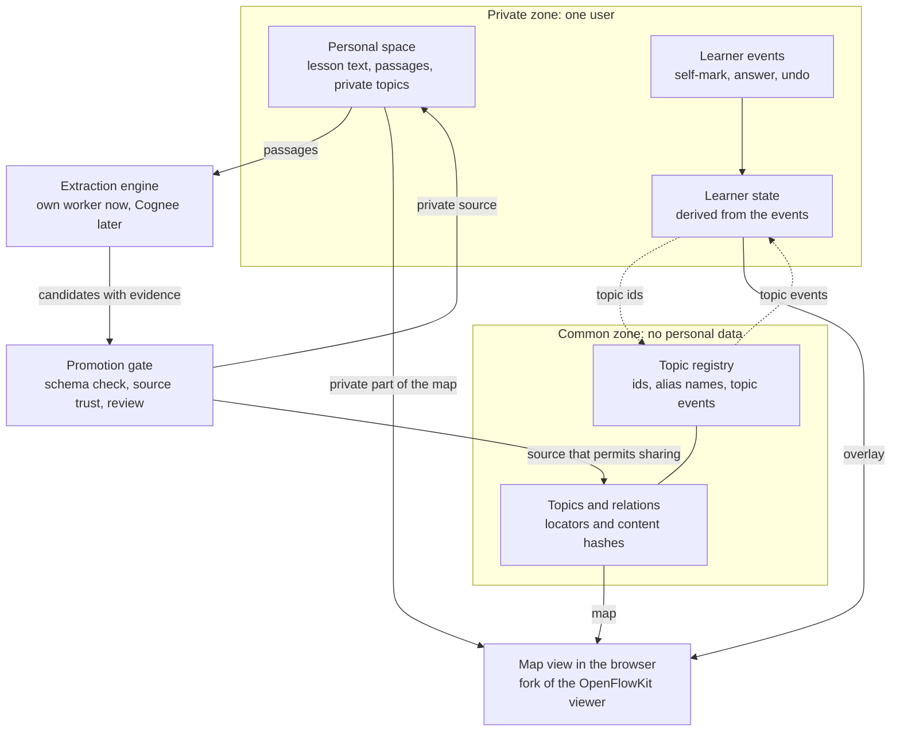

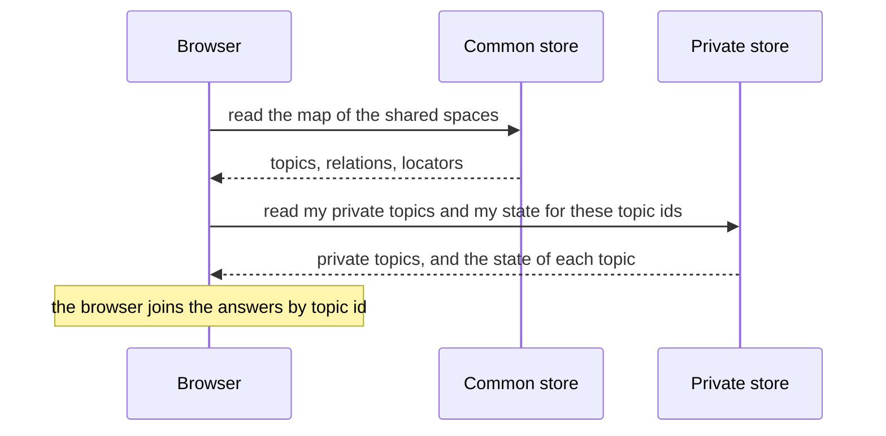

Five contracts make the parts replaceable.

1. **Topic identity.** A registry gives each topic a stable id. Names are alias names. Each rename, merge, split and retirement is one row in an append-only list of topic events. The private zone stores topic ids only.
2. **Extraction boundary.** An engine takes passages and returns topic candidates and relation candidates with evidence. Our worker is the first engine. Cognee can be a later engine for shared sources.
3. **Learner evidence.** Events go in: a self-mark, an answer, an exposure, a retraction. A state comes out for each topic. The callers do not know where the private store runs.
4. **Overlay.** A reader with the rights of the user reads the map and the state as two answers, and joins them by topic id. No joined copy exists outside the private zone.
5. **Promotion gate.** Canon enters a shared space only through one gate: a schema check, a trust level for the source, a review for a change of identity, and no user id.

Seven rules follow from the evidence.

| #   | Rule                                                                                                                                                                      | Evidence                                                                                          |
| --- | ------------------------------------------------------------------------------------------------------------------------------------------------------------------------- | ------------------------------------------------------------------------------------------------- |
| 1   | The common store holds no user id and no learner state.                                                                                                                   | The inference from the EU guidance, and the shared store of Microsoft that needs no tenant filter |
| 2   | The private store points at the common store. The common store points at nothing in the private store.                                                                    | Rule 1 needs it. Tutor MCP shows the form: its concept state uses a key that the caller sets.     |
| 3   | The common store holds knowledge about a source: a locator and a content hash. The text of a source stays with the user who loaded it, unless the source permits sharing. | H.2                                                                                               |
| 4   | A topic from a private source or a company source stays in its space. A link "same as a common topic" lives on the private side.                                          | Without this rule, the name of a private topic is visible to other users                          |
| 5   | Server code enforces each border. The language model enforces no border.                                                                                                  | OWASP, AWS, Microsoft, Google                                                                     |
| 6   | Each write to the common store passes the promotion gate, gets a version, and leaves an audit row.                                                                        | OWASP items on poisoning and on injection. Cognee and Graphiti have no approval before a write.   |
| 7   | A change of a common topic reaches the private store as a topic event. A written policy says what happens to the old evidence.                                            | Tutor MCP marks old evidence as invalid and does not move it                                      |

Rule 3 gives evidence without a copy of the text. A reader who has the same passage, with the same hash, sees the quote. Another reader sees the locator only.

Two extraction paths follow from rules 3 and 4:

- A private source goes through the engine inside the private zone, and its topics stay in the personal space.
- A source that permits sharing goes through the engine and the promotion gate into a shared space.

So the product needs its own extraction engine in both designs. An outside engine can serve only the second path.

### H.6 Three levels of separation

| Level | What separates the zones                                                                          | Facts                                                                                                                           | Cost                                          |
| ----- | ------------------------------------------------------------------------------------------------- | ------------------------------------------------------------------------------------------------------------------------------- | --------------------------------------------- |
| L0    | Today: one schema, row-level security for each user, and one service key that passes each rule    | `worker/main.ts:50`, `supabase/migrations/20261124123303_create_jobs.sql:82`                                                    | Nothing                                       |
| L1    | One database with two schemas, separate grants, and a narrow role for each job kind of the worker | The Supabase docs describe custom schemas and custom roles                                                                      | No new service. One database is one target.   |
| L2    | Two databases: a second Supabase project, or the common store as a separate service               | Two projects fit the Free plan, with a pause after 1 week of inactivity. The Pro plan costs 35 USD each month for two projects. | A join in the app                             |
| L3    | One database for each user, or one key for each user                                              | A Durable Object with SQLite is on the Workers Free plan. Supabase Vault does not separate users.                               | A new platform part, with limits for each day |

The five contracts of H.5 are the same at each level. So a move from L1 to L2 or L3 changes where a zone runs, and not how the callers use it.

### H.7 Five hybrid compositions

| #   | Common store                                                      | Private store                                               | Projects in direct use                                              | Level          | Worker estimates                                                                                       | Verdict                                                                            |
| --- | ----------------------------------------------------------------- | ----------------------------------------------------------- | ------------------------------------------------------------------- | -------------- | ------------------------------------------------------------------------------------------------------ | ---------------------------------------------------------------------------------- |
| C1  | Own tables with the registry. Own engine in the Node worker.      | Own tables. The learner engine as a port.                   | OpenFlowKit (fork), `ts-fsrs`, Remnic (3 modules), Mermaid (option) | L1, then L2    | 5 to 8 days for the graph ideas. 8 to 15 days for the learner engine. No estimate for the viewer fork. | Recommended base                                                                   |
| C2  | C1, plus Cognee as the engine for shared sources                  | As C1                                                       | C1, plus Cognee as a service                                        | L2 for common  | 22 to 34 days more. More than 512 Mi of memory. A graph store.                                         | The candidate for the company future: many loaders, and datasets with access lists |
| C3  | Cognee as a service                                               | Tutor MCP as a service or as a fork                         | Cognee, Tutor MCP, OpenFlowKit                                      | L2             | 22 to 34 days, plus 15 to 25 days for the fork                                                         | Not recommended. The blockers of Tutor MCP stay, and three runtimes run.           |
| C4  | As C1                                                             | One Durable Object with SQLite for each user, with the port | As C1                                                               | L3 for private | No estimate                                                                                            | An option for the strongest separation, later                                      |
| C5  | Own Python service on the Graphiti library, with a graph database | As C1                                                       | Graphiti as a library                                               | L2             | 23 to 36 days, plus about 66 USD each month for a managed graph service                                | Not recommended. Cognee gives more for a similar effort.                           |

The estimates come from different workers. They are not one total.

**Recommendation: composition C1 now, with the contracts of H.5, and C2 as the planned extension.** The third follow-up moves C1 to phases B and C, and the MVP uses composition C0 (R.10).

- C1 uses the projects where they are strong and cheap: a viewer, a scheduler library, three small modules, and the patterns of F.6.
- C1 needs no new service, and its cost for stores is zero.
- The product needs its own extraction engine for private sources in each composition (H.5). So C2 adds Cognee for shared sources only, and does not replace the engine.
- The topic registry is the part that makes a hybrid of engines possible. The earlier notes of the user name the problem of a pair of Cognee and Tutor MCP: "the two stores never share concept names" (`llm-communication-profile-research.md:207` in the projects folder). The registry gives that shared identity.

### H.8 Threats and controls

| #   | Threat                                                      | Control                                                                                                                 | Source of the control                                                             |
| --- | ----------------------------------------------------------- | ----------------------------------------------------------------------------------------------------------------------- | --------------------------------------------------------------------------------- |
| 1   | One user reads the private data of another user             | Row-level security for each learner, and a check at start that refuses a role with too many rights                      | Tutor MCP and Honcho. The tenant-only policy of Tutor MCP shows the weak form.    |
| 2   | The one key of the worker passes each rule                  | A role for each job kind: a writer of the common store, and a processor for the data of one learner                     | Supabase custom roles                                                             |
| 3   | Private data enters the common store                        | Rules 1, 3 and 4, and the promotion gate                                                                                | EU guidance, H.2                                                                  |
| 4   | A poisoned source changes the shared graph for all users    | A trust level for each source, a schema with pruning, source text marked as data, review for identity changes, versions | OWASP, neo4j-graphrag-python, Graphiti time fields, the conflict review of Cognee |
| 5   | An outside engine sends data out                            | Telemetry off. The engine gets no user identity and no learner data. One pipeline identity calls it.                    | The defaults of Cognee and of Graphiti                                            |
| 6   | A changed or merged topic breaks the state of a learner     | The registry with redirects, the topic events, and the policy of rule 7                                                 | Tutor MCP. Cognee and Graphiti leave no redirect.                                 |
| 7   | A user asks for deletion                                    | The private store holds all personal data. Remove the access first, then the data.                                      | Tutor MCP erasure flow, EU guidance                                               |
| 8   | Statistics about a small group show the state of one person | No learner statistics in the common store, or a minimum group size                                                      | Tutor MCP needs 5 learners for cohort statistics                                  |

### H.9 What this follow-up changes

- **F.7, the reason "that join needs one store with one access rule":** the assumption of two separate stores withdraws this reason. The join now happens at read time (contract 4).
- **F.7, the recommendation "option A":** it stays as composition C1, with two zones and five contracts in place of one store.
- **F.7, "Cognee is the candidate engine":** it stays, with a smaller role. Cognee can serve shared sources only, and the product keeps its own engine.
- **F.7, the four low-cost choices:** three more choices come in H.10.
- **F.3, Tutor MCP "port the learner model":** it stays. H.4 now gives the code reasons why a service is not possible.

### H.10 What S-02 does now, so that the split is a move and not a new design

1. Each row of the knowledge tables carries a space id. The first space is the personal space of the learner.
2. The knowledge tables hold no learner column. A later learner table points at a topic id and nothing more.
3. A topic id is stable and has no meaning. Names are alias names. An append-only table records each identity change.
4. A link from a topic to a passage stores a locator and a content hash. The view reads the quote from the passage row.
5. The extraction engine stays behind one boundary.

These five points cost little in S-02. A second database, separate worker roles, an outside engine and embeddings are not part of S-02.

### H.11 Limits of this follow-up

- No project was run. The effort numbers are estimates of the workers.
- The platform facts have the date 2026-11-25. Prices and limits change.
- The legal part gives sources only. It is not legal advice.
- Not verified: a custom role for a Supabase secret key, the CPU limit of a Durable Object on the Free plan, the memory of a Cognee container, and the Anthropic request of Cognee through LiteLLM.
- The content hash of rule 3 is a design inference. Nobody tested how stable a hash is when a site changes the markup of a page.
- This research did not design the tables. That is work for the plan.

## Follow-up Research 2026-11-25 (3): a reduced design that fits a 2-week MVP

### R.1 Request and method

The user asked for a simpler form of the second follow-up:

- Use fewer projects. For each project, judge its value for the product, how well real use tested it, and how much the MVP needs it.
- The target is an architecture that 2 weeks of intense agent-driven coding can build.
- When the scope is too large, show which parts enter in the MVP and which parts come in later phases.

How this research reads the request:

- The MVP is milestone M-01 of the roadmap. Its open slices are S-02 to S-10, which cover FR-003 to FR-011 (`context/foundation/roadmap.md:42-54`).
- "2 weeks" is 10 working days of full-time work. The PRD records a different budget: 4 to 6 weeks of after-hours work (`context/foundation/prd.md:10`).
- "Battle-tested" is "tested by real use": the age of a project, its user base, its number of authors and its release history.

Method:

- The researcher read the GitHub API, the npm registry and the PyPI statistics for 29 repositories on 2026-11-25.
- The researcher measured the import closure of the code that the second follow-up wanted to fork.
- The researcher measured the speed of this repository from its git history.
- One read-only worker estimated the nine slices. It did not read this research.
- No project was run. The data is in `research-appendix/project-maturity.md` and `research-appendix/mvp-effort-estimate.md`.

### R.2 The answer in short

- **The design of the second follow-up does not fit 2 weeks.** The worker estimates of composition C1 are 5 to 8 days for the graph ideas and 8 to 15 days for the learner engine. They do not cover the viewer fork or the pages (H.7, F.7).
- **The reduced design uses no code from the 23 projects.** Six projects give the patterns that the MVP needs. Three mature libraries from sections 8 and 9 do the work that needs a library.
- **Two code parts of the second follow-up are larger than their names say.** The viewer of OpenFlowKit pulls 154 files, and two of the three Remnic modules pull 1,810 and 5,041 lines at run time (R.5).
- **Six rules keep the two-store future open.** Each rule is a way to write a table or a function that the MVP needs for its own slices (R.6).
- **Composition C0 fits 10 working days for S-02 to S-08, with S-09 and S-10 as the reserve.** For all nine slices, a worker estimates 47 to 150 hours, with 78 hours as the likely value (R.8).
- **The parts that leave the MVP come back in three phases:** a deeper learner model, the shared store, and the company scale (R.9).

### R.3 How well real use tested each project

The score is a judgment from four signals: age, user base, the share of the main author, and the release history.

| Score | Meaning                                                                                                               |
| ----- | --------------------------------------------------------------------------------------------------------------------- |
| 3     | Long and wide use: about 4 years or more of releases, a large user base, and a broad team or wide use as a dependency |
| 2     | Real use with a limit: a short history, fast change, a small team, or a small user base                               |
| 1     | A young project with a small user base, or one author with about 90% of the commits or more                           |
| 0     | A demo or an artifact: under 10 commits, or under 50 stars with no package                                            |

| Project               | Age in months | Stars       | Contributors | Main author | Releases  | Downloads each week              | Score |
| --------------------- | ------------- | ----------- | ------------ | ----------- | --------- | -------------------------------- | ----- |
| Mermaid               | 145           | 91,252      | 866          | 20%         | 229       | 28,517,796 (npm)                 | 3     |
| LlamaIndex            | 49            | 53,006      | 2,011        | 16%         | 435       | 1,319,702 (PyPI, core)           | 3     |
| Mem0                  | 41            | 69,468      | 412          | 17%         | 416       | 519,373 (PyPI)                   | 2     |
| Cognee                | 39            | 33,607      | 336          | 28%         | 162       | 54,779 (PyPI)                    | 2     |
| Graphiti              | 28            | 33,090      | 65           | 32%         | 206       | 241,132 (PyPI)                   | 2     |
| LightRAG              | 26            | 40,865      | 423          | 65%         | 86        | 48,850 (PyPI)                    | 2     |
| Microsoft GraphRAG    | 32            | 36,753      | 51           | 29%         | 44        | 7,655 (PyPI)                     | 2     |
| neo4j-graphrag-python | 33            | 1,340       | 43           | 22%         | 40        | 70,575 (PyPI)                    | 2     |
| Honcho                | 38            | 8,278       | 76           | 21%         | 9         | 57,805 (PyPI)                    | 2     |
| py-fsrs and `ts-fsrs` | 48 and 45     | 536 and 894 | 12 and 22    | 67% and 70% | 38 and 91 | 117,032 (PyPI) and 362,677 (npm) | 2     |
| pyBKT                 | 114           | 294         | 18           | 53%         | 4         | 798 (PyPI)                       | 2     |
| Letta Code            | 13            | 3,915       | 53           | 32%         | 397       | 51,845 (npm)                     | 2     |
| OpenFlowKit           | 9             | 1,014       | 10           | 95%         | 5         | 291 (npm, the command-line tool) | 1     |
| Remnic                | 10            | 235         | 22           | 76%         | 1,248     | 15,301 (npm)                     | 1     |
| Tutor MCP             | 8             | 112         | 4            | 93%         | 24        | no registry                      | 1     |
| OpenTutor             | 9             | 192         | 8            | 70%         | 0         | no registry                      | 1     |
| iText2KG              | 29            | 980         | 3            | 99%         | 10        | 78 (PyPI)                        | 1     |
| Memobase              | 27            | 2,966       | 15           | 87%         | 0         | 302 (PyPI)                       | 1     |
| LearningMAP           | 6             | 17          | 5            | 71%         | 0         | no registry                      | 0     |
| PersonaMem            | 27            | 209         | 6            | 93%         | 0         | no registry                      | 1     |
| knowledge-graph-mcp   | 11            | 2           | 1            | 100%        | 0         | no registry                      | 0     |
| adaptive-explainer    | 7             | 0           | 1            | 100%        | 0         | no registry                      | 0     |

The three libraries of the reduced design, for comparison:

| Library                    | Age in months | Stars  | Contributors | Downloads each week | Score |
| -------------------------- | ------------- | ------ | ------------ | ------------------- | ----- |
| `@xyflow/react`            | 88            | 39,156 | 174          | 22,653,787          | 3     |
| `@dagrejs/dagre`           | 170           | 5,865  | 52           | 9,494,230           | 3     |
| `mdast-util-from-markdown` | 75            | 297    | 6            | 100,499,523         | 3     |

Readings:

- Rulesync has no role, so the table does not list it.
- The four projects that the second follow-up used as code have the scores 1, 1, 3 and 2. The two forks, OpenFlowKit and Remnic, have the score 1.
- The map code of OpenFlowKit is younger than the project. Its first commits have the dates 2026-10-08 and 2026-10-09, which is 7 weeks before this research.
- Remnic made 1,248 releases in 10 months and is at major version 10. A copy of its code goes out of date fast. Its npm count is high for 235 stars. Inference: frequent releases raise a download count through mirrors.
- Cognee and Graphiti have a large user base. Cognee has 188 releases on PyPI, and Graphiti is below version 1.0. A service on one of them needs upgrade work.
- pyBKT is old, and it has 798 downloads each week. It is a research library.
- A low score does not make an idea wrong. It makes a copy of the code expensive, because we then own code that few people tested.

### R.4 Value, need in the MVP, and the verdict for each project

Each score goes from 0 to 3. "Value" is the weight of the contribution for the core of the product. "Need" is how much milestone M-01 needs it.

| Project               | Role in follow-up (2) | Value | Tested | Need | Verdict                                                                                         |
| --------------------- | --------------------- | ----- | ------ | ---- | ----------------------------------------------------------------------------------------------- |
| Graphiti              | Pattern               | 3     | 2      | 3    | **MVP pattern:** the identity check. Rules run first, then the model selects from a short list. |
| neo4j-graphrag-python | Pattern               | 2     | 2      | 3    | **MVP pattern:** a schema with a pruning step.                                                  |
| LightRAG              | Pattern               | 2     | 2      | 2    | **MVP pattern:** one stored result for each content hash, and the heading path in the prompt.   |
| OpenTutor             | Pattern               | 2     | 1      | 2    | **MVP pattern:** the cycle check of the prerequisite relations.                                 |
| Tutor MCP             | Pattern               | 3     | 1      | 2    | **MVP pattern:** a claim is not a proof. Its engine, its roles and its erasure flow come later. |
| OpenFlowKit           | Fork of a part        | 2     | 1      | 2    | **MVP pattern:** a budget for boxes and for arrows, and the evidence on a click. No fork.       |
| py-fsrs, `ts-fsrs`    | Library               | 2     | 2      | 0    | Later, as code, in phase B.                                                                     |
| pyBKT                 | Pattern               | 2     | 2      | 0    | Later, as a pattern, in phase B: the update formula with a guess chance.                        |
| Cognee                | Service, later        | 2     | 2      | 0    | Later, as a service, in phase D.                                                                |
| Honcho                | Pattern               | 1     | 2      | 0    | Later, as a pattern, in phase C: the check of the database role at start.                       |
| Microsoft GraphRAG    | Pattern               | 1     | 2      | 0    | An add-on: a second extraction pass, when the first pass misses topics.                         |
| Mermaid               | Library               | 1     | 3      | 0    | An add-on: its text format as an export of the graph, with no library.                          |
| Remnic                | Fork of a part        | 1     | 1      | 1    | Not used. The MVP writes its own quote check (R.5).                                             |
| LearningMAP           | Pattern               | 2     | 0      | 1    | Not used. Tutor MCP shows the same idea: the state is a function of a log.                      |
| LlamaIndex            | Pattern               | 1     | 3      | 1    | Not used. neo4j-graphrag-python shows the same check.                                           |
| Mem0                  | Pattern               | 1     | 2      | 1    | Not used. Graphiti shows the same idea of small integer ids (F.6, principle 4).                 |
| iText2KG              | Pattern               | 1     | 1      | 0    | Not used. Graphiti covers the topic match.                                                      |
| knowledge-graph-mcp   | Pattern               | 1     | 0      | 0    | Not used.                                                                                       |
| Memobase              | Pattern               | 1     | 1      | 0    | Not used. Its last push has the date 2026-01-11.                                                |
| Letta Code            | Pattern               | 1     | 2      | 0    | Not used.                                                                                       |
| PersonaMem            | Pattern               | 1     | 1      | 0    | Not used. It stays a reference for a later test set.                                            |
| adaptive-explainer    | Pattern               | 1     | 0      | 0    | Not used. It has no license.                                                                    |
| Rulesync              | None                  | 0     | none   | 0    | No role.                                                                                        |

The count changes like this:

| Depth                | Follow-up (2) | Reduced design, in the MVP | Reduced design, later         |
| -------------------- | ------------- | -------------------------- | ----------------------------- |
| Code that we use     | 4 projects    | 0 projects                 | 1 project: `ts-fsrs`          |
| A service            | 1 project     | 0 projects                 | 1 project: Cognee             |
| A pattern            | 17 projects   | 6 projects                 | 2 projects: pyBKT, Honcho     |
| An add-on, if needed | 0             | 0                          | 2 projects: GraphRAG, Mermaid |
| Not used             | 1 project     | not applicable             | 11 projects                   |

### R.5 Measurements that decide the reduction

**A fork of the OpenFlowKit viewer is not small**

- The viewer is not a library. The root package is `openflowkit-app` with `"private": true` (`package.json:2-3` in the OpenFlowKit folder). The npm package `openflowkit` is the command-line tool.
- The import closure of `src/viewer/map/standalone.tsx` has 154 TypeScript files with 18,616 lines, as the code stands. Without type-only import statements it has 102 files with 12,242 lines. The folder `src/viewer/map` alone has 15 files with 1,020 lines.
- The viewer build puts the ELK layout engine into the page (`vite.map-viewer.config.ts`). `elkjs` has the license EPL-2.0 (F.10).
- The map model describes a code repository. Its node kinds are `part`, `group`, `folder`, `file`, `external` and `more`. Its link kinds are `import`, `call`, `data` and `build` (`src/dsl/map/types.ts:4-5`). Its fold step groups files by import lines and by the words in file names (`src/dsl/map/fold.ts:3-8,45`).
- 3 commits touch `src/viewer/map`, and its 2 test files have 34 lines.
- So a fork gives a young viewer for another domain, and we then own about 12,000 to 18,000 lines. The ideas are small: 14 children for each box (`src/dsl/map/fold.ts:26`), an arrow budget (`src/dsl/map/edgeBudget.ts:4-11`), and a range split for the overflow (`src/dsl/map/fold.ts:315-320`).

**Only one of the three Remnic modules is small**

- `memory-worth.ts` has 216 lines and no imports.
- `trust-score.ts` has 450 lines. Its runtime closure has 5 files with 5,041 lines.
- `provenance.ts` has 905 lines. Its runtime closure has 7 files with 1,810 lines, and it has no test file beside it.
- The quote check that S-02 needs is one comparison of a quote with a passage, with a rule for white space.

**The MVP has no requirement for decay**

- FR-003 to FR-011 name no forgetting and no review dates (`context/foundation/prd.md:113-152`).
- The PRD recorded the argument "knowledge fades, so old knowledge needs re-checking" for FR-011 and did not accept it (`context/foundation/prd.md:137-140`).
- The learner models worker gave the same advice: add `ts-fsrs` when spaced reviews arrive (`research-appendix/learner-models.md`, section 4).

**The parts of composition C1 are larger than the budget**

- The port of the learner engine has a worker estimate of 8 to 15 days, plus 3 to 5 days for the choice of the next question (H.4).
- Cognee as the common service has a worker estimate of 22 to 34 days (H.4).
- Two schemas with separate grants and a role for each job kind serve a shared store. Milestone M-01 has one named user and no shared store (`context/foundation/prd.md:23,64`).

**The measured speed of this repository**

- F-01 went from its first phase commit to its last review commit in 3 hours 23 minutes: 43 files and 3,872 inserted lines.
- S-01 went from its plan commit to its last review commit in 12 hours 44 minutes of clock time, with a night between: 98 files and 12,497 inserted lines.
- So one finished item took about one working day or less. These are two items, and neither needed prompt work on real text.

### R.6 The reduced design: composition C0

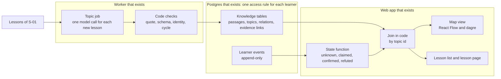

The parts:

1. **Engine.** One new job type in the worker that exists. The job makes one model call for each lesson that has no stored result for its content hash. Code checks each answer: the quote exists in the passage, the relation type is allowed, the prerequisite relations have no cycle, and a name rule runs before the model selects an existing topic.
2. **Knowledge tables.** Passages, topics, relations and evidence links. Each row belongs to one learner, with the access rule of S-01.
3. **Learner events.** One append-only table. A pure function gives one of four states for each topic: unknown, claimed, confirmed or refuted.
4. **Read side.** A page reads the map and the state as two reads, and joins them in code.
5. **View.** One React island with `@xyflow/react` and `@dagrejs/dagre`. It shows an overview of the lessons, and the topics of one lesson. The server renders an outline list beside it.
6. **Later model calls.** The questions of S-06 and the summaries of S-09 use the model call that S-02 brings. Each result is stored.

C0 adds no service, no second database, no embedding provider and no graph database.

**Three defaults make the design small.** They are recommendations for the plan.

- A part of the map is a lesson. FR-007 says "one part of the course at a time" (`context/foundation/prd.md:133`). So the model makes no hierarchy, and each topic belongs to the first lesson that teaches it. A course with more lessons than the box budget gets groups of lessons by position.
- The model returns one relation type: prerequisite. "Part of" comes from the link between a topic and its lesson.
- The learner state has four values, not a probability. A self-mark gives "claimed". A correct answer gives "confirmed", and a wrong answer gives "refuted". The owner decides the exact rule (`context/foundation/roadmap.md:249`).

**Six rules keep the future of H.5 open.**

| #   | Rule                                                                                                                          | Source in follow-up (2)       | What it keeps open                                           |
| --- | ----------------------------------------------------------------------------------------------------------------------------- | ----------------------------- | ------------------------------------------------------------ |
| 1   | A knowledge table holds no learner state.                                                                                     | H.10 point 2, rule 1          | The knowledge tables can move to a common store unchanged.   |
| 2   | A learner table points at a topic id. No knowledge table points at a learner table.                                           | Rule 2                        | The split into two stores                                    |
| 3   | A topic id has no meaning, and names are alias names. A merged topic keeps its row and points at the topic that replaces it.  | Contract 1, in a smaller form | S-10, and the topic registry of phase C                      |
| 4   | A link from a topic to a passage uses the content hash of the passage.                                                        | H.10 point 4, rule 3          | A reload of a course, and evidence with no copy of the text  |
| 5   | The extraction engine is one function: passages go in, and candidates with evidence come out.                                 | Contract 2                    | A second engine, such as Cognee                              |
| 6   | The learner state is a function of the events. No database view and no database function joins the map with the learner data. | Contracts 3 and 4             | A deeper learner model, and a private store in another place |

Each rule is a way to write a table or a function that the slices of M-01 need for their own work. The slices S-03 to S-10 then add tables beside the tables of S-02, and they do not need to change them.

**What the reduction gives up, and the risk of each loss**

- No probability and no decay. A topic that the learner knew a year before stays "confirmed". Phase B adds both with no change of the stored data, because the events have a time.
- No embeddings. The identity check uses a name rule and one model choice. The risk is a wrong match in S-10, where a wrong match skips an assessment that the learner needs (`context/foundation/roadmap.md:216-227`).
- No record of each merge. The column "merged into" keeps the lineage, and it does not keep the reason or the time of a merge.
- No space id. A shared space needs one migration later. Each knowledge row has one owner, so that migration can give each row the personal space of its owner.
- No ready viewer. React Flow gives pan, zoom, touch and keyboard support (section 9). The topic panel and the state marks are our own work.

### R.7 What happens to each part of the second follow-up

| Part of follow-up (2)                                             | In the MVP                                                                         | Comes back in                 |
| ----------------------------------------------------------------- | ---------------------------------------------------------------------------------- | ----------------------------- |
| Contract 1: registry with an append-only list of topic events     | The topic table with alias names and two lifecycle columns                         | Phase C                       |
| Contract 2: extraction boundary                                   | One function (rule 5)                                                              | In the MVP                    |
| Contract 3: learner evidence                                      | The event table and the state function (rule 6)                                    | In the MVP                    |
| Contract 4: overlay join at read time                             | Two reads and a join in code (rule 6)                                              | In the MVP                    |
| Contract 5: promotion gate                                        | No gate. Its two checks that S-02 needs stay: the schema check and the quote check | Phase C                       |
| Space id on each knowledge row (H.10 point 1)                     | No. Each row has one owner.                                                        | Phase C                       |
| Two schemas, and a role for each job kind (level L1)              | No. Level L0, as today                                                             | Phase C                       |
| A second database (level L2), Cognee for shared sources           | No                                                                                 | Phase D                       |
| One database for each user (level L3)                             | No                                                                                 | Phase D, as an option         |
| Port of the learner engine                                        | The four-state function                                                            | Phase B                       |
| `ts-fsrs`, misconception records, the choice of the next question | No                                                                                 | Phase B                       |
| A stored extraction result for each passage                       | One stored result for each lesson hash                                             | An add-on                     |
| Embeddings and a vector store                                     | No                                                                                 | An add-on in S-10, or phase B |
| An end date on a relation                                         | No. F.6 says that it matters most for company knowledge.                           | Phase D                       |
| A nested map with more than two levels, and a stored layout       | Two levels, with the layout in the browser                                         | An add-on                     |
| Fork of the OpenFlowKit viewer, the three Remnic modules          | No                                                                                 | Not planned                   |

An add-on is a bounded piece of work that can enter a slice of the MVP when that slice shows the need. It needs no change of the design.

### R.8 The budget: does milestone M-01 fit in 10 working days?

Two estimates exist:

- **Bottom-up, by a worker.** The worker read the roadmap, the PRD, the plan of S-01, the git history and the code. It did not read this research. It estimated each slice in hours of the owner, with the plan, the review and the pull request included. Its design is C0 with one more relation type, "part of" (`research-appendix/mvp-effort-estimate.md`).
- **Top-down, by the researcher.** It scales the measured time of S-01 by the size of each slice. The researcher made this check after the worker reported, so the two estimates are not independent.

| Slice     | Work in C0                                                                  | Optimistic | Likely | Pessimistic |
| --------- | --------------------------------------------------------------------------- | ---------- | ------ | ----------- |
| S-02      | Tables, topic job, code checks, map view, outline, prompt runs on real text | 12         | 20     | 36          |
| S-03      | Event table, state function, marks with undo                                | 3          | 5      | 9           |
| S-04      | Lesson rule, adjusted list page with reasons                                | 5          | 8      | 15          |
| S-05      | First lesson reader, collapsed blocks                                       | 5          | 8      | 16          |
| S-06      | Question job, quiz page                                                     | 7          | 11     | 22          |
| S-07      | State marks on the map, legend                                              | 2          | 3.5    | 7           |
| S-08      | View of one part, topic page with quotes                                    | 3          | 5.5    | 10          |
| S-09      | Summary job, summary block                                                  | 4          | 7      | 13          |
| S-10      | Second material, view of the new topics                                     | 6          | 10     | 22          |
| **Total** | Hours of the owner                                                          | **47**     | **78** | **150**     |

Readings:

- Ten days of 8 hours hold 80 hours, and the likely total is 78 hours. The worker gives about 40% confidence that all nine slices fit.
- The days of 2026-11-24 and 2026-11-25 were longer than 8 hours. At the pace of 2026-11-24, 10 days hold about 110 hours, and the worker gives about 70% confidence.
- The worker judges that code takes about 25 of the 78 likely hours. Owner work takes the rest, and agents do not make it faster:

| Owner work                                                  | Likely hours | Slices                       |
| ----------------------------------------------------------- | ------------ | ---------------------------- |
| Plans, review decisions, pull requests, CI waits            | 28           | All                          |
| Reading model output against real course text               | 15           | S-02, S-04, S-06, S-09, S-10 |
| Visual checks of the map and the reader                     | 6            | S-02, S-05, S-07, S-08       |
| Production setup: 7 open rows of the plans of F-01 and S-01 | 4            | S-02, S-06, S-09             |

- The milestone is done only when F-01 is done too (`context/foundation/roadmap.md:27`). F-01 has the status `in-progress` because its production rows are open (`context/foundation/roadmap.md:44`, `context/changes/background-work-path/plan.md:698-702`).
- The top-down check: the worker judges that S-01 took 13 to 15 active hours. The researcher judges that the nine slices hold about 5 times the code work of S-01, plus prompt work that S-01 did not need. That gives about 75 to 90 hours, close to the likely total of the worker.

**Verdict**

- C0 fits 10 working days for S-02 to S-08. These seven slices need 61 likely hours. The other 19 hours cover the pessimistic side of S-02, which is 16 more hours. S-02 is the slice with the most risk.
- S-09 and S-10 are the reserve. They need 17 likely hours. Both are must-have requirements (`context/foundation/prd.md:137,152`), so the owner decides if they move to a later week.
- When time runs out, the worker gives this order to move slices out: S-10, then S-09, then S-08. S-02 to S-07 need 55.5 likely hours.
- The design of follow-up (2) does not fit. Composition C1 adds 8 to 15 days for the learner engine alone (H.4).

**The three largest risks** (judgment of the worker):

1. The quality of the topics on real text, in S-02. Each later slice inherits its errors.
2. Two open decisions of the owner block S-04, S-05, S-06 and S-10, with 37 likely hours of work. The decisions are the business rule (`context/foundation/roadmap.md:249`) and the effect of a finished lesson (`context/foundation/roadmap.md:262`).
3. The job rules and the production worker, in the next list.

**Work that the estimate includes and that R.6 does not name.** The researcher read each line again.

- **A lesson key that survives a reload.** A reload deletes the old lesson rows (`supabase/migrations/20261125120000_harden_course_load.sql:104-106`) and inserts rows with new ids (`:113-122`). An extension push updates the row of a known URL in place (`:238-245`). The `lessons` table has no hash column (`supabase/migrations/20261124200800_create_courses.sql:34-53`). Rule 4 of R.6 and the lesson URL cover this.
- **A start for the topic job.** One unique index allows one job in progress for each learner (`supabase/migrations/20261124123303_create_jobs.sql:30-33`). The runner marks a job done after its handler returns (`worker/run.ts:241-244`), so the load handler cannot insert the topic job. An extension push starts no job (`src/pages/api/extension/pages.ts:64-80`). The Stop button of the extension sends no call to the product (`extension/src/popup.ts:111-119`).
- **A quota and a payload check for each paid job type.** A learner can insert a job row with a type and a payload (`supabase/migrations/20261124123303_create_jobs.sql:79`).
- **A path with no model key in CI.** The CI job sets no Anthropic key (`.github/workflows/ci.yml:116`). The topic job, the question job and the summary job each need a path that makes no model call.
- **Changes in the model call that exists.** It has a limit of 4,096 output tokens (`worker/llm.ts:112`) and no retry (`worker/llm.ts:105`). No method of the worker reads the text of a lesson (`worker/queue.ts:75-82`).
- **A first lesson reader.** No page shows lesson text today (`src/pages/dashboard/courses/[id].astro:44`). The worker judges that crawled Markdown needs a sanitizer.
- **The phone check.** The check fails a page when an element passes the right edge or a tap target is below 44 px (`scripts/phone-check.mjs:30,122-141`). A map canvas must pass it.
- **A long job in production.** The worker replies to the wake request first, and then runs the loop (`worker/main.ts:89-91`). The worker judges that an idle service can stop a long job. Open Question 9 names the same risk.

The worker judges these items at about 30 likely hours, inside the totals of the table.

### R.9 Phases for the parts that leave the MVP

| Phase | Content                                                                                                                                         | Start it when                                                     | What makes it an addition                               |
| ----- | ----------------------------------------------------------------------------------------------------------------------------------------------- | ----------------------------------------------------------------- | ------------------------------------------------------- |
| A     | Milestone M-01 with composition C0                                                                                                              | Now                                                               | Not applicable                                          |
| B     | A deeper learner model: a probability for each topic, decay with `ts-fsrs` or its curve, misconception records, the choice of the next question | The owner used the product on a second course and wants re-checks | Rule 6. The events stay, and a new function reads them. |
| C     | The shared store at level L1: spaces, two schemas, a role for each job kind, the promotion gate, the list of topic events                       | A second person must read the same map                            | Rules 1, 2 and 3                                        |
| D     | The company scale: a second database, Cognee as the engine for shared sources, connectors, end dates on relations                               | Many sources of many kinds, and access lists for groups           | Rule 5, and the contracts of H.5                        |

- Phase B has worker estimates in the appendices: 2 hours for the decay curve, half a day to 1 day for `ts-fsrs`, and 8 to 15 days for the full engine of Tutor MCP.
- Phase C has no estimate. H.6 describes its level L1.
- Phase D has the worker estimate of 22 to 34 days for Cognee as a service (H.4).
- The open questions 17 to 21 belong to phase C. The plan of S-02 does not need their answers.

### R.10 What this follow-up changes

- **H.3, "the hybrid uses 4 projects as code":** in the MVP it uses 0. `ts-fsrs` moves to phase B. Mermaid becomes an add-on. OpenFlowKit gives a pattern only. Remnic gives nothing.
- **H.3, the row for Remnic, "three small modules":** one module is small. The other two pull 5 and 7 files at run time (R.5).
- **H.7, "composition C1 now":** the MVP uses composition C0. C1 is the target of phases B and C. C2 is phase D.
- **H.10, the five points for S-02:** points 2, 4 and 5 stay as rules 1, 4 and 5. Point 3 stays in a smaller form: no append-only table yet. Point 1, the space id, moves to phase C.
- **F.8 and Open Question 15, "a fork of the OpenFlowKit viewer":** this research withdraws the fork as an option for the MVP. The view is React Flow with two levels.
- **F.7, "5 to 8 days for the port of the graph ideas":** C0 uses six patterns in their smallest form. Their work is inside the estimate of S-02 (R.8).
- **Section 9, "the worker can calculate the positions one time and store them":** C0 calculates the layout in the browser. One lesson has few topics, and `@dagrejs/dagre` needed 27 ms for 50 nodes in the measurement of section 9. Nobody tested this on a phone.
- **Open Questions 2, 3, 5, 13, 14 and 16:** C0 gives a default for each. The model returns the prerequisite relation only. S-02 stores the link to a passage. A reload runs the model only for the lessons with a new content hash. The core is our own. A topic belongs to the learner. The MVP has no embeddings.

### R.11 Limits of this follow-up

- The estimates are judgments. Their base is two finished items of this repository.
- The scores of R.3 and R.4 are judgments from public signals. A download count includes build servers.
- No project was run, and nobody built the reduced design. No model call ran on the text of a real course in this repository.
- The file counts of R.5 describe the code as it stands. A bundler removes unused code, and a careful fork can cut files.
- The three defaults of R.6 are recommendations. The plan and the owner decide them.
- This research did not design the tables. That is work for the plan.

## Follow-up Research 2026-11-26 (4): Cognee in the MVP, and the origin of each block

### W.1 Request and method

The user asked two things:

- How does the analysis of follow-up (3) change if the owner insists on Cognee in the MVP?
- The research has no system design diagram that shows where each block comes from: our own code, or a project that we reuse. The right granularity is a project that solves a complex problem, not a small library of a programming language.

Method:

- The researcher read the Cognee facts of the earlier appendices again. The researcher checked the new facts in the Cognee code, commit `1961133`, version 1.6.10. A path in W.8 is a path in the Cognee repository, unless it starts with `research-appendix/` or names this repository.
- The researcher read the Cloud Run container contract on 2026-11-26.
- The worker of follow-up (3) estimated the extra hours for two forms of Cognee. It read the Cognee code and this repository. Its report is in `research-appendix/mvp-effort-estimate.md`, section 8.
- No project was run.

### W.2 The answer in short

- **Cognee can enter the MVP in one form that keeps the design: as the extraction engine behind contract 2 (form K1).** Cognee runs in a separate Python container. Our tables stay the system of record, and no Cognee id leaves the container.
- **K1 costs 43 more likely hours.** Ten working days then hold S-02, S-03, S-04 and S-07. S-05, S-06, S-08, S-09 and S-10 move out. Without Cognee, the 10 days hold S-02 to S-08 (W.10).
- **Cognee as the store of the map (form K2) does not fit the MVP.** Its node ids are random or come from names, a merge leaves no redirect, and a delete removes a topic with no source left. So a mark of S-03 can lose its topic. S-02 alone needs about 113 likely hours in K2.
- **In form K1, Cognee does a small part of the work.** Each run starts with empty stores. With our own graph model, Cognee does not merge entities, and its default summary is a list, not prose. So the MVP keeps our passages, our cache by content hash, our identity check and our cycle check.
- **What K1 gives the MVP:** a tested extraction pipeline that runs our own graph model and prompt, a link from each node to its chunk, loaders for PDF and EPUB files (FR-012), and an early start on the engine of phase D.
- **Three diagrams now show the origin of each block** (W.4 to W.6). One table lists each block with its project and its problem (W.7).

### W.3 How to read the diagrams

| Tag in a block | Color  | Meaning                                                      |
| -------------- | ------ | ------------------------------------------------------------ |
| OWN            | blue   | New code that we write                                       |
| EXISTS         | grey   | Code or platform that exists in this repository (F-01, S-01) |
| REUSE          | green  | A project that we run, as a library or as a service          |
| PATTERN        | violet | Our own code that follows the design of a named project      |
| SERVICE        | orange | An outside service that we call                              |

- One block solves one problem. A small library, such as a Markdown parser or an HTTP client, is not a block. It stays inside the block that uses it.
- The tag is in the text of each block, so the diagrams do not rely on color alone.

### W.4 Diagram 1: the MVP without Cognee (composition C0)

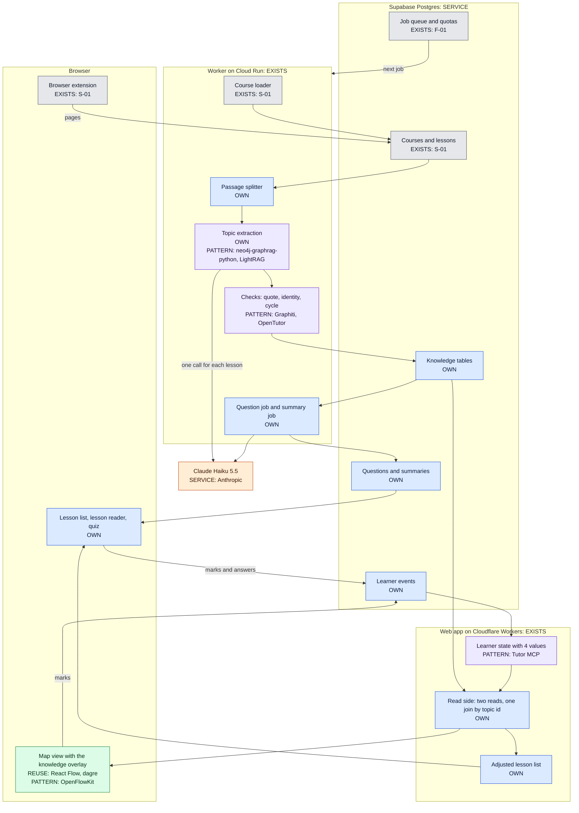

### W.5 Diagram 2: the MVP with Cognee as the extraction engine (C0 + K1)

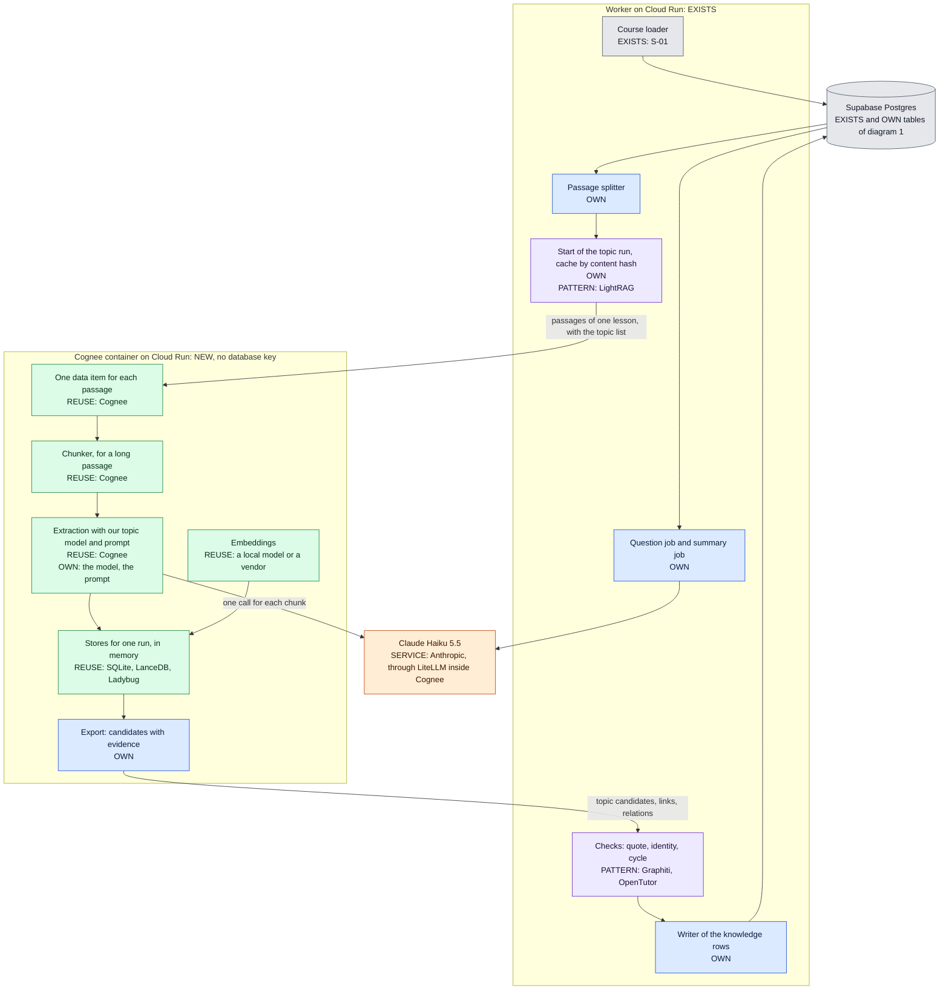

The browser and the web app stay as in diagram 1. Only the worker side changes:

- The extraction call of C0 moves into the Cognee container.
- Our passage splitter stays, because S-05 collapses our passages. The worker gives Cognee one data item for each passage. Inference: a chunk then does not cross a passage border. Nobody tested this.
- The checks, the writer of the knowledge rows, and the question and summary jobs stay in the Node worker.
- The Cognee container gets the passages of one lesson and returns candidates. It holds no database key and no learner data. This follows control 5 of H.8.
- With our own graph model, Cognee does not merge entities (W.8). So our identity check does all of the identity work.
- The export step maps each chunk to our passage row by our own content hash. So no Cognee id reaches our tables, and rules 3 and 4 of R.6 hold.

### W.6 Diagram 3: the target after phases B to D

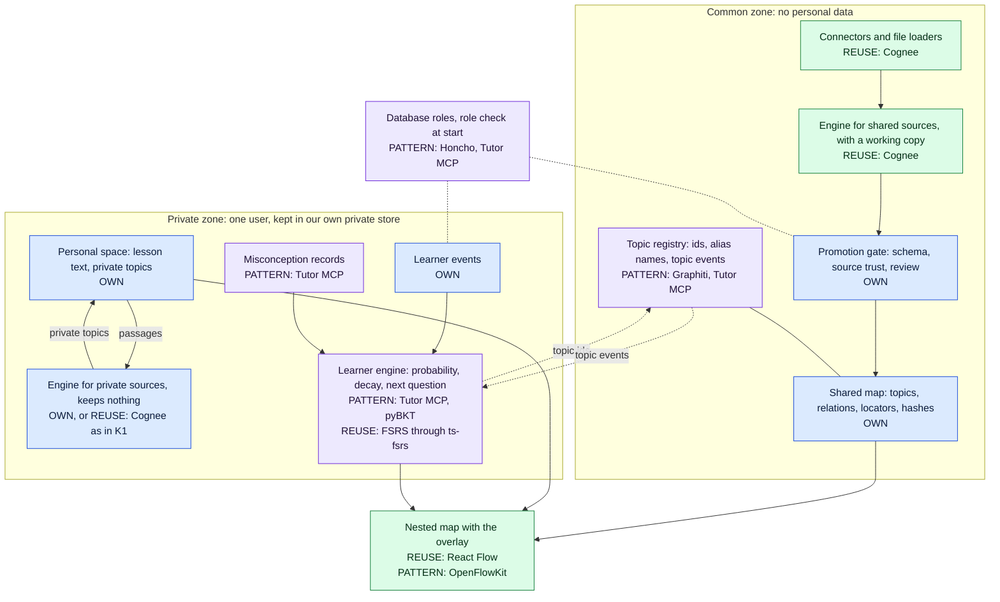

H.5 gives the contracts between the zones, and R.9 gives the order of the phases. Cognee keeps no private knowledge in this target (P.3).

### W.7 Each block, its origin and its problem

| Block                                             | Origin in C0       | Origin in C0 + K1     | Project                                       | The problem that it solves                                          | Phase |
| ------------------------------------------------- | ------------------ | --------------------- | --------------------------------------------- | ------------------------------------------------------------------- | ----- |
| Course loader and browser extension               | Exists             | Exists                | None                                          | Reads a course from its site, or through the browser of the learner | Done  |
| Job queue and quotas                              | Exists             | Exists                | None                                          | Runs long work outside a page request, one job for each learner     | Done  |
| Passage splitter                                  | Own                | Own                   | None                                          | Cuts a lesson into passages with stable ids                         | A     |
| Topic extraction                                  | Own, with patterns | Reuse, with our model | neo4j-graphrag-python, LightRAG; Cognee in K1 | Turns passages into topics and relations under a schema             | A     |
| Embeddings                                        | None               | Reuse                 | A local model or a vendor                     | Gives the vectors that the Cognee stores need                       | A, K1 |
| Identity check                                    | Pattern            | Pattern               | Graphiti                                      | Keeps one topic for one concept across lessons                      | A     |
| Cycle check                                       | Pattern            | Pattern               | OpenTutor                                     | Keeps the prerequisite relations free of cycles                     | A     |
| Quote check                                       | Own                | Own                   | None                                          | Proves that each link points at real text                           | A     |
| Knowledge tables                                  | Own                | Own                   | None                                          | Holds the map as the system of record                               | A     |
| Learner events and the state function             | Pattern            | Pattern               | Tutor MCP                                     | Keeps a claim apart from a proof                                    | A     |
| Map view                                          | Reuse, pattern     | Reuse, pattern        | React Flow, dagre; OpenFlowKit                | Draws an interactive graph with a layout, one part at a time        | A     |
| Question job and summary job                      | Own                | Own                   | None                                          | Checks a claim, and shortens a known passage                        | A     |
| Learner engine                                    | Not in the MVP     | Not in the MVP        | Tutor MCP, pyBKT; FSRS through `ts-fsrs`      | Gives a probability, a decay and the next question                  | B     |
| Misconception records                             | Not in the MVP     | Not in the MVP        | Tutor MCP                                     | Keeps a wrong belief as a record that blocks a collapse             | B     |
| Topic registry with topic events                  | Not in the MVP     | Not in the MVP        | Graphiti, Tutor MCP                           | Keeps topic identity across sources, with merges and splits         | C     |
| Promotion gate                                    | Not in the MVP     | Not in the MVP        | None                                          | Lets only checked canon into the common store                       | C     |
| Database roles and the role check                 | Not in the MVP     | Not in the MVP        | Honcho, Tutor MCP                             | Gives narrow rights to each job kind                                | C     |
| Engine, connectors and loaders for shared sources | Not in the MVP     | Not in the MVP        | Cognee                                        | Reads many sources, with access lists for groups                    | D     |

### W.8 Facts that decide the form of Cognee

**What K1 can use**

- The SDK has `add`, `cognify`, `update`, `delete` and `search` (`cognee/__init__.py:40-91`). So Cognee runs as a library, with no API server. Inference: the register route and the API key defects of H.4 then do not apply.
- `cognify` takes our own graph model as a `DataPoint` subclass, and a custom prompt (`cognee/api/v1/cognify/cognify.py:138-162,414-417`). A custom graph model works only with the `llm` extractor (`cognify.py:519-522`).
- The chunk keeps a `contains` link to each node of a custom model that came from it (`cognee/tasks/graph/extract_graph_from_data.py:165-172`, parameter `chunk_attachment`).
- The default stores are local files: SQLite (`cognee/infrastructure/databases/relational/config.py:22`), LanceDB (`cognee/infrastructure/databases/vector/config.py:32`) and Ladybug for the graph (`cognee/infrastructure/databases/graph/config.py:47`).
- Cognee reads Markdown and text with its core loader (`cognee/infrastructure/loaders/core/text_loader.py:24`). It reads PDF through `pypdf`, a core dependency (`cognee/infrastructure/loaders/external/pypdf_loader.py:24`). HTML needs the optional extra `scraping`, and EPUB and DOCX need the optional extra `docs` (`pyproject.toml:150-152,196-204`, `cognee/infrastructure/loaders/external/unstructured_loader.py:35-49`). The researcher found no MOBI loader. FR-012 asks for EPUB, MOBI, MD and PDF.
- `TELEMETRY_DISABLED` stops the telemetry (`cognee/shared/utils.py:575`). Without it, events go to an outside address (`cognee/shared/utils.py:23`).

**What K1 must add or change**

- **Embeddings.** The default embedder is OpenAI `text-embedding-3-large` (`cognee/infrastructure/databases/vector/embeddings/config.py:20-21`). Cognee uses the local model `BAAI/bge-small-en-v1.5`, a 67 MB download, only when no usable model key exists (`embeddings/config.py:23-30,220-233`). The MVP has an Anthropic key, so K1 must select a local model or an embedding vendor. Anthropic has no embedding model (section 6).
- **Chunk size.** The automatic chunk size is the smaller of the token limit of the embedding model and half of the context of the language model (`cognee/infrastructure/llm/utils.py:13-41`). An explicit chunk size also stops at the input limit of the embedding model (`cognee/infrastructure/llm/utils.py:51-76`). Inference: with a small local embedding model, one lesson gives several chunks and several model calls. C0 makes one call for each lesson.
- **Memory.** The file system of a Cloud Run container is in memory, so each file that a run writes uses the memory of the instance. The data does not persist when the instance stops ([container contract](https://cloud.google.com/run/docs/container-contract)). Our worker has 512 MiB. The Cognee `pyproject.toml` has 53 dependency lines, among them `onnxruntime`, `lancedb`, `litellm`, `fastapi`, `dlt` and `pandas`. Nobody measured the memory of one run.
- **Model call.** Cognee calls Anthropic through LiteLLM (`cognee/infrastructure/llm/config.py:107`). It sends `temperature` only when `LLM_TEMPERATURE` is set (`cognee/infrastructure/llm/config.py:269-298`). So the sampling rule of section 6 holds when that variable stays empty. Nobody ran a LiteLLM request with structured output on `claude-haiku-5-5`.
- **Our ids.** For our own graph model, a node id is random, unless the model names identity fields. Then the id comes from those values (`cognee/infrastructure/engine/models/DataPoint.py:188-202,217-247`). A chunk id comes from the document id, the content hash and the occurrence (`cognee/modules/chunking/chunk_id.py:20-22`). So the export step must map a chunk to our passage row by our own content hash. Rules 3 and 4 of R.6 then hold.
- **No entity merge.** With a graph model that is not the built-in `KnowledgeGraph`, Cognee attaches the result of each chunk as it is and skips its merge of duplicates (`cognee/tasks/graph/extract_graph_from_data.py:165-176`). So our identity check does all of the identity work, as in C0.
- **No prose summary.** The default summary of a chunk is one line for each extracted type and one line for each relation, with no model call. A prose summary costs one model call for each chunk (`cognee/modules/cognify/config.py:18-22`). So S-09 keeps its own summary job.
- **No memory between runs.** Each run starts with empty stores, so `incremental_loading` (`cognify.py:149`) has no earlier state to read. The chunk-level update refuses a custom graph model in any case (`cognee/api/v1/update/update.py:453-457`).
- **Existing topics.** The extraction of one chunk gets no list of the existing topics. Inference: the custom prompt of each run can carry that list, as the prompt of C0 does. Nobody tested this.
- **CPU for a long run.** A Cloud Run job gets CPU for its whole life ([container contract](https://cloud.google.com/run/docs/container-contract), "For jobs"). A service gets CPU while it processes a request. So the Cognee container fits a service that returns candidates in the response, or a job.

**What K2 breaks**

- Rule 3 of R.6, a topic id with no meaning: a node id of our model is random, or it comes from name values (`cognee/infrastructure/engine/models/DataPoint.py:188-202`). A merge leaves no redirect (`research-appendix/common-store-cognee-graphiti.md`, the identity section). Inference: a rebuild of a lesson then leaves a mark of S-03 on a topic id that no longer exists.
- The separation of learners: with access control off, all datasets share one graph and one vector store (`cognee/context_global_variables.py:149-170`). Isolation on Neo4j needs Enterprise or AuraDB, or one container for each dataset (`cognee/infrastructure/databases/graph/neo4j_driver/Neo4jDatasetDatabaseHandler.py:31-37`).
- The Cognee relational tables have no schema (`cognee/infrastructure/databases/relational/ModelBase.py:5-11`). Inference: on our Supabase they land in `public`, and the API of this repository exposes `public` (`supabase/config.toml:13`).
- Principle 5 of F.6, "a topic with no source left stays as a retired topic": a delete removes an entity that has no source left (`research-appendix/graph-engines-from-web.md`, the Cognee update and delete).
- K2 needs persistent stores. The Postgres graph adapter is a demo (the Cognee `README.md:282`), so the graph needs a volume or Neo4j.
- K2 needs the API server, with the hardening list of H.4: the register route, the plain API keys and the default password.

### W.9 The forms of Cognee in the MVP

| Form | What Cognee does                                                                      | What stays ours                                                                           | New infrastructure                                                                     | Extra hours (optimistic, likely, pessimistic) | Verdict                                      |
| ---- | ------------------------------------------------------------------------------------- | ----------------------------------------------------------------------------------------- | -------------------------------------------------------------------------------------- | --------------------------------------------- | -------------------------------------------- |
| K0   | Nothing in the MVP. It enters in phase D.                                             | All of C0                                                                                 | None                                                                                   | 0, 0, 0                                       | The plan of follow-up (3)                    |
| K1   | It extracts topics with our graph model and prompt, and links each node to its chunk. | The passages, the cache by content hash, the identity, cycle and quote checks, the tables | One Python container with no database key, and an embedding choice                     | 25, 43, 87                                    | The form to use if Cognee must be in the MVP |
| K2   | It stores the map, with one dataset for each learner.                                 | The learner events                                                                        | A Cognee API service, persistent stores, and a graph store that separates the learners | 55, 107, 220                                  | It does not fit the MVP                      |

- K1 runs with empty stores at each run. A K1 with persistent stores needs a graph store that persists and separates the learners. That store is the main cost of K2.
- The hours come from the worker (`research-appendix/mvp-effort-estimate.md`, section 8).

### W.10 The budget with Cognee in the MVP

| Composition | Optimistic | Likely | Pessimistic | Slices in 80 hours                                      | Order to move slices out     |
| ----------- | ---------- | ------ | ----------- | ------------------------------------------------------- | ---------------------------- |
| C0          | 47         | 78     | 150         | S-02 to S-08 (61 hours). S-09 and S-10 are the reserve. | S-10, S-09, S-08             |
| C0 + K1     | 71         | 118.5  | 233         | S-02, S-03, S-04 and S-07 (77 hours)                    | S-10, S-09, S-08, S-06, S-05 |
| C0 + K2     | 99         | 178.5  | 359         | No set. S-02 alone needs about 113 hours.               | All slices after S-02        |

Readings:

- K1 adds 43 likely hours, and it saves 2.5 likely hours: the model call with its parse in S-02, and the name rule. So S-02 grows from 20 to 60.5 likely hours.
- The worker judges that Cognee saves nothing in S-05, S-09 and S-10. S-05 needs our passages. The default Cognee summary is a list, not prose (W.8). A run with empty stores sees no earlier course.
- With K1, the north star S-04 still fits in 10 working days. S-05 and S-06 move out, so the collapsed passages of FR-009 and the double-check questions of FR-006 are not in the 10 days.
- The largest K1 items, in likely hours: the mapping of our model, prompt and chunks (8), the deploy, secrets, setup script and docs (7), the CI path with a fake model (6), and the container (5).
- The order with the least risk, if Cognee must be in M-01 (researcher judgment): build S-02 with our own engine, reach S-04, and then put K1 behind contract 2. Rule 5 makes this a change of one function. This order costs about 2.5 more likely hours, because S-02 first builds its own model call. In return, the north star does not wait for the second runtime.

The three largest new risks (worker judgment, and the researcher read each line again):

1. The privacy of learners in K2. W.8 gives the code facts: shared stores with access control off, Enterprise or AuraDB for isolation on Neo4j, and Cognee tables in `public`.
2. Chunks are not passages. With a local embedding model of about 512 tokens, a lesson of 5,000 tokens needs about 10 model calls. A vendor embedder avoids this, and it adds a paid key.
3. A second production service with no proof. Five production rows of F-01 are still open (`context/changes/background-work-path/plan.md:698-702`).

### W.11 What this changes in follow-up (3)

- **R.4, the row for Cognee:** with K1, the verdict moves from "later, phase D" to "MVP, as the extraction engine". The MVP then uses 1 project as code. Cognee replaces the patterns of neo4j-graphrag-python and LightRAG inside the extraction step. Our cache by content hash keeps the LightRAG pattern outside the container. The patterns of Graphiti, OpenTutor, Tutor MCP and OpenFlowKit stay.
- **R.6:** the six rules stay. Rule 5 makes the swap possible. One rule comes in: no Cognee id leaves the Cognee container.
- **R.6, the passage splitter:** it stays in K1, because S-05 needs our passages.
- **R.7, contract 2:** Cognee implements it from the start.
- **R.2 and R.8, "C0 fits 10 working days for S-02 to S-08":** with K1, the 10 days hold S-02, S-03, S-04 and S-07. W.10 gives the new budget.
- **R.9, phase D:** it gets smaller. The engine runs already, so phase D adds the service form, the datasets with access lists, and the shared sources.
- **H.8, control 5:** it holds in K1, because the container gets passages only.

### W.12 Limits of this follow-up

- No project was run. The hours are judgments of one worker.
- Nobody measured the memory, the start time or the image size of a Cognee container.
- Nobody ran Cognee with `claude-haiku-5-5` through LiteLLM.
- Nobody compared the extraction of one chunk with the extraction of one lesson on real course text.

## Follow-up Research 2026-11-26 (5): where private knowledge lives, and the private brain as a separate service

### P.1 Request and method

The user asked two things:

- In diagram 3 (W.6), does the private zone keep its knowledge in Cognee too?
- How well does the design support a "private brain": the private zone as a separate service that other apps use, outside the current scope? Example: a recipe site reads the food preferences of the person over a safe protocol, like a private key that holds our data, and shows a personal list of recipes.

Method:

- The researcher read the private zone of H.2, H.5, H.6 and R.6 again, and the access tokens of S-01 in this repository.
- One worker checked the status of the protocols for consent and delegated access in primary sources, on 2026-11-26.
- One worker read how the evaluated memory projects let an outside app read the data of one person. It ran nothing.
- The researcher read the schema.org page for `RestrictedDiet` on 2026-11-26.
- The reports are in `research-appendix/private-brain.md`. No project was run.
- A path that starts with the name of an evaluated project is relative to the folder of the evaluated projects. A path that starts with `cognee/` is relative to the Cognee repository.

### P.2 The answer in short

- **No. Cognee keeps no private knowledge in the target design.** In the private zone, Cognee can only be the engine in the form of K1: it gets passages, returns candidates and keeps nothing. Our own private store keeps all private knowledge. In phase D, Cognee keeps a working copy of shared sources only.
- **The design supports a private brain well in its structure.** The private zone already has one direction of reference, an event log, a state function and a contract with no fixed place. So the zone can move to its own service, or to one store for each person, without a change of the common zone.
- **Four parts are missing for the recipe example:** claims about the person that are not about learning, a shared vocabulary for each domain, consent with scopes for each app, and a query policy that gives an app the minimum.
- **Of the evaluated projects, only Tutor MCP asks the person to approve an app.** Its OAuth consent for each client and scope is the pattern for the brain. Three projects show traps to avoid (P.6).
- **Open standards cover the protocol.** OAuth 2.1 with Rich Authorization Requests fits a live query with consent, and the MCP authorization profile gives AI agents the same path. Signed claims (VC 2.0, SD-JWT) fit "a private key with our data": the person carries the claims and shows only the needed ones.
- **The safest query style is "compute at the brain".** The recipe site sends its recipe ids, and the brain returns only an order of those ids. The preferences stay in the brain.
- **For the MVP, the cost is near zero.** Rules 1, 2 and 6 of R.6 already keep the split open. P.10 adds two small choices.

### P.3 Where the private knowledge lives

Cognee keeps no private knowledge in the target design (W.6):

- In the private zone, Cognee can only be the engine, in the stateless form of K1. It gets the passages of one private source, returns candidates, and keeps nothing after the run.
- The private store keeps all private knowledge: the personal space, the learner events and the learner state. It is our own store: tables in Postgres now, a separate database at level L2, or one store for each person at level L3 (H.6).
- In phase D, Cognee as a service keeps a working copy of shared sources. The canon that people see comes through the promotion gate into our shared map.

Five reasons from the code facts:

1. **Ids.** The learner state points at stable topic ids (rules 2 and 3 of R.6). A Cognee node id is random or comes from name values, and a merge leaves no redirect (W.8).
2. **No learner model.** Our learner state is an event log with a policy version (F.6, principle 8). Cognee has no such model.
3. **Weak separation on our stack.** With access control off, all Cognee datasets share one graph and one vector store. Isolation on Neo4j needs Enterprise or AuraDB, or one container for each dataset. Local files on Cloud Run do not persist (W.8).
4. **Erasure.** With one private store, the erasure flow removes the access first and the data after that, in one place (H.8, threat 7).
5. **A second record of each question.** The Cognee search stores the query text and the answer (H.4). For a private brain, that is a second log of each question about the person.

An option exists: one Cognee dataset for each person, with its own stores. This research does not recommend it, for reasons 1 to 4.

The labels of diagram 3 now say this: the private zone is "kept in our own private store", and the engine for private sources "keeps nothing".

### P.4 Terms

| Term              | Meaning in this research                                                                                                                                             |
| ----------------- | -------------------------------------------------------------------------------------------------------------------------------------------------------------------- |
| Private brain     | The private zone of H.5 as a separate service: one service, or one store for each person                                                                             |
| Owner             | The person whose data the brain holds                                                                                                                                |
| Client app        | An app that reads or writes a part of the brain for the owner: this product, a recipe site, or the AI agent of another app                                           |
| Claim             | One statement about the owner: a kind (knowledge, preference, constraint), a subject id, a value, a state (declared, observed, confirmed), and its evidence events   |
| Shared vocabulary | The ids that the brain and a client app both understand. For this product it is the topic registry. For recipes it can be the schema.org values of `RestrictedDiet`. |

schema.org defines `RestrictedDiet` with 11 values, for example `VegetarianDiet`, `VeganDiet` and `GlutenFreeDiet`. The property `suitableForDiet` of a `Recipe` or a `MenuItem` takes these values ([schema.org](https://schema.org/RestrictedDiet), read on 2026-11-26).

### P.5 What the design already gives

| Property                                                                                                         | Where                                                                           | What it gives the private brain                                                                             |
| ---------------------------------------------------------------------------------------------------------------- | ------------------------------------------------------------------------------- | ----------------------------------------------------------------------------------------------------------- |
| The common store holds no personal data, and the private store points at the common store (rules 1 and 2)        | H.5, R.6                                                                        | The private zone can move to its own service, and the common zone does not change.                          |
| Contract 3: events go in, a state comes out, and the callers do not know where the private store runs            | H.5                                                                             | The API of the brain exists in outline.                                                                     |
| Contract 4: the reader joins the map and the state                                                               | H.5                                                                             | An outside app is one more reader. It joins its own items with the claims that it may read.                 |
| The state is a pure function of the events and a policy version                                                  | R.6 (rule 6), F.6 (principle 8)                                                 | The brain can give different views to different apps from one log, and it can replay them.                  |
| A claim is not a proof                                                                                           | F.6 (principle 9)                                                               | An app can see if a preference is declared, observed or confirmed.                                          |
| A topic id has no meaning and does not change                                                                    | R.6 (rule 3)                                                                    | An app can keep a reference that a rename does not break.                                                   |
| Levels L2 and L3                                                                                                 | H.6                                                                             | A separate database, or one store for each person. L3 is the closest form to "a private key with our data". |
| The erasure flow                                                                                                 | H.8 (threat 7)                                                                  | Export and deletion of one person happen in one place.                                                      |
| Personal access tokens: hashed, named, revocable, at most 5 live tokens, and usable only through named functions | `supabase/migrations/20261124200900_create_access_tokens.sql:1-19,25-53,81-127` | A first form of access for an app that acts for one person exists already.                                  |

The S-01 tokens have no scope, no expiry and no log of each use. Only the time of the last use is stored (`create_access_tokens.sql:16`).

### P.6 What the design lacks for the recipe example

| Gap                                                    | Why the recipe example needs it                               | What can fill it                                                                                                                                                                                                 |
| ------------------------------------------------------ | ------------------------------------------------------------- | ---------------------------------------------------------------------------------------------------------------------------------------------------------------------------------------------------------------- |
| The claims hold learning only                          | Food preferences are another kind of claim                    | A claim model with kinds and states (P.4). Honcho keeps a peer card with prefixes such as `IDENTITY:` and `ATTRIBUTE:`. Memobase keeps profile slots such as `interest` (`research-appendix/memory-systems.md`). |
| No shared vocabulary outside learning                  | The site and the brain must name "vegetarian" in the same way | The schema.org values of `RestrictedDiet` (P.4)                                                                                                                                                                  |
| No consent for each app                                | The owner approves one app for one kind of data               | OAuth 2.1 with PKCE, and RAR for the kinds of claims (P.7). Tutor MCP stores an approval for each learner, client, redirect address and scope (`tutor-mcp/auth/oauth.go:785-814`).                               |
| A Supabase OAuth token has the full access of the user | A recipe site must not read the learning data                 | Rule 10 of P.9                                                                                                                                                                                                   |
| No expiry and no read audit                            | The owner sees who read what, and the access ends             | Short access tokens with rotating refresh tokens: Tutor MCP uses 30 minutes (`tutor-mcp/auth/jwt.go:39-42`). An audit row for each read is our own work: no evaluated project logs reads for the owner.          |
| No query policy                                        | An app gets the minimum                                       | Way B of P.7. Honcho shows the code side: the token limits what its chat can recall to a set of sessions (`honcho/src/routers/peers.py:297-348`).                                                                |
| No defense against a hostile app                       | Text from an app can try to steer a model                     | Rule 5 of H.5, and rules 3 and 5 of P.9                                                                                                                                                                          |

**What the evaluated projects show** (worker judgment, and the researcher read each anchor again):

- Only Tutor MCP asks the person to approve an app. It stores the approval for each client and scope, and its scopes separate read from write (`tutor-mcp/models/oauth.go:16-23`). Its OAuth design is the pattern for the consent of the brain.
- Cognee makes each app its own principal, with an access list for each dataset (`research-appendix/private-brain.md`, section 2).
- Honcho lets the token set the part of the data that the model can read, and code limits the recall to that part (`honcho/src/routers/peers.py:297-348`).

Three traps:

1. **The person is a field of the request, not a claim of the token.** In Mem0 and Memobase, a key holder names the user in the request (`research-appendix/private-brain.md`, section 2). Then each key can read each person.
2. **Defaults that open everything.** Memobase accepts any root token when `ACCESS_TOKEN` is not set (`memobase/src/server/api/memobase_server/api_layer/middleware.py:178-182`). Honcho gives admin rights when auth is off (`honcho/src/security.py:328-329`). Tutor MCP gives the broad `learner` scope to a request with no scope (`tutor-mcp/auth/scopes.go:21-24`).
3. **No revocation for each app, and no read audit for the owner.** Honcho keys are stateless signed tokens with no deny list. Cognee keeps the text of each question and its answer by default (`cognee/modules/search/operations/search_history_config.py:1-14`). That is a second copy of personal data, not an audit for the owner.

### P.7 Three ways for an outside app to use the brain

| Way                                      | What leaves the brain                                  | Freshness                                                | Standards and their status on 2026-11-26                                                                                                                                   | Fit for the recipe example                                        |
| ---------------------------------------- | ------------------------------------------------------ | -------------------------------------------------------- | -------------------------------------------------------------------------------------------------------------------------------------------------------------------------- | ----------------------------------------------------------------- |
| A. Claims with consent                   | The claims of the approved kinds, for example the diet | Live                                                     | OAuth 2.1 (Internet-Draft 17, not an RFC), PKCE (RFC 7636), Rich Authorization Requests (RFC 9396), Resource Indicators (RFC 8707), Protected Resource Metadata (RFC 9728) | Good for a few stable preferences                                 |
| B. Compute at the brain                  | Only an order of the ids that the app sent             | Live                                                     | The same as A, with a typed request: ids go in, and ids in an order come out                                                                                               | The best privacy of the three: the app learns only an order       |
| C. Signed claims that the person carries | Only the claims that the person shows                  | As of the date of issue. A status list gives revocation. | VC Data Model 2.0 (W3C Recommendation, 2025-05-15), SD-JWT (RFC 9901, 2025-11), OID4VCI 1.0 (final, 2025-09-16), OID4VP 1.0 (final, 2025-07-09)                            | Good for stable claims. The site needs no live call to the brain. |

- **AI agents.** The MCP authorization of version 2026-07-28 uses the same parts as way A. The authorization server must implement OAuth 2.1. An MCP server must publish its Protected Resource Metadata (RFC 9728), and a client must find the authorization server through it ([MCP authorization](https://modelcontextprotocol.io/specification/2026-07-28/basic/authorization)). So one brain API can serve a website and the agent of another app.
- **Fine-grained consent.** Rich Authorization Requests carry a list of `authorization_details` with a type, actions and data types. The person can approve a part of the list (RFC 9396, worker report).
- **Way C and "a private key with our data".** This way matches the picture best: a wallet holds the keys and the signed claims, and the person shows only "vegetarian" to the recipe site. A signed claim proves who issued it, not that it is true. SD-JWT VC, the profile for such claims, is still a draft (draft 27, in IESG evaluation on 2026-11-16).
- **Not chosen.** UMA 2.0 (Kantara Recommendation, 2018) and GNAP (RFC 9635, 2024-10) fit rules that the owner sets in advance, but the worker found no named adopters. The Solid Protocol is a draft community report (version 0.11.0, 2024-05-12), not on the W3C standards track.
- The status of each item and its source are in `research-appendix/private-brain.md`, section 1.

### P.8 The target: the private brain as a separate service

This diagram adds two tags to the tags of W.3:

| Tag      | Meaning                                              |
| -------- | ---------------------------------------------------- |
| STANDARD | An open protocol or format that the block implements |
| OUTSIDE  | An app of another party (dashed border)              |

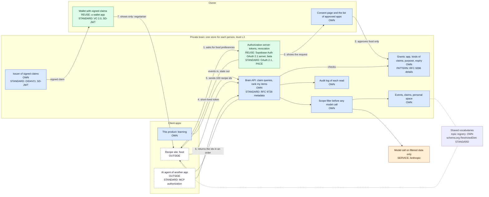

How to read the numbers:

- Steps 1 to 4 are way A of P.7. The recipe site asks, the owner approves food preferences only, and the site gets a short-lived token. Our consent page writes the approval into our own grants table.
- Steps 5 and 6 are way B. The site sends its recipe ids, and the brain returns them in an order. The preferences do not leave the brain.
- Step 7 is way C. The wallet shows one signed claim, and the brain gets no call.
- The AI agent of another app uses the same API, through the MCP authorization profile.

### P.9 Rules for a private brain

1. The owner approves each app for named kinds of claims and one purpose. The owner can revoke an approval at any time.
2. A token lives for a short time. It is bound to one app, one owner, a set of scopes and one resource. The owner comes from the token, never from a field of the request (trap 1 of P.6).
3. Code filters the data by scope before any model call. The model never sees data outside the scope. This is rule 5 of H.5.
4. The brain prefers "compute at the brain". The app sends its items, and the brain returns ids in an order, through a structured output.
5. Text from an app is data, never an instruction to the brain.
6. Each read leaves an audit row that the owner can see.
7. The brain gives derived claims, not raw events or personal content, unless the owner approves that kind.
8. Export and deletion of all data of one owner happen in one place. A revoked app loses its access at once.
9. Each default refuses access. No auth setting, no scope or no grant means no access (trap 2 of P.6).
10. A token of an outside app works only on the brain API. With Supabase as the authorization server, each OAuth access token has the full access of the user, plus a `client_id` claim, and custom scopes do not exist yet ([Supabase OAuth flows](https://supabase.com/docs/guides/auth/oauth-server/oauth-flows), read on 2026-11-26). So each row-level security policy of the private tables refuses a token with a `client_id`, and the brain API checks our own grants table.

A limit of rule 4: an order of recipes still tells the app something. An app that always sees meat at the end can infer a vegetarian diet. So rule 4 reduces what leaves the brain, and it does not remove it.

### P.10 What S-02 does now

1. Keep rules 1, 2 and 6 of R.6. They are the base of the split, and they cost nothing extra.
2. Give each learner event a source: the app or the feature that wrote it. Later, the owner can see which app said what, and an app can get only the claims that it may read.
3. Put the reads and writes of learner data behind one module with the shape of contract 3. A later scope check then has one place.

These choices take minutes to an hour in S-03. The MVP needs no OAuth server, no scopes, no audit log and no wallet.

### P.11 Where this fits in the phases

| Phase | Content                                                                                                              | Start it when                                                | It needs                                                |
| ----- | -------------------------------------------------------------------------------------------------------------------- | ------------------------------------------------------------ | ------------------------------------------------------- |
| E     | The private brain as a service for other apps: claims of more kinds, consent, scopes, audit, the query styles of P.7 | A second app outside this product needs the data of a person | Phase B (claims with states), and level L2 or L3 of H.6 |

Phase E is outside M-01 and outside phases B to D. This research gives no estimate for it.

### P.12 Limits of this follow-up

- No project was run, and nobody built a part of a private brain.
- The protocol facts have the date 2026-11-26. A draft can change.
- The legal part is not legal advice. A brain that reads preferences for many apps does profiling of a person, so it needs a legal review before it starts.
- The claim model of P.4 is a sketch. The plan of phase E must design it.

## Follow-up Research 2026-11-26 (6): a sharing protocol between a course knowledge base and a private knowledge base

### G.1 Request and method

The user asked for a second view of the private brain of follow-up (5):

- A course knowledge base (CKB) is a service, preferably on Cognee.
- A private knowledge base (PKB) belongs to one person, preferably on Cognee. It holds many kinds of information, for example the knowledge of a topic and food preferences.
- Question: how does a safe protocol look that lets a service fetch the data of a person, but only the information that the person wants to share?

Method:

- The researcher read the sharing parts of Cognee (commit `1961133`): agent principals, dataset rights, the search filter, node sets and the defaults. Paths that start with `cognee/` are paths in the Cognee repository.
- The researcher read five more sources on 2026-11-26: Rich Authorization Requests (RFC 9396, sections 7 and 11), DPoP (RFC 9449), token revocation (RFC 7009), OpenID Connect Core 1.0 (section 17.3) and Article 9 of the GDPR.
- The protocol reuses the standards that follow-up (5) checked (P.7, `research-appendix/private-brain.md`).
- No project was run. The protocol is a design sketch, and the JSON shapes are examples.

### G.2 The answer in short

- **The protocol is a profile of open standards, not a new protocol.** OAuth 2.1 with PKCE carries the consent. Rich Authorization Requests name what the service may read. DPoP binds each token to the key of the service. A small typed API carries the queries.
- **The unit of sharing is a category, and each category is one Cognee dataset.** Cognee checks the read right of each dataset in a search. A node set is only a tag, so it cannot be a unit of sharing.
- **A sharing gateway stands in front of the PKB.** The gateway checks the grant, calls Cognee as a separate principal for each app, checks each answer against a schema, and writes an audit row. No app talks to Cognee directly.
- **The service sends its items, and the PKB answers about those items only.** The course service sends its topic ids and gets a state for each id. The recipe site sends its recipe ids and gets them back in an order. Raw notes and free text do not leave the PKB.
- **Food preferences can be special categories of data.** "Halal" shows a religion and "diabetic" shows a health condition (GDPR Article 9). So they get their own categories, with an explicit consent.
- **Cognee can be the store of a PKB under six conditions** (G.10). This changes P.3 for the case where the PKB belongs to the person.
- **The course service then keeps no personal state.** It asks the PKB of the person in each session, and it writes evidence back only when the person allows it.

### G.3 The two knowledge bases

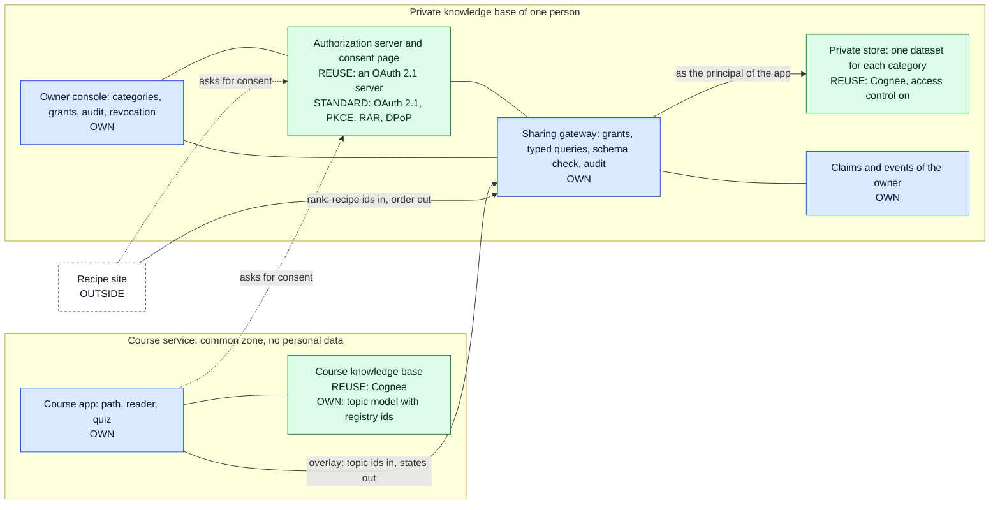

The tags are the tags of W.3 and P.8.

- **The CKB** holds the course canon: topics, relations and passages. It holds no personal data. Its topic ids must not change, because a PKB stores them. In Cognee, a data point gets a deterministic id only from its `identity_fields`, and else a random id (`cognee/infrastructure/engine/models/DataPoint.py:189-200`). So the topic model of the CKB names the registry key as its identity field, not the topic name.
- **The PKB** holds the information of one person. The sharing gateway is the only door to it. The gateway keeps the claims and the events of the owner in its own small store, and Cognee keeps the content: the graph, the chunks and the vectors.
- **One company can run both.** Even then, the course service gets no special path into the PKB. It uses the same protocol, the same grants and the same audit as the recipe site.

### G.4 What Cognee gives for sharing, and what it does not

| Fact                                                                                                                            | Anchor                                                                                                                                             | Use in the protocol                                                            |
| ------------------------------------------------------------------------------------------------------------------------------- | -------------------------------------------------------------------------------------------------------------------------------------------------- | ------------------------------------------------------------------------------ |
| Each dataset has four rights for a principal: read, write, delete and share.                                                    | `cognee/modules/users/permissions/permission_types.py:1`                                                                                           | A grant maps to the read right on the datasets of its categories.              |
| An owner can make an agent principal with its own API key. Agents are one level deep.                                           | `cognee/modules/agents/create_agent.py:10-21`                                                                                                      | The gateway makes one agent principal for each app.                            |
| Only a principal with the share right can give or take away a right on a dataset.                                               | `cognee/modules/users/permissions/methods/authorized_give_permission_on_datasets.py:15,31-32`, `authorized_revoke_permission_on_datasets.py:17,30` | Only the owner, through the gateway, changes the rights.                       |
| The search checks the read right for the given datasets, or uses all readable datasets. This works only in access control mode. | `cognee/modules/search/methods/search.py:245-249`                                                                                                  | The gateway always sends the dataset ids of the grant, with access control on. |
| The search can return context only, and it can add references.                                                                  | `cognee/api/v1/search/search.py:48,58,70`                                                                                                          | The matcher of the gateway reads context, and the gateway writes the answer.   |
| The search types include `CYPHER` and `NATURAL_LANGUAGE`, which run queries on the graph.                                       | `cognee/modules/search/types/SearchType.py:85-108`                                                                                                 | The gateway never offers these types to an app.                                |
| A node set is a tag on documents. The permission code does not use node sets.                                                   | `cognee/api/v1/add/add.py:47,188-192`                                                                                                              | A category must be a dataset, not a node set.                                  |
| API keys have no scope and no expiry (`research-appendix/private-brain.md`, section 2). Key hashing is off by default.          | `cognee/modules/users/api_key/hash_api_key.py:4`                                                                                                   | Apps never see a Cognee key. The gateway holds the keys, with hashing on.      |
| The search keeps each question and its answer by default.                                                                       | `cognee/modules/search/operations/search_history_config.py:1-14`                                                                                   | The PKB turns this off. The audit of the gateway keeps no content.             |
| Telemetry is on until `TELEMETRY_DISABLED` is set. The API server always mounts the register route.                             | `cognee/shared/utils.py:23,575`, `cognee/api/client.py:389-393`                                                                                    | The PKB sets the switch, and its Cognee API is never public.                   |

So Cognee gives a store with a right for each dataset, and the gateway gives everything that faces an app: consent, scopes, expiry, the typed API and the audit.

### G.5 The unit of sharing: categories and their sensitivity

Each piece of information in the PKB belongs to exactly one category, and each category is one Cognee dataset.

| Category           | Example content                                       | Sensitivity | Can be shared                                 |
| ------------------ | ----------------------------------------------------- | ----------- | --------------------------------------------- |
| `private.inbox`    | Each new piece of information, before a review        | never       | No                                            |
| `knowledge.topics` | The state of each topic: known, partly known, unknown | normal      | Yes, as states for the ids that an app sends  |
| `knowledge.notes`  | Notes and passages that the person wrote or loaded    | never       | No                                            |
| `food.preferences` | Vegetarian, vegan, dislikes                           | normal      | Yes                                           |
| `food.religious`   | Halal, kosher, Hindu diet                             | special     | Only with an explicit consent for one purpose |
| `food.health`      | Diabetic, low salt, allergies                         | special     | Only with an explicit consent for one purpose |

Rules for the categories:

1. New information goes to `private.inbox`. A classifier can propose a category, and the owner confirms each move to a category that can be shared.
2. A category with the sensitivity "never" does not appear on a consent page.
3. A "special" category needs its own explicit consent for one purpose. Article 9 of the GDPR forbids the processing of data that shows religious beliefs or health, unless an exception applies. One exception is the explicit consent of the person for specified purposes ([GDPR Article 9](https://gdpr-info.eu/art-9-gdpr/), read on 2026-11-26).
4. The values of schema.org show why food needs three categories. `RestrictedDiet` has `HalalDiet`, `KosherDiet` and `HinduDiet`, which show a religion, and `DiabeticDiet`, which shows a health condition (P.4).

### G.6 The protocol as a profile of standards

| Step                   | What happens                                                                                                                                                      | Standard                                                                                                                                                                                                                   |
| ---------------------- | ----------------------------------------------------------------------------------------------------------------------------------------------------------------- | -------------------------------------------------------------------------------------------------------------------------------------------------------------------------------------------------------------------------- |
| 1. Discovery           | The gateway publishes its metadata: the authorization server, and a catalog of the categories, the operations and the vocabularies that it accepts.               | Protected Resource Metadata (RFC 9728). RFC 9396, section 11.1: publish the types of authorization details in the server metadata.                                                                                         |
| 2. Client registration | The app registers its name, purpose, redirect addresses and privacy policy. The consent page shows them.                                                          | Client ID Metadata Document or pre-registration, as in MCP authorization 2026-07-28                                                                                                                                        |
| 3. Request             | The app asks for named categories and operations, a purpose and a retention, for one resource.                                                                    | OAuth 2.1 with PKCE, Rich Authorization Requests (RFC 9396), Resource Indicators (RFC 8707)                                                                                                                                |
| 4. Consent             | The owner sees the app, each category, each operation, the purpose and the retention. The owner can approve a part. A wider request later asks again.             | RFC 9396, sections 7 and 11.2: the token carries the details "as granted by the resource owner", and the consent step can change the request. Pattern: the stored consent of Tutor MCP (`tutor-mcp/auth/oauth.go:785-814`) |
| 5. Token               | A short-lived token for the gateway only, bound to the key of the app. Its subject is a pairwise id, so two apps cannot link the person. A refresh token rotates. | DPoP (RFC 9449), OpenID Connect Core 1.0 section 17.3                                                                                                                                                                      |
| 6. Query               | The app calls one of the typed operations of G.7.                                                                                                                 | Our own API contract                                                                                                                                                                                                       |
| 7. Revocation          | The owner revokes a grant in the console. The app can revoke its own token.                                                                                       | Token Revocation (RFC 7009)                                                                                                                                                                                                |
| 8. Agents              | The AI agent of an app uses the same grants and operations through an MCP server of the gateway.                                                                  | MCP authorization, version 2026-07-28                                                                                                                                                                                      |
| 9. Offline claims      | For a stable claim, the PKB issues a signed claim to a wallet, and the person shows only that claim. No live call is necessary.                                   | OID4VCI 1.0, OID4VP 1.0, SD-JWT (RFC 9901)                                                                                                                                                                                 |

- OpenID Connect Core 1.0, section 17.3: "To protect the End-User from possible correlation among Clients, the use of a Pairwise Pseudonymous Identifier (PPID) as the sub (subject) SHOULD be considered."
- DPoP lets an app prove that it holds a private key, and the server binds the tokens to that key (RFC 9449, section 1). A stolen token is then useless without the key.
- OAuth 2.1 is still an Internet-Draft (P.7).

### G.7 The typed operations

The gateway offers four operations. Each grant names the operations that it allows. No operation returns free text from a model.

| Operation         | The app sends                                         | The PKB returns                                                           | Example                                 |
| ----------------- | ----------------------------------------------------- | ------------------------------------------------------------------------- | --------------------------------------- |
| `overlay`         | A list of item ids with labels, in a named vocabulary | One state for each sent id, and the basis of the state                    | The course service and its topic ids    |
| `rank`            | A list of item ids with attributes                    | The same ids in an order. With the `filter` action, also the excluded ids | The recipe site and its recipe ids      |
| `claims`          | A category                                            | Typed claims of that category                                             | "VegetarianDiet, declared"              |
| `append_evidence` | Events about the owner, for example a passed quiz     | An acknowledgement                                                        | The course service writes a quiz result |

The request of the course service in step 3:

```json
{
  "response_type": "code",
  "client_id": "https://courses.example/client.json",
  "resource": "https://pkb.example/",
  "code_challenge_method": "S256",
  "authorization_details": [
    {
      "type": "pkb_share",
      "category": "knowledge.topics",
      "actions": ["overlay", "append_evidence"],
      "vocabulary": "https://courses.example/vocab/topics/v1",
      "purpose": "adjust-course-path",
      "retention": "session"
    }
  ]
}
```

An `overlay` call in step 6, with the DPoP proof in its header:

```json
{
  "vocabulary": "https://courses.example/vocab/topics/v1",
  "category": "knowledge.topics",
  "items": [
    { "id": "t-0193", "label": "MergeTree engine" },
    { "id": "t-0194", "label": "Repeatable read" }
  ]
}
```

The answer:

```json
{
  "results": [
    { "id": "t-0193", "state": "unknown" },
    { "id": "t-0194", "state": "known", "basis": "checked" }
  ],
  "policy": "pkb-share/1"
}
```

A `rank` call of the recipe site, and its answer:

```json
{
  "vocabulary": "https://schema.org/",
  "category": "food.preferences",
  "items": [
    { "id": "r-1", "suitableForDiet": ["VeganDiet"], "ingredients": ["tofu", "rice"] },
    { "id": "r-2", "suitableForDiet": [], "ingredients": ["beef", "onion"] }
  ]
}
```

```json
{ "order": ["r-1", "r-2"], "policy": "pkb-share/1" }
```

How the PKB computes an answer:

1. When the PKB holds the id of the vocabulary, it reads the state directly. A person who learned with this product has the ids already, because the private side points at the common ids (rule 2 of H.5).
2. Else the gateway searches the granted dataset as the principal of the app, with context only. A model then matches each sent item to that context and returns only an id and a state, through a structured output.
3. The gateway checks the answer: each id must come from the request, each state must come from the fixed list, and the count must not pass the limit of the grant.

### G.8 The flow

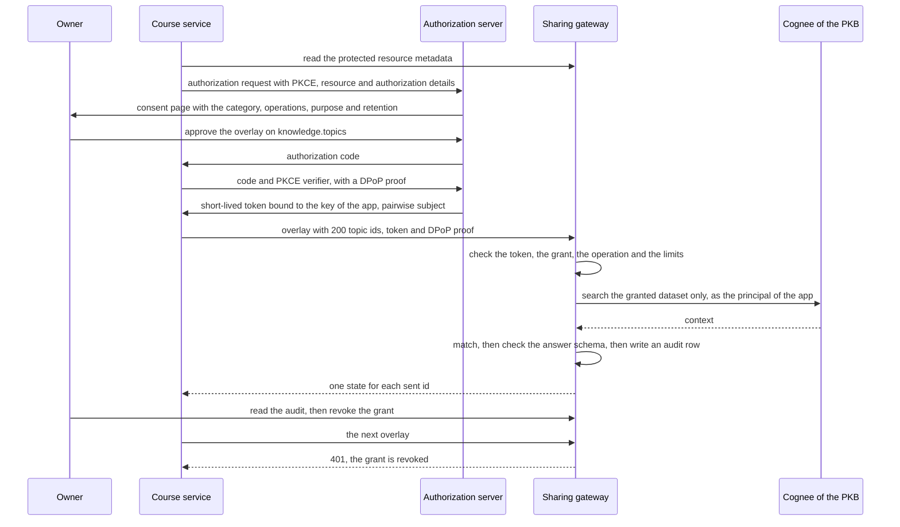

### G.9 Five walls in the gateway and the store

| Wall | Where            | What it stops                                                                                                                                                      |
| ---- | ---------------- | ------------------------------------------------------------------------------------------------------------------------------------------------------------------ |
| 1    | Gateway          | A token that is expired, revoked, for another resource or without its key. An operation or a category outside the grant. Too many items.                           |
| 2    | Cognee rights    | The gateway calls Cognee as the principal of the app, which has the read right on the granted datasets only. A defect in wall 1 still cannot read another dataset. |
| 3    | Search types     | Only the context search is in use. The graph query types are never in use.                                                                                         |
| 4    | Answer schema    | An answer with an id that the app did not send, a state outside the fixed list, free text, or too many results.                                                    |
| 5    | Audit and limits | Many queries that rebuild a profile: each grant has a budget of queries for each day, and the owner sees each call.                                                |

The audit row holds the time, the app, the grant, the operation, the category and the counts. It holds no content.

### G.10 Cognee as the store of a PKB: six conditions

P.3 did not recommend Cognee as the private store, for five reasons. That analysis put the private store inside this product. In this view, the PKB belongs to the person, and the conditions below answer each reason.

| #   | Condition                                                                                                                                        | Reason of P.3 that it answers       |
| --- | ------------------------------------------------------------------------------------------------------------------------------------------------ | ----------------------------------- |
| 1   | The PKB refers to topics by the ids of the vocabulary, and the CKB gives them stable ids through `identity_fields`. No Cognee id leaves the PKB. | 1, ids                              |
| 2   | The gateway keeps the claims and the events of the owner in its own small store. Cognee keeps the content.                                       | 2, no learner model                 |
| 3   | One Cognee for each person, or access control on with a store for each dataset.                                                                  | 3, weak separation                  |
| 4   | The deletion of a PKB deletes its Cognee, or all datasets of the owner, and the grants.                                                          | 4, erasure                          |
| 5   | `COGNEE_LOG_SEARCH_HISTORY=false`, `TELEMETRY_DISABLED`, and `HASH_API_KEY=true`.                                                                | 5, a second record of each question |
| 6   | The Cognee API of the PKB is never public. The gateway is the only door.                                                                         | The hardening list of H.4           |

Where a PKB can run:

| Place                                                     | Separation                                                                         | Note                                                                                                                            |
| --------------------------------------------------------- | ---------------------------------------------------------------------------------- | ------------------------------------------------------------------------------------------------------------------------------- |
| A hosted Cognee for each person                           | The strongest of the hosted options                                                | A cost for each person. Cloud Run files do not persist, so it needs a volume (W.8).                                             |
| One hosted Cognee for many people, with access control on | Weaker: the relational database with the users and the rights is shared (W.8, H.4) | Wall 1 must also check the owner on each call.                                                                                  |
| Cognee on the device of the person                        | The closest form to "a private key with our data"                                  | The defaults of Cognee are local files (W.8). When the device is offline, signed claims (step 9 of G.6) cover the stable facts. |

### G.11 Threats and controls

| #   | Threat                                                      | Control                                                                                                |
| --- | ----------------------------------------------------------- | ------------------------------------------------------------------------------------------------------ |
| 1   | An app reads more than the owner approved                   | Walls 1 to 4                                                                                           |
| 2   | A stolen token                                              | DPoP, a token for one resource, a short life                                                           |
| 3   | Two apps link the same person                               | A pairwise subject id for each app                                                                     |
| 4   | Many queries rebuild a profile                              | A budget for each grant, limits on the items, and the audit                                            |
| 5   | Text in an item tries to steer the model of the matcher     | Items are data. The model sees the granted dataset only. The schema accepts ids from the request only. |
| 6   | Food data shows a religion or a health condition            | Separate special categories, with an explicit consent for one purpose                                  |
| 7   | A wrong category puts a private fact into a shared dataset  | New information goes to the inbox, and the owner confirms each move                                    |
| 8   | The defaults of Cognee leak data                            | Condition 5 and condition 6 of G.10                                                                    |
| 9   | The company that runs the course service also hosts the PKB | Separate services and keys, the same protocol for each app, and an audit that the owner sees           |
| 10  | An app keeps the shared data too long                       | The retention in the grant and in the terms. Operations with small answers, such as `rank`.            |

### G.12 What this follow-up changes

- **P.3, "Cognee keeps no private knowledge":** it stays for the private store inside this product. For a PKB that belongs to the person, Cognee can be the store under the six conditions of G.10.
- **H.5, contract 3 (learner evidence):** in this view it becomes the operations `overlay` and `append_evidence` of the protocol.
- **H.5, contract 4 (overlay at read time):** the course service joins its own topics with the states from the PKB in each session. The course service then keeps no personal state.
- **P.7:** the three ways stay. This follow-up gives them one protocol: way A is `claims`, way B is `rank` and `overlay`, and way C is step 9 of G.6.

### G.13 Limits of this follow-up

- This is a design sketch. Nobody built the gateway, and no project was run.
- The names of the operations, the categories and the JSON fields are examples.
- OAuth 2.1 and SD-JWT VC are still drafts.
- The legal part is not legal advice. The categories of G.5 need a legal review.
- Nobody measured a Cognee for each person: its memory, its start time or its cost.

## Follow-up Research 2026-11-26 (7): sharing one part of a connected private brain

### M.1 Request and method

The request: "In your private brain, let's assume there are informations mixed and interconnected like in human brain. How to permit access to only part of the informations, e.g. let know about cooking preferences but not share medical and emotional data to outside?" The user asked for ideas outside the box, and for no detail about OAuth.

Scope:

- G already gives the door: consent, tokens, the gateway and the typed operations. This follow-up does not change them.
- This follow-up looks at the content: which part of a connected brain can leave, and how the brain decides it.

Method:

- Three workers ran in parallel. The first read the research on models that infer private facts and on agents that leak them. The second read classic security, EU law and product precedents. The third read the Cognee code at commit 1961133.
- I checked the decisive numbers in the papers, the paragraphs of both court rulings, the Topics quote and the decisive Cognee anchors myself. M.17 lists each source.

### M.2 The answer in short

- **The hard part is inference, not access.** A right on data hides the node "diabetes" with no effort. But "avoids sugar" and a few other lines can let the model of a recipe site guess the diabetes. Models guess personal attributes from text with up to 85% top-1 accuracy (M.8).
- **EU law counts the guess.** Data that reveal a special category "indirectly, following an intellectual operation involving deduction or cross-referencing" get the protection of Article 9 GDPR (CJEU C-184/20, paragraphs 123 and 127). This holds when the guess is wrong (CJEU C-252/21, paragraph 69).
- **A connected brain leaks by six paths,** and rights on data stop only the first one (M.3).
- **The brain acts like a discreet person.** It thinks with everything and speaks through a filter. Seven habits of a discreet person give seven mechanisms (M.4).
- **The unit of privacy is a claim with labels,** not a note and not a node. A derived claim gets the labels of its sources, and only the owner removes a label (M.5, M.6).
- **Questions from outside never reach the connected graph.** They reach a share view. For most audiences, the view is a short card that the owner approves line by line. Cognee stays the thinking graph, and it stops being the door (M.7, M.12, M.13).
- **A model plays the attacker.** It tries to guess the hidden labels from each card before the card goes live (M.8).
- **The strongest level reverses the flow.** The agent of the person takes the public recipe list and ranks it on the side of the person. The site learns only the clicks (M.9).
- **G.5 changes.** Categories become labels on claims, and the shared units become views (M.14).

### M.3 Six ways a connected brain leaks

An example: one journal note of the owner.

> "After the diabetes diagnosis I felt low for weeks. Cooking Mediterranean dinners with my sister helped me. I try to avoid sugar now."

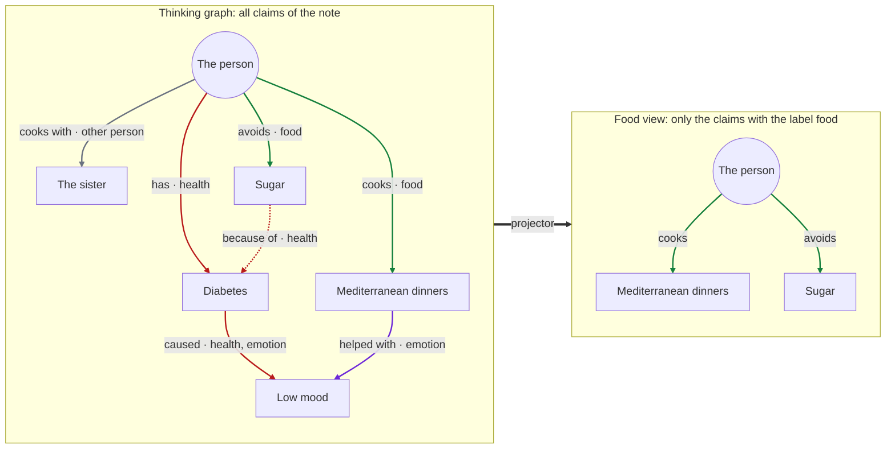

Edge colors: green for food, red for health, purple for emotion, gray for another person. The projector keeps only the green edges.

The note gives seven claims. The labels are on the claims, which are the edges, because one node can be in several claims. The node "Mediterranean dinners" is in a food claim and in an emotional claim.

| Claim                                            | Labels          | Can go into a food view |
| ------------------------------------------------ | --------------- | ----------------------- |
| The person has diabetes.                         | health          | No                      |
| The diabetes caused a low mood.                  | health, emotion | No                      |
| The person cooks Mediterranean dinners.          | food            | Yes                     |
| The cooking helped with the low mood.            | emotion         | No                      |
| The person cooks with the sister.                | other person    | No                      |
| The person avoids sugar.                         | food            | Yes, but see path 3     |
| The person avoids sugar because of the diabetes. | health          | No                      |

| #   | Leak path    | Example                                                                                               | Control                                                                         | Section |
| --- | ------------ | ----------------------------------------------------------------------------------------------------- | ------------------------------------------------------------------------------- | ------- |
| 1   | Direct read  | An app reads "has diabetes".                                                                          | Rights on what an app can read                                                  | G.9     |
| 2   | Neighbor     | A search for food finds "Mediterranean dinners" and returns its neighbor "helped with the low mood".  | Questions from outside reach a separate view, never the connected graph         | M.7     |
| 3   | Inference    | The view holds only food claims, but "avoids sugar" with other lines lets a model guess the diabetes. | A model tries to guess the hidden labels before the view goes live              | M.8     |
| 4   | Refusal      | The brain answers questions about sugar for most people, but refuses for this person.                 | The brain decides by the type of question, never by the data                    | M.10    |
| 5   | Accumulation | Many small answers over months add up to a profile.                                                   | A ledger of what each audience got, a budget, and the check on the whole ledger | M.10    |
| 6   | Persuasion   | Text from the app talks the model of the brain into telling more.                                     | The model that reads text from outside never sees the private claims            | M.11    |

Rights on data stop only path 1. The other five paths need the mechanisms of M.5 to M.11.

### M.4 The principle: think with everything, speak through a filter

A person knows the diagnosis, and still tells the cook only "no sugar, please". Privacy research calls this contextual integrity. Nissenbaum names two types of norms: "norms of appropriateness, and norms of flow or distribution" (Washington Law Review 79, 2004). Barth, Datta, Mitchell and Nissenbaum describe each flow by its sender, its recipient, its subject, the type of information and "a principle of transmission" (IEEE S&P 2006). So the brain has two layers:

1. **The thinking graph.** It holds everything, connected. Only the owner and the agent of the owner use it.
2. **The discretion layer.** It builds one share view for each audience and purpose, and it checks each view before the view leaves.

The mechanisms come from the habits of a discreet person:

| #   | Habit of a discreet person                                                              | Mechanism of the brain                                                              | Pattern                             | Section |
| --- | --------------------------------------------------------------------------------------- | ----------------------------------------------------------------------------------- | ----------------------------------- | ------- |
| 1   | I know which of my facts are private, fact by fact.                                     | Each claim gets labels at ingestion.                                                | Labels on each fact                 | M.5     |
| 2   | A secret stays a secret when I say it in other words.                                   | A derived claim gets the labels of all its sources. Only the owner removes a label. | Information flow control            | M.6     |
| 3   | The cook and the doctor hear different stories.                                         | One share view for each audience, separate from the thinking graph                  | Partial identity                    | M.7     |
| 4   | Before I speak, I ask: "What can they guess from this?"                                 | A model tries to guess the hidden labels from each view.                            | Inference control                   | M.8     |
| 5   | I pick from the menu myself, and I do not explain why.                                  | The brain answers instead of telling, or the catalog comes to the brain.            | SafeAnswers, matching on the device | M.9     |
| 6   | I give everyone the same polite "I prefer not to say", and I remember what I told whom. | Answers do not depend on the secret. A ledger records each disclosure.              | Simulatable auditing                | M.10    |
| 7   | A stranger cannot talk me into telling a secret.                                        | The model that reads text from outside never sees private claims.                   | Dual LLM, CaMeL, AirGapAgent, FIDES | M.11    |

```mermaid
flowchart LR
  SRC["Notes, chats and events of the owner<br/>OUTSIDE"]
  LLM["Model API<br/>SERVICE"]
  subgraph BRAIN["Private brain: only the owner and the agent of the owner"]
    LAB["Claim splitter and labeler<br/>OWN"]
    TG["Thinking graph: all claims, connected<br/>REUSE: Cognee, one dataset"]
    CS["Claim store: labels, sources, owner decisions<br/>OWN"]
  end
  subgraph DISC["Discretion layer"]
    PROJ["Projector: keeps the claims that the policy allows<br/>OWN, PATTERN: information flow control"]
    CHK["Inference check: a model guesses the hidden labels<br/>OWN, PATTERN: inference control"]
    CON["Owner console: approves each line<br/>OWN"]
    CARD["One share view, a card, for each audience<br/>OWN, PATTERN: partial identity"]
    LED["Ledger of each disclosure<br/>OWN, PATTERN: query auditing"]
  end
  GW["Sharing gateway of G<br/>OWN"]
  APP["Recipe site<br/>OUTSIDE"]
  AG["Agent of the person, level 0<br/>OWN"]
  SRC --> LAB
  LAB --> TG
  LAB -->|"through the inbox"| CS
  CS --> PROJ --> CHK --> CON --> CARD
  CARD --> GW
  GW --- LED
  APP -->|"typed request"| GW
  GW -->|"answer from the view only"| APP
  APP -.->|"public catalog"| AG
  TG -.->|"the full brain, results stay with the person"| AG
  LAB -.- LLM
  CHK -.- LLM
  classDef own fill:#dbeafe,stroke:#1d4ed8,color:#0b1b3a
  classDef reuse fill:#dcfce7,stroke:#15803d,color:#052e16
  classDef service fill:#ffedd5,stroke:#c2410c,color:#3b1502
  classDef outside fill:#ffffff,stroke:#4b5563,color:#111827,stroke-dasharray:4 3
  class LAB,CS,PROJ,CHK,CON,CARD,LED,GW,AG own
  class TG reuse
  class LLM service
  class SRC,APP outside
```

The tags are the tags of W.3 and P.8. Only the thinking graph reuses a project. The discretion layer is our own code, and each of its blocks follows a published pattern.

### M.5 Habit 1: labels on each claim

1. **Split each source into claims.** A claim is one fact: a subject, a relation and an object. A note is never only "food" or only "health".
2. **Give each claim one or more labels from a fixed list.** Start from the special categories of GDPR Article 9: health, religion, ethnic origin, political opinions, sex life, genetic data, biometric data and trade union membership. Add our own labels: emotion, other person, money and place. Add neutral labels for the subject: food and knowledge.
3. **Label the reason apart from the preference.** "Avoids pork" is a preference. "Because of my religion" is a reason. Many sensitive facts are reasons, so the brain shares the what and keeps the why.
4. **Keep the events in.** Memory research separates episodic memory, which holds events, from semantic memory, which holds stable facts (Tulving, "Episodic and semantic memory", in _Organization of Memory_, 1972). Emotion comes mostly with events. So only stable claims can enter a view, and events never leave.
5. **Deny by default.** A claim without a label, or with an uncertain label, counts as private. A new claim goes to the inbox of G.5 first.
6. **Keep other people out.** "My partner has a nut allergy" is the health data of another person. A view can say "no nuts", which is the what. It never says why.

The labeler is a model, and a model makes mistakes. The worst mistake is a "food" label on a health claim. Three controls reduce it:

- The labeler asks one narrow question for each sensitive label, for example "Can this claim show the health of a person?". It prefers a false "yes" to a false "no".
- A word list adds labels that the model missed: names of drugs, conditions, and diets with a medical name.
- The owner confirms each claim before it enters a view (M.12).

### M.6 Habit 2: labels follow the data

- **The rule.** A claim that the brain derives from other claims gets the labels of all its sources. This is the lattice model of information flow: "The central component of the model is a lattice structure derived from the security classes" (Denning, CACM, 1976). In the decentralized label model, a value from two inputs gets "the union of the two set of policies" (Myers and Liskov, ACM TOSEM, 2000, section 3.5).
- **An example.** The brain derives "prefers recipes with little sugar" from "has diabetes". The derived claim gets the label health, although its text is about food.
- **Only the owner removes a label.** In the same model, "a principal may weaken only the policies that it has itself provided" (Myers and Liskov, section 1). In the brain, the owner can say: "Share 'avoids sugar' as a taste, without its reason." The brain records this decision with its date.
- **Label creep.** A claim that comes from many sources collects many labels, and then nothing can leave. The decisions of the owner on the card (M.12) solve this for the few lines that matter.
- **Unknown sources.** A claim from a source that the brain cannot trace gets all labels. Cognee writes some derived output with no source. The default stage list of `improve()` has nine stages, among them user preferences and a global context index (`cognee/modules/improve/registry.py:26-36`). Output without a data item gets no provenance (`cognee/tasks/storage/add_data_points.py:180-187`). So no output of Cognee goes into a view directly. It goes to the inbox as a new claim with all labels.
- **A research precedent.** Collaborative Memory keeps a private tier and a shared tier, records the provenance of each memory fragment, and checks read and write policies (Rezazadeh et al., arXiv 2505.18279, 2025).

### M.7 Habit 3: one separate view for each audience

- **Filters on one big graph are weak.** One missed filter, one search type without the filter, or one path through a hidden node shows the hidden fact. The Cognee code at commit 1961133 shows each of these:
  - The default search type is `HYBRID_COMPLETION`, which reads "Document passages plus entity neighbourhoods" (`cognee/api/v1/search/search.py:45,91-92`).
  - The graph search scores each triplet from both of its nodes and its edge (`cognee/modules/graph/cognee_graph/CogneeGraph.py:480-516`). The graph data around the hits includes "their direct neighbors" (`cognee/infrastructure/databases/graph/ladybug/adapter.py:3437-3440`). So a food question can return "Mediterranean dinners, helped with, low mood".
  - The text for the model is the full text of a chunk, or the description of a node (`cognee/modules/graph/utils/resolve_edges_to_text.py:53-59`).
  - A node set filter keeps the tagged nodes and their neighbors (`adapter.py:3239-3293`). The worker found that edges carry no node set tag.
  - One entity name gives one node across all notes, because the id is a uuid5 of the name (`cognee/infrastructure/engine/models/DataPoint.py:217-247`, `cognee/modules/graph/utils/expand_with_nodes_and_edges.py:128`). An update replaces the whole property blob of the node (`adapter.py:135-142`), so the description comes from the last note that wrote it.
  - The search has no filter on custom properties. The graph filter compares declared columns, such as `type`, not keys inside the property blob (`adapter.py:3366-3377`).
- **A mature graph database has the same class of problem.** In Neo4j, "the user can see all labels attached to a node they have access to, even if they do not have access to traverse on all of those labels" (Neo4j Operations Manual, limitations).
- **A view is a separate store.** It holds only the claims whose labels the policy of that audience allows. A question from the app cannot reach a health claim, because the view does not hold one.
- **A view has no holes.** It never shows "hidden" or an empty slot, because a hole tells the reader that something is there.
- **A view does not need to be a graph.** A food view is a short list of typed claims: likes, avoids, time and budget. The graph is how the brain thinks, and the card is how the brain speaks. Only a large view needs its own Cognee dataset, for example the notes of the person on a topic for a tutor app. With access control on, which is the default when the stores support it, each dataset has its own graph file and its own vector file (`cognee/context_global_variables.py:149-170`, `LadybugDatasetDatabaseHandler.py:40-43`, `LanceDBDatasetDatabaseHandler.py:35`).
- **The projector rebuilds a view** when the owner adds, changes or withdraws a claim, or changes a policy.
- **Products also separate memory by context.** Claude creates "a separate memory for each project" (Anthropic, 2025-09-11). In 2024, OpenAI steered ChatGPT memory "away from proactively remembering sensitive information, like your health details" (OpenAI, 2024-02-13). Its current help center says that sensitive information can appear in memory when the person shares it. So the brain cannot rely on a model to leave sensitive facts out.

The policy of one view:

```yaml
view: cooking
audience: recipe sites
purpose: suggest recipes
allow_labels: [food]
deny_labels: [health, religion, emotion, other person]
kinds: [stable preference] # events never leave
owner_review: each new line
level: 0 # the leak ladder of M.9
expires: 2027-05-26
```

### M.8 Habit 4: an attacker inside

- **The check.** Before a view goes live, and after each change, a separate model plays the app. It gets the view and the list of hidden labels, and it tries to guess each hidden label with a confidence.
- **Why a model.** Staab et al. let models guess eight personal attributes from Reddit comments, such as age, sex, place and income. The best model reached "up to 85% top-1 and 95% top-3 accuracy", with 100 times less cost and 240 times less time than human labelers ("Beyond Memorization", ICLR 2024). Health and religion were not among the eight attributes, but the method is the same. An app with a model can try the same guesses, so the brain tries them first.
- **A list of safe topics is not enough.** Google curated the Topics taxonomy "to exclude categories generally considered sensitive". Its explainer still says: "It may be possible that topics, or groups of topics, are statistically correlatable with sensitive categories."
- **What the brain does with a guess:**
  1. It shows the owner a warning on the line, for example: "'Avoids pork' and 'avoids alcohol' together can show a religion."
  2. It offers three choices: keep the line, remove it, or make it vaguer.
  3. It records the decision.
- **A standard asks for the same warning.** The W3C Verifiable Credentials Data Model 2.0 says that holders "ought to be warned by their software" when "a correlation risk is posed by the combination of two or more" credentials (section 8).
- **Neutral reasons.** A line is safer when many people hold it for a neutral reason. "Little sugar" has many neutral reasons, such as fitness or taste. The schema.org value `DiabeticDiet` has one reason only (G.5).
- **The union, not one line.** The check reads the whole view and the ledger of the audience (M.10), because leaks add up.
- **The result of the check is sensitive too.** A guess such as "a religion that forbids pork" reveals a special category, and C-252/21 makes this independent "of whether or not the information revealed ... is correct" (paragraph 69). So the result stays in the brain, with all labels.
- **A test for defects.** For each answer type, a test runs the answer with and without the hidden claims, and the two answers must be the same. This is non-interference: what one group does "has no effect on what the second group of users can see" (Goguen and Meseguer, IEEE S&P 1982). The same paper leaves "security breaches arising through inference" out of its model. So this test checks the projector, and the model check above covers the guesses.
- **The limit.** The check finds the obvious guesses. It is a test, not a proof.

An example result of the check:

```json
{
  "view": "cooking",
  "guesses": [
    {
      "label": "religion",
      "guess": "a religion that forbids pork and alcohol",
      "confidence": "high",
      "because": ["avoids pork", "avoids alcohol", "halal meat only"]
    },
    {
      "label": "health",
      "guess": "diabetes",
      "confidence": "low",
      "because": ["avoids sugar"]
    }
  ]
}
```

### M.9 Habit 5: answer instead of tell, and bring the catalog to the brain

The leak ladder. Each level leaks less than the level above it.

| Level | What leaves the brain                           | What the recipe site learns                           | Example                                                                     |
| ----- | ----------------------------------------------- | ----------------------------------------------------- | --------------------------------------------------------------------------- |
| 4     | The notes or the graph                          | Everything                                            | Never allowed                                                               |
| 3     | The lines of a view                             | The approved lines of the card                        | "Likes spicy food, avoids pork"                                             |
| 2     | An answer that the brain computes from the view | The result. Many results can show a part of the view. | The order of the 100 recipe ids that the site sent (`rank` of G.7)          |
| 1     | A yes or a no for each item                     | One bit for each item                                 | "Recipe 17 fits"                                                            |
| 0     | Nothing. The catalog comes to the brain.        | Only the clicks of the person                         | The agent of the person reads the public recipes and ranks them on its side |

- **Level 2 is SafeAnswers.** In openPDS, "applications submit code (the question) to be run against the metadata, and only the result (the answer) is sent back to them" (de Montjoye et al., PLoS ONE, 2014).
- **Level 0 has a precedent.** Brave Ads download "a catalog with a subset of all available ads" and match the ads inside the browser (Brave blog, 2020). Brave states that "your personal data never leaves your device". This is the claim of the vendor.
- **Agents make level 0 natural.** The agent of the person visits the recipe site like any reader, takes the public recipes, and ranks them with the full brain. The site sees an anonymous reader. Do not send your data to the app. Send the data of the app to your brain.
- **The agent takes a broad part of the catalog.** A narrow search, such as "desserts for diabetics", tells the site the secret again.
- **Sensitive claims can help, but only at level 0.** The brain can use "has diabetes" to rank recipes when the result goes only to the person. At levels 1 to 3 the result goes to the site, so the brain uses the view only. The rule: a sensitive claim shapes a result only when the result stays with the person.

### M.10 Habit 6: answers do not depend on the secret

- **A refusal can leak.** Suppose the brain refuses "Does the person eat sugar?" only for people with diabetes. Then each refusal tells the site the diagnosis. Kenthapadi, Mishra and Nissim show that "query denials may leak information". Their simulatable auditor decides "based exclusively on" the questions so far and the earlier answers, and not on the dataset (PODS 2005, definition 4.1).
- **The rule.** The brain decides by the type of question and the policy. It answers a type of question for every person, or for no person.
- **The same shape.** An empty view, a view with few lines and a refusal look the same for every person. The time to answer does not depend on the data.
- **The ledger.** The brain records each disclosure for each audience: the date, the lines and the answer type. The check of M.8 reads it. Farkas and Jajodia name the old form of this problem: "Indirect data disclosure via inference channels occurs when sensitive information can be inferred from non-sensitive data and metadata" (SIGKDD Explorations, 2002).
- **The budget.** Each audience gets a fixed number of answers for each period (G.9, wall 5).
- **Noise, as an option.** Randomized response gives each answer a known chance to be random, so no single answer is certain (Warner, JASA, 1965). Chrome used this idea in RAPPOR (Erlingsson et al., ACM CCS 2014). The Topics API returned a random topic in 5% of the cases. Google retired Topics in October 2025, and its status page lists Topics as removed from Chrome. Noise lowers the quality of the recipes, so the brain uses it only for lines near a sensitive label.

### M.11 Habit 7: the model that reads text from outside never sees private claims

- **Models leak in context.** In ConfAIde, GPT-4 and ChatGPT told a secret to the wrong people in 39% and 57% of the meeting summaries, "even though they are directly instructed to preserve privacy" (ICLR 2024, tier 4). In PrivacyLens, a privacy prompt changed the leak rate of GPT-4 only from 26.37% to 24.54%. For Llama-3-70B, the rate went up from 36.51% to 39.15% (NeurIPS 2024).
- **Memory makes it worse.** CIMemories found "up to 69% attribute-level violations" and a "granularity failure": a model picks the right domain, but shares unneeded details inside it (arXiv 2511.14937, 2025). That is the recipe case: the domain is food, and the unneeded detail is the reason.
- **An attacker can pull memory out.** MEXTRA took 50 private queries out of the memory of an agent for health records with 30 attack prompts (ACL 2025).
- **Split the roles:**
  1. The projector and the check see the private claims and the type of the task. They never read free text from an app. AirGapAgent uses this split: "the design does not allow any information from the third party to flow back to the minimizer module". Under one hijacking question, the privacy score of a plain Gemini Ultra agent fell from 94.4% to 45.2%, and AirGapAgent kept 96.7%. The cost was in the utility score: 98.9% fell to 88.7% (ACM CCS 2024).
  2. The answer model reads the request of the app and the view only. The Dual LLM pattern is the simple form: a privileged model with trusted input only, and a quarantined model without tools for untrusted text (Willison, 2023).
  3. Each value carries its labels, and a policy checks each flow. In CaMeL, capabilities "track the sources and allowed recipients of each value". CaMeL solved 77% of the AgentDojo tasks with provable security, against 84% with no defense (arXiv 2503.18813, version 2). FIDES lets data out only "if all recipients are permitted to read the data", and with its policy checks it stopped all prompt injection attacks in AgentDojo (arXiv 2505.23643).
- **G already helps.** Its typed operations carry ids, not free text (G.7). This habit keeps that rule when an agent, not a form, talks to the brain.

### M.12 The owner sees one card for each audience

```text
Cooking card       for: recipe sites     purpose: suggest recipes
                   level: 0              expires: 2027-05-26
  Likes:    Mediterranean food, spicy food, one-pot dinners
  Avoids:   desserts with much sugar, pork
  Time:     30 minutes on weekdays
  Warning:  "Avoids pork" can show a religion.         [Keep] [Remove] [Make vaguer]
  New line: "Avoids alcohol" (from a note of 2026-11-20)   [Add] [Ignore]
```

- The card is the human form of declassification. The owner approves each line, and sees what each audience can know.
- A card is a partial identity: "a subset of attribute values of a complete identity" (Pfitzmann and Hansen, terminology v0.34, 2010, section 13.3). Here the owner can read it.
- New lines come from the inbox, with the warning of the check.
- The card is cheap to build and easy to understand. It is a good first version of the discretion layer.

### M.13 How this maps to Cognee

| Need of the design                  | What Cognee gives at commit 1961133                                                                                                                                        | Anchor                                                                                                                                     | What our code adds                                                                         |
| ----------------------------------- | -------------------------------------------------------------------------------------------------------------------------------------------------------------------------- | ------------------------------------------------------------------------------------------------------------------------------------------ | ------------------------------------------------------------------------------------------ |
| One connected graph for the owner   | One node for each entity name, across all notes of a dataset                                                                                                               | `DataPoint.py:217-247`, `expand_with_nodes_and_edges.py:128`                                                                               | Nothing                                                                                    |
| A trace from a claim to its source  | A chunk `contains` each entity that it mentions. Each node row keeps the keys of the chunks that produced it.                                                              | `expand_with_nodes_and_edges.py:155-174`, `ladybug/adapter.py:544-568`                                                                     | The claim store keeps its own link from each claim to the hash of its source               |
| Labels on claims                    | Custom fields persist as node properties, but an update replaces the whole property blob                                                                                   | `get_graph_from_model.py:96-101`, `ladybug/adapter.py:135-142`                                                                             | Labels live in the claim store, not in Cognee                                              |
| A filter by label in a search       | No filter on custom properties. A node set filter adds the neighbors.                                                                                                      | `ladybug/adapter.py:3239-3293,3366-3377`                                                                                                   | Separate views (M.7)                                                                       |
| Physical separation of a large view | One graph file and one vector file for each dataset, with access control on by default                                                                                     | `context_global_variables.py:149-170`, `LadybugDatasetDatabaseHandler.py:40-43`, `LanceDBDatasetDatabaseHandler.py:35`                     | The projector writes a large view into its own dataset                                     |
| The withdrawal of a claim           | `delete_data` removes a node or an edge when no source owns it any more. A node that another note also uses stays, and the worker infers that its property blob stays too. | `cognee/api/v1/datasets/datasets.py:464-644` (worker report), `cognee/infrastructure/databases/unified/provenance_delete_planner.py:57-59` | The projector rebuilds each view from the claim store. A full forget rebuilds the dataset. |
| Derived knowledge                   | `improve()` writes preferences, conflicts and a global index. Output without a data item gets no provenance.                                                               | `cognee/modules/improve/registry.py:26-36`, `cognee/tasks/storage/add_data_points.py:180-187`                                              | Derived output enters a view only through the inbox, with all labels                       |

So Cognee fits the thinking graph. The discretion layer is our own code, because Cognee has no labels that its search enforces. This matches condition 2 of G.10: the gateway keeps the claims of the owner in its own small store, and Cognee keeps the content.

### M.14 What this follow-up changes

- **G.5, "each piece of information in the PKB belongs to exactly one category":** this does not hold for a connected brain. Labels on claims replace it. The categories of G.5 become views, and its sensitivity levels (never, normal, special) become properties of the labels.
- **G.4 and G.9, wall 2:** a view, not a category, maps to a Cognee dataset. Most views are cards and need no dataset.
- **G.10, condition 2:** the small store of the gateway holds the claims with their labels, sources and owner decisions.
- **G.11, threat 6:** the check of M.8 and the warning on the card add to the special categories.
- **P.7:** level 0 of M.9 goes above way B.
- **G.7, `overlay`:** the course service gets a level 2 answer from the view `knowledge.topics`. A topic state is a stable claim. A quiz answer is an event, and it stays in the brain.

### M.15 What S-02 does now

- S-02 does nothing new.
- For S-03 and S-06, one rule joins the two choices of P.10: a learner event holds a typed state and a source. Free text from the learner, for example an answer to a double-check question, is an event. It stays private, and only its verdict can become a shared state.

### M.16 Limits of this follow-up

- This is a design sketch. Nobody built the labeler, the projector or the check.
- A model labels the claims and runs the check, and both make mistakes. Nothing here proves that an inference is impossible.
- Level 0 needs an agent or an app on the side of the person.
- The numbers in the papers come from their benchmarks, not from food data.
- The legal part is not legal advice.

### M.17 Sources

All sources were read on 2026-11-26.

| #   | Source                                                                                                                    | Used in        | Link                                                                                                                                                                                                                                                                           |
| --- | ------------------------------------------------------------------------------------------------------------------------- | -------------- | ------------------------------------------------------------------------------------------------------------------------------------------------------------------------------------------------------------------------------------------------------------------------------ |
| 1   | Staab et al., "Beyond Memorization: Violating Privacy via Inference with Large Language Models", ICLR 2024                | M.2, M.8       | https://arxiv.org/abs/2310.07298                                                                                                                                                                                                                                               |
| 2   | CJEU C-184/20, OT v Vyriausioji tarnybinės etikos komisija, 2022-08-01, paragraphs 119 to 128 and ruling point 2          | M.2            | https://eur-lex.europa.eu/legal-content/EN/TXT/?uri=CELEX:62020CJ0184                                                                                                                                                                                                          |
| 3   | CJEU C-252/21, Meta Platforms v Bundeskartellamt, 2023-07-04, paragraphs 68 and 69                                        | M.2, M.8       | https://eur-lex.europa.eu/legal-content/EN/TXT/?uri=CELEX:62021CJ0252                                                                                                                                                                                                          |
| 4   | Nissenbaum, "Privacy as Contextual Integrity", Washington Law Review 79(1), 2004                                          | M.4            | https://digitalcommons.law.uw.edu/wlr/vol79/iss1/10                                                                                                                                                                                                                            |
| 5   | Barth, Datta, Mitchell, Nissenbaum, "Privacy and Contextual Integrity: Framework and Applications", IEEE S&P 2006         | M.4            | https://nissenbaum.tech.cornell.edu/papers/Privacy%20and%20Contextual%20Integrity%20-%20Frameworks%20and%20Applications.pdf                                                                                                                                                    |
| 6   | Tulving, "Episodic and semantic memory", in _Organization of Memory_, 1972                                                | M.5            | No link                                                                                                                                                                                                                                                                        |
| 7   | Denning, "A Lattice Model of Secure Information Flow", CACM 19(5), 1976                                                   | M.6            | https://doi.org/10.1145/360051.360056                                                                                                                                                                                                                                          |
| 8   | Myers and Liskov, "Protecting Privacy Using the Decentralized Label Model", ACM TOSEM, 2000                               | M.6            | https://doi.org/10.1145/363516.363526                                                                                                                                                                                                                                          |
| 9   | Rezazadeh et al., "Collaborative Memory: Multi-User Memory Sharing in LLM Agents with Dynamic Access Control", 2025       | M.6            | https://arxiv.org/abs/2505.18279                                                                                                                                                                                                                                               |
| 10  | Neo4j Operations Manual: read privileges and limitations                                                                  | M.7            | https://neo4j.com/docs/operations-manual/current/authentication-authorization/limitations/                                                                                                                                                                                     |
| 11  | Anthropic, "Memory", 2025-09-11. OpenAI, "Memory and new controls for ChatGPT", 2024-02-13, and the Memory FAQ            | M.7            | https://www.anthropic.com/news/memory, https://openai.com/index/memory-and-new-controls-for-chatgpt/, https://help.openai.com/en/articles/8590148-memory-faq                                                                                                                   |
| 12  | Google Privacy Sandbox: Topics taxonomy, the Topics explainer, the retirement of 2025-10-17 and the status page           | M.8, M.10      | https://privacysandbox.google.com/private-advertising/topics/web/topic-classification, https://github.com/patcg-individual-drafts/topics, https://privacysandbox.com/news/update-on-plans-for-privacy-sandbox-technologies/, https://privacysandbox.google.com/overview/status |
| 13  | W3C Verifiable Credentials Data Model 2.0, section 8                                                                      | M.8            | https://www.w3.org/TR/vc-data-model-2.0/                                                                                                                                                                                                                                       |
| 14  | Goguen and Meseguer, "Security Policies and Security Models", IEEE S&P 1982                                               | M.8            | https://doi.org/10.1109/SP.1982.10014                                                                                                                                                                                                                                          |
| 15  | de Montjoye et al., "openPDS: Protecting the Privacy of Metadata through SafeAnswers", PLoS ONE, 2014                     | M.9            | https://journals.plos.org/plosone/article?id=10.1371/journal.pone.0098790                                                                                                                                                                                                      |
| 16  | Brave, "Intro to Brave Ads", 2020, and the Brave browser privacy policy                                                   | M.9            | https://brave.com/blog/intro-to-brave-ads/, https://brave.com/privacy/browser/                                                                                                                                                                                                 |
| 17  | Kenthapadi, Mishra, Nissim, "Simulatable Auditing", PODS 2005                                                             | M.10           | https://doi.org/10.1145/1065167.1065183                                                                                                                                                                                                                                        |
| 18  | Farkas and Jajodia, "The Inference Problem: A Survey", SIGKDD Explorations, 2002                                          | M.10           | https://doi.org/10.1145/772862.772864                                                                                                                                                                                                                                          |
| 19  | Warner, "Randomized Response", JASA, 1965. Erlingsson, Pihur, Korolova, "RAPPOR", ACM CCS 2014                            | M.10           | https://doi.org/10.1080/01621459.1965.10480775, https://arxiv.org/abs/1407.6981                                                                                                                                                                                                |
| 20  | Mireshghallah et al., "Can LLMs Keep a Secret?" (ConfAIde), ICLR 2024                                                     | M.11           | https://arxiv.org/abs/2310.17884                                                                                                                                                                                                                                               |
| 21  | Shao et al., "PrivacyLens", NeurIPS 2024 Datasets and Benchmarks                                                          | M.11           | https://arxiv.org/abs/2409.00138                                                                                                                                                                                                                                               |
| 22  | Mireshghallah et al., "CIMemories: A Compositional Benchmark for Contextual Integrity of Persistent Memory in LLMs", 2025 | M.11           | https://arxiv.org/abs/2511.14937                                                                                                                                                                                                                                               |
| 23  | Wang et al., "Unveiling Privacy Risks in LLM Agent Memory" (MEXTRA), ACL 2025                                             | M.11           | https://arxiv.org/abs/2502.13172                                                                                                                                                                                                                                               |
| 24  | Bagdasarian et al., "AirGapAgent: Protecting Privacy-Conscious Conversational Agents", ACM CCS 2024                       | M.11           | https://arxiv.org/abs/2405.05175                                                                                                                                                                                                                                               |
| 25  | Willison, "The Dual LLM pattern for building AI assistants that can resist prompt injection", 2023                        | M.11           | https://simonwillison.net/2023/Apr/25/dual-llm-pattern/                                                                                                                                                                                                                        |
| 26  | Debenedetti et al., "Defeating Prompt Injections by Design" (CaMeL), version 2, 2025                                      | M.11           | https://arxiv.org/abs/2503.18813                                                                                                                                                                                                                                               |
| 27  | Costa et al., "Securing AI Agents with Information-Flow Control" (FIDES), 2025                                            | M.11           | https://arxiv.org/abs/2505.23643                                                                                                                                                                                                                                               |
| 28  | Pfitzmann and Hansen, "A terminology for talking about privacy by data minimization", v0.34, 2010                         | M.12           | https://dud.inf.tu-dresden.de/literatur/Anon_Terminology_v0.34.pdf                                                                                                                                                                                                             |
| 29  | Cognee at commit 1961133, local clone. Anchors in M.6, M.7 and M.13.                                                      | M.6, M.7, M.13 | https://github.com/topoteretes/cognee                                                                                                                                                                                                                                          |
