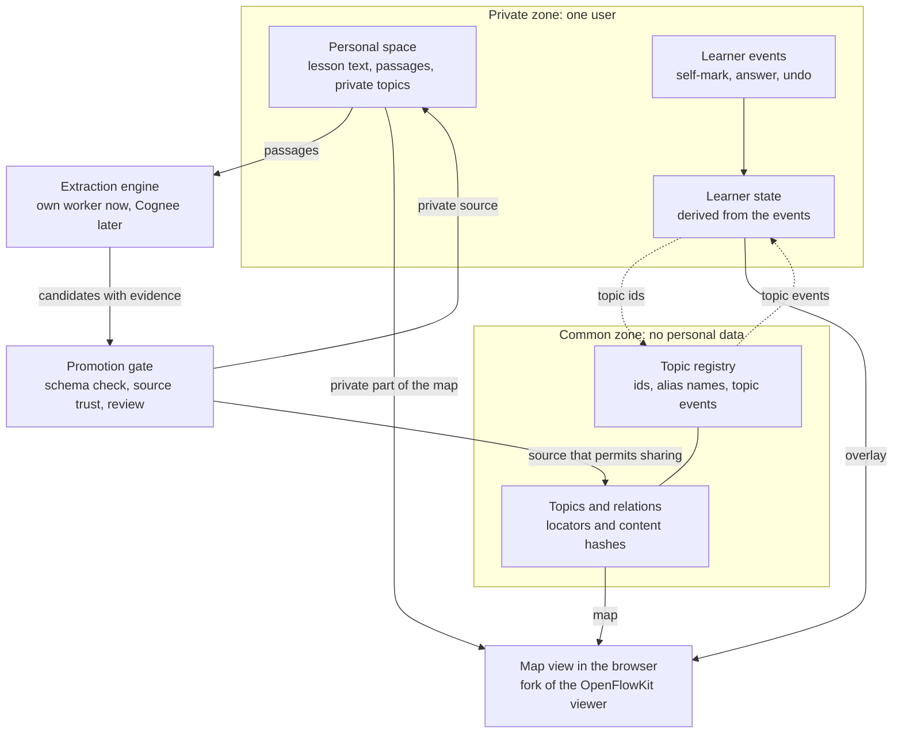
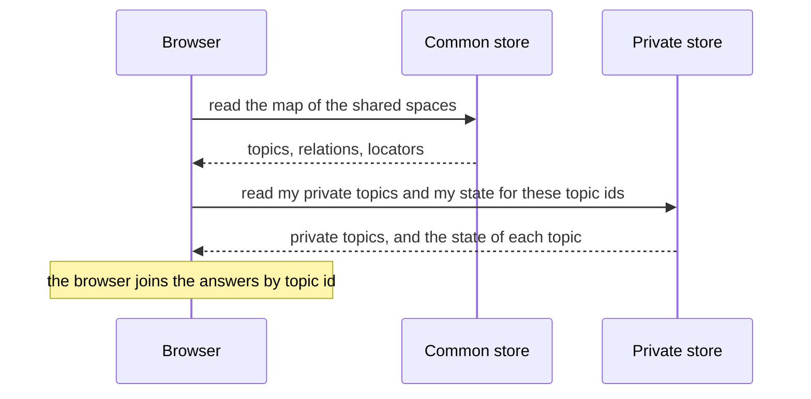
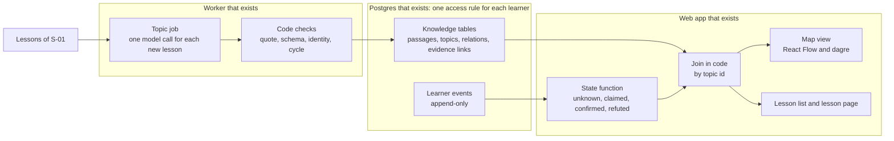

# Research: How to build and show the topic graph of a loaded course (S-02, FR-003)

**Date**: 2026-11-25T17:01:31+01:00
**Researcher**: Claude Code
**Git Commit**: 83056f07e73b4c34eab2e978f809ff9305c226b9
**Branch**: course-topic-graph
**Repository**: plancys/rubber-duck-on-steroids

## Research Question

Roadmap item S-02 says: "Learner can see a loaded course as a graph of its topics and how they relate" (`context/foundation/roadmap.md:113`, PRD FR-003 at `context/foundation/prd.md:113`).

The command gave no other question. So this research answers four questions for the plan of S-02:

1. What does S-02 build on in the code that S-01 and F-01 left?
2. Which earlier decisions and open questions bind S-02?
3. Which options exist to extract topics and their relations with a language model, and what do they cost?
4. Which options exist to show the graph in the web app?

## Summary

- **The input is ready.** Each lesson is one row in `lessons` with its text in `markdown` (`supabase/migrations/20261124200800_create_courses.sql:34-53`). S-01 stored Markdown for this purpose (`context/archive/2026-11-24-load-course-from-url/plan.md:5`).
- **S-02 needs its own job type.** The site of the PRD example course answers 403 to automated clients, so that course loads through the browser extension (`context/archive/2026-11-24-load-course-from-url/plan.md:15`, `plan-brief.md:21-22`). An extension course has no `load_course` job (`src/pages/dashboard/courses/[id].astro:53`, `supabase/migrations/20261125120000_harden_course_load.sql:40-48`). So the topic work cannot be a step of the load job alone.
- **A new job type touches four places:** the type check, an optional payload trigger, one handler, and one insert path in the web app (`worker/handlers/index.ts:1`, `supabase/migrations/20261124200800_create_courses.sql:115-116`).
- **A job cannot start a second job for the same learner while it runs.** One unique index allows one job in progress for each learner, for all job types (`supabase/migrations/20261124123303_create_jobs.sql:30-33`).
- **No real model call ran in this repository yet.** In the local database, the 14 `load_course` jobs with status `done` record `finder: rule`, and 0 record `model`. Plan rows 5.5 and 5.6 of S-01 are open.
- **The service and the cheap model are chosen.** S-01 uses Anthropic with `claude-haiku-5-5` and a monthly spend limit of about 5 USD (`worker/llm.ts:7`, `README.md:607-609`). Roadmap Question 18 still says that S-02 must settle it.
- **Cost does not decide the design.** For an assumed course of 150 lessons and 1.5 million characters, each design in the cost table of section 7 costs between 0.10 USD and 1.60 USD for one run. Quality, output size and run time decide the design.
- **No document defines a topic.** The PRD, the shape notes and the roadmap do not say how fine a topic is, which relation types exist, or how a topic links to a lesson or a passage. The shape notes give one example in the user's words: one long paragraph about "Repetable read" (`context/foundation/shape-notes.md:101`). The plan must decide the definition.
- **Two graph view candidates fit (F.8 adds a third):** React Flow (`@xyflow/react`) and Cytoscape.js. For both, the worker can calculate the layout, and the server can render an outline list as the accessible form.
- **The project has no graph or chart library today** (root `package.json`, inspected dependency list).

**Added by the follow-up of 2026-11-25 (see "Follow-up Research" at the end):**

- **No open-source project covers the core.** Of 23 evaluated projects, no project scores 2 or more on both the topic graph and the learner model (F.3).
- **The recommendation is our own core in Postgres, with ideas from the best projects, and one boundary for the extraction engine** (F.7). Cognee is the candidate engine for the company future.
- **The most common defect is a name as the identity of a topic** (F.5). The code must give a topic its identity.
- **The graph view gets a third candidate and a new target:** the nested map of OpenFlowKit (F.8).
- **A language is no longer a reason to reject a project.** F.9 lists each conclusion of the first research that changes.

**Added by the second follow-up of 2026-11-25 (see "Follow-up Research (2)" at the end):**

- **A hybrid of projects is possible, at four depths.** 4 projects enter as code, Cognee is a possible service, and 17 projects give patterns (H.3).
- **The data has three kinds, not two:** the canon, the content and the learner state. The lesson text does not move to a shared store by default (H.2).
- **The target is two zones with five contracts:** topic identity, extraction boundary, learner evidence, overlay, and promotion gate (H.5).
- **Tutor MCP cannot be the private store as it is, and Cognee is the one realistic service for the common store** (H.4).
- **The recommended composition is our own two stores with code from four projects, and Cognee as a planned extension for shared sources** (H.7).
- **S-02 keeps the split open with five small choices** (H.10).

**Added by the third follow-up of 2026-11-25 (see "Follow-up Research (3)" at the end):**

- **The MVP needs no code from the 23 projects.** Six projects give the patterns, and three mature libraries do the library work (R.4).
- **A fork of the OpenFlowKit viewer is not small.** Its import closure has 154 files with 18,616 lines, and its map model describes code repositories (R.5).
- **The reduced design, composition C0, is the stack that exists plus one job type, a few tables and one view** (R.6). Six rules keep the two-store future open.
- **C0 fits 10 working days for S-02 to S-08.** For all nine slices, a worker estimates 47 to 150 hours, with 78 hours as the likely value (R.8).
- **The parts that leave the MVP come back in three phases:** a deeper learner model, the shared store, and the company scale (R.9).

## Detailed Findings

### 1. The data that S-01 left

- `lessons` columns: `id`, `course_id`, `user_id`, `position`, `title`, `url`, `markdown`, `status`, `error`, `created_at` (`create_courses.sql:34-53`). The table has no `updated_at` column.
- `markdown` holds at most 1,048,576 bytes for each lesson (`create_courses.sql:44`). A lesson with status `failed` has no Markdown (`create_courses.sql:43`).
- `status` is `loaded` or `failed` (`create_courses.sql:45`). A course is `loading`, `ready` or `failed` (`create_courses.sql:21-22`).
- A learner can select their own lessons and cannot write them (`create_courses.sql:93-97,111-112`).
- **Lesson ids change on a reload of a crawl course.** `finish_course_load` deletes the old lessons and inserts new rows. It keeps a row only when its URL failed in the new crawl and loaded before (`supabase/migrations/20261125120000_harden_course_load.sql:71-135`).
- **Lesson ids stay for an extension course.** `extension_save_page` updates the row of the same URL in place, or inserts a new row at the next position (`harden_course_load.sql:210-275`).
- `(course_id, url)` is unique (`create_courses.sql:52`). So the URL is the stable key of a lesson inside a course, for both course kinds.
- A reload can leave a lesson `loaded` with old text. The S-01 review named this for S-02 (`context/archive/2026-11-24-load-course-from-url/reviews/impl-review.md:70`).
- Limits: a crawl gives at most 200 lessons (`worker/llm.ts:11`), and an extension course holds at most 500 lessons (`harden_course_load.sql:251-257`).

**Measured size (local development database, read-only, 2026-11-25):**

| Course                                                                      | Kind      | Lessons loaded | Characters | Largest lesson | Average |
| --------------------------------------------------------------------------- | --------- | -------------- | ---------- | -------------- | ------- |
| Get started with ClickHouse (`clickhouse.com/docs/get-started`)             | crawl     | 16             | 65,103     | 12,176         | 4,069   |
| Real-time Analytics with ClickHouse (the PRD example course, partly loaded) | extension | 4              | 20,618     | 8,120          | 5,155   |

These are the two real courses in the local database. The other rows are test fixtures with fewer than 1,000 characters. The full size of the example course is not known, because 4 of its lessons are loaded.

### 2. The job system and a new job type

- The `jobs.type` column has a check constraint. It allows `demo` and `load_course` today (`create_courses.sql:115-116`). A new type needs a migration that replaces this check.
- The handler map has one entry for each type. The file comment says what a new type adds (`worker/handlers/index.ts:1,14-18`).
- A handler gets `jobId`, `payload`, `attempt`, `step()` and `signal`, and returns JSON (`worker/run.ts:31-46`). It must stop when `signal` aborts.
- `step(index, count, label)` writes the progress and extends the lease (`worker/run.ts:38-39`). The course page shows it as "Step i of n: label" through `JobStatus`.
- A `SafeError` message goes to the learner. `retry: false` makes the failure final (`worker/run.ts:18-29`).
- A job gets at most 3 starts. A job that starts again runs from its first step, because F-01 has no checkpoints (`context/changes/background-work-path/plan.md:57`).
- F-01 named the gap: "a job that is longer than an instance life needs checkpoints. That is work for S-01 and S-02" (`context/changes/background-work-path/plan-brief.md:78`). Cloud Run can stop an instance at most 15 minutes after the last request (`background-work-path/plan.md:49`).
- "Every later job type must be safe to run two times, because a job can start again" (`background-work-path/plan-brief.md:79`).
- The payload holds at most 4,096 bytes (`supabase/migrations/20261124170000_limit_job_payload.sql:5-6`). So a job carries a `courseId`, not lesson text.

**Rules that a new type does not get by default:**

- The payload trigger `jobs_check_load_course_payload` runs for `load_course` rows (`create_courses.sql:153-157`). It checks the course owner and the kind `crawl` (`harden_course_load.sql:40-48`). A new type has no owner check until a new trigger adds one.
- The quota of 10 jobs in one hour counts rows with `type = 'load_course'` (`harden_course_load.sql:50-58`). A new type has no quota. A topic job that calls the model spends tokens, so the missing quota matters more than for a crawl.
- The learner can insert a job row through the REST API with the columns `type` and `payload` (`create_jobs.sql:77-79`). So the database must hold the rules, as it does for `load_course`.

**How one job relates to the next job:**

- The index `jobs_one_in_progress_per_user_idx` allows one row with status `waiting` or `running` for each learner (`create_jobs.sql:30-33`). It covers all job types.
- The runner calls `complete_job` after the handler returns (`worker/run.ts:241-243`). So an insert of a second job for the same learner from inside a running handler fails with error 23505. This is an inference from the index and the call order. No code tries it today.
- The `Queue` interface of the worker has no call that inserts a job (`worker/queue.ts:30-47`).
- The `service_role` has the insert privilege on `jobs` and bypasses row-level security in the local database (query `has_table_privilege`, 2026-11-25).
- Precedent for an insert in SQL: `reload_course` sets the course to `loading` and inserts the job in one transaction (`harden_course_load.sql:296-323`).
- The worker runs one job at a time for all learners, because Cloud Run runs at most one instance (`.github/workflows/ci.yml:374`). A long topic job delays the jobs of other learners (`load-course-from-url/plan-brief.md:78`).

### 3. The model call that exists

- Package: `@anthropic-ai/sdk` at the pinned version `1.13.0` (`worker/package.json:10`). The npm registry showed `1.14.0` on 2026-11-25.
- Model: `claude-haiku-5-5` (`worker/llm.ts:7`).
- Client: timeout of 60 seconds, 0 retries, and an injectable `fetch` for the tests (`worker/llm.ts:8,105`).
- Structured answer: one forced tool call with a JSON schema (`worker/llm.ts:46-61,115`).
- The system prompt tells the model to treat page text as data, not as instructions (`worker/llm.ts:43`).
- The result carries `inputTokens` and `outputTokens` (`worker/llm.ts:123-124`). The handler logs the token counts and does not log the prompt (`worker/llm.ts:3`).
- Without a key, the picker is `null`, and the finder uses its rule (`worker/llm.ts:102-103`). CI runs without a key (`load-course-from-url/plan-brief.md:26`).
- The tests give the SDK a fake `fetch`, so they call no real API (`worker/llm.ts:97-98`, `worker/llm.test.ts`).
- The key goes to the worker and to no other process (`AGENTS.md:93`).

**What does not carry over to S-02:**

- The lesson finder has a rule that replaces the model. Topic extraction has no rule of that kind in the code or in the documents. So the plan must say what the learner sees when the model call fails or when CI runs without a key.
- A forced tool call works on `claude-haiku-5-5`. It returns HTTP 400 on `claude-sonnet-5-5` and `claude-opus-5-5` (Claude API reference, `shared/tool-use-concepts.md:106`). A pass on one of those two models must use `output_config.format` or a strict tool with `tool_choice: auto`.

### 4. The web app side

- The course page reads the newest job with `type = 'load_course'` for the course (`src/pages/dashboard/courses/[id].astro:53-61`). A job of a new type does not show there until the query changes.
- `JobStatus` shows the progress of a job and reloads the page when the job ends (`src/components/jobs/JobStatus.tsx:39-44`, `[id].astro:130`). A job that waits or runs with no change for more than 30 seconds counts as stale, and the status route then sends the wake request again (`src/lib/jobs.ts:93-102`).
- A route starts a job with an insert as the learner, then calls `wakeWorker()` (`src/lib/courses.ts:215-225`, `src/pages/api/courses/index.ts:82-84`).
- The web app has 10 ms of CPU for each request on the Workers Free plan. A request above the cap fails with Error 1102 (`context/foundation/infrastructure.md:70`).
- The web app must not import from `worker/` (`AGENTS.md:51`).
- The lesson query of the course page has a limit of 500 rows and does not read `markdown` (`[id].astro:46-52`). A graph page needs the same care: it reads topics and edges, not lesson text.
- React islands exist and use `client:load` (`[id].astro:130,156`). The root `package.json` lists no graph, chart or layout library.

### 5. Earlier decisions and open questions

| Subject                         | State                                                                                                                                                                                                                                     | Source                                                                |
| ------------------------------- | ----------------------------------------------------------------------------------------------------------------------------------------------------------------------------------------------------------------------------------------- | --------------------------------------------------------------------- |
| Model service (Question 18)     | Partly answered. S-01 chose Anthropic, `claude-haiku-5-5`, and a spend limit "for example 5 USD". The roadmap text still says "The plan of S-02 must settle it".                                                                          | `load-course-from-url/plan-brief.md:26`, `roadmap.md:266`             |
| Model budget for S-02           | Not defined. S-01 allowed 1 model call for each course.                                                                                                                                                                                   | `load-course-from-url/plan-brief.md:28`                               |
| Open-source reuse (Question 19) | The user prefers "well-know open-sources projects". No project is selected for S-02. S-01 used Crawlee, Readability and Turndown.                                                                                                         | `shape-notes.md:270`, `roadmap.md:267`, `plan-brief.md:25-27`         |
| What a topic is                 | No definition in `prd.md`, `shape-notes.md`, `roadmap.md` or the plans of S-01 and F-01. One example exists: the user names a long paragraph about "Repetable read" as a passage on a known topic, next to "ACID" and "isolation levels". | `shape-notes.md:101`                                                  |
| Relation types                  | Implied only. The PRD speaks of "concepts and their dependencies" and of a missing prerequisite. FR-003 says "how they relate".                                                                                                           | `prd.md:17,19,113`                                                    |
| Passage level                   | The user said that whole articles are "not enough granular". The recorded decision: "lesson-level only is not granular enough". Later slices split Markdown by heading.                                                                   | `shape-notes.md:29,101`, `plan-brief.md:27`                           |
| Risk of a wrong graph           | "the graph can be wrong, and assessment and the path inherit every error". The counter-argument was not accepted.                                                                                                                         | `prd.md:114-117`, `roadmap.md:122`                                    |
| Size of a graph                 | "a graph may be the wrong picture for hundreds of topics; an outline could be more legible". Not accepted.                                                                                                                                | `prd.md:116`                                                          |
| One part at a time              | This belongs to FR-007 and S-07, not to S-02. No document defines a "part".                                                                                                                                                               | `prd.md:133-136`                                                      |
| Guardrail                       | Hidden content stays one step away, and a wrong mark is cheap to undo.                                                                                                                                                                    | `prd.md:63`                                                           |
| Example course                  | "Real-time analytics with ClickHouse". Its site answers 403 to automated clients, so it loads through the extension.                                                                                                                      | `prd.md:26`, `load-course-from-url/plan.md:15`, `plan-brief.md:21-22` |
| Glossary                        | `context/domain/` does not exist. No "don't call it" names apply yet.                                                                                                                                                                     | directory listing, 2026-11-25                                         |
| Team lessons                    | `context/foundation/lessons.md` does not exist.                                                                                                                                                                                           | directory listing, 2026-11-25                                         |

Blocking questions of other slices do not block S-02. Question 1 (the business rule) blocks S-04, S-05 and S-06. Question 14 blocks S-10 (`roadmap.md:237-239,243`). The roadmap lists no blocker for S-02 (`roadmap.md:118`).

**What later slices need from the output of S-02 (from the roadmap):**

- S-03: a list of topics that a learner can mark quickly (`roadmap.md:127,135`).
- S-04: an order of lessons that can change, so a relation that gives an order.
- S-05: the passages of a lesson that teach a topic (`roadmap.md:154`).
- S-08: a topic that the learner can open (`roadmap.md:193`).
- S-10: a match of the same topic across two materials (`roadmap.md:226`).

### 6. Anthropic API facts for this job

Checked on 2026-11-25 against the official pages and against the Claude API reference bundled with Claude Code (cached 2026-11-03).

| Model               | Input, USD for 1M tokens | Output, USD for 1M tokens | Condition                                                                         |
| ------------------- | ------------------------ | ------------------------- | --------------------------------------------------------------------------------- |
| `claude-haiku-5-5`  | 0.10                     | 0.50                      | The prompt has 100,000 tokens or fewer.                                           |
| `claude-haiku-5-5`  | 0.50                     | 2.50                      | The prompt has more than 100,000 tokens. The prompt length selects the rate card. |
| `claude-sonnet-5-5` | 2.00                     | 10.00                     | Each prompt length.                                                               |
| `claude-opus-5-5`   | 4.00                     | 20.00                     | Each prompt length.                                                               |

- The three models have a context window of 1M tokens and a maximum output of 128,000 tokens.
- **Tokens for the same text:** on `claude-haiku-5-5`, the same text counts as about 30% more tokens than on Haiku 4.5. The pipeline worker read a ratio of about 2.5 characters for each token in the docs. So 1.5 million characters are about 600,000 tokens, not 375,000. The token counting endpoint is free and gives the real number.
- **Structured outputs** exist on these three models: `output_config.format` with a JSON schema, or `strict: true` on a tool. A strict schema does not support recursive schemas or the constraints `minimum`, `maximum` and `multipleOf`. Each object needs `additionalProperties: false`.
- **Thinking:** `claude-haiku-5-5` thinks by default at effort `medium`, and thinking tokens count as output. A forced tool call on Haiku 5.5 skips thinking. `thinking: {type: "disabled"}` works on Haiku 5.5 at effort `high` or lower. It returns HTTP 400 on `claude-sonnet-5-5`.
- **Sampling:** a value of `temperature`, `top_p` or `top_k` that is not the default returns HTTP 400 on these models. So two runs on the same course can give different topics.
- **Prompt caching:** a cache read costs 0.1 times the input price. A 5-minute cache write costs 1.25 times, and a 1-hour write costs 2 times. The minimum prefix is 512 tokens on the 5.5 models.
- **Message Batches:** 50% of the standard price, at most 100,000 requests or 256 MB for each batch. Most batches end within 1 hour, and the limit is 24 hours.
- **Refusals:** a request can end with `stop_reason: "refusal"` and HTTP 200. Haiku 5.5 has no server-side fallback for a refusal. The code must read `stop_reason` before it reads the content.
- **Embeddings:** Anthropic has no embedding model. Its docs name Voyage AI.

Sources: [pricing](https://platform.claude.com/docs/en/about-claude/pricing), [models](https://platform.claude.com/docs/en/about-claude/models/overview), [structured outputs](https://platform.claude.com/docs/en/build-with-claude/structured-outputs), [prompt caching](https://platform.claude.com/docs/en/build-with-claude/prompt-caching), [batch processing](https://platform.claude.com/docs/en/build-with-claude/batch-processing), [token counting](https://platform.claude.com/docs/en/build-with-claude/token-counting), [embeddings](https://platform.claude.com/docs/en/build-with-claude/embeddings).

### 7. Extraction pipeline options and cost

**Patterns in the literature:**

- **Extract for each lesson, then merge.** GraphRAG extracts entities for each chunk and then merges them ([arXiv 2404.16130](https://arxiv.org/abs/2404.16130)). The weak point is the merge: one concept gets several names. Graphusion adds a global step that merges entities and resolves conflicts ([arXiv 2407.10794](https://arxiv.org/abs/2407.10794)).
- **One pass over the whole course, or over its outline.** The model sees the full structure one time, so the names stay consistent. The risk is a topic that is in the body text and not in a heading.
- **Two passes:** first a list of topics, then an assignment of sections to topics. This gives stable topic ids and a link from a topic to a section. This is a design inference. The pipeline worker found no paper that names it.
- **Prerequisite relations:** a zero-shot model recovers concept graphs about as well as supervised methods ([arXiv 2402.14293](https://arxiv.org/abs/2402.14293)). InstructKG uses the teaching order of the course as a signal ([arXiv 2602.17111](https://arxiv.org/abs/2602.17111)).
- **Cycles:** find the strongly connected components, then remove the edge that conflicts with the lesson order.
- **Quality checks without a labelled set:** sections with no topic, topics with no section, the graph has no cycle, the share of edges against the lesson order, and the overlap of the topic sets of two runs.

**Cost estimate.** The assumption is a course of 150 lessons and 1.5 million characters. Case A uses 375,000 tokens (4 characters for each token). Case B uses 600,000 tokens (2.5 characters for each token). The prices are the checked prices of section 6. The token counts for prompts and answers are estimates of the pipeline worker. Thinking is off or skipped in these numbers.

| Design                                                     | Case A, USD  | Case B, USD  |
| ---------------------------------------------------------- | ------------ | ------------ |
| For each lesson then merge, Haiku 5.5 for both steps       | 0.14         | 0.17         |
| For each lesson on Haiku 5.5, merge on Sonnet 5.5          | 0.60         | 0.62         |
| Outline first, two passes, Haiku 5.5 for both              | 0.10         | 0.12         |
| Outline first, pass 1 on Sonnet 5.5, pass 2 on Haiku 5.5   | 0.28         | 0.30         |
| The same with Batch and caching                            | 0.12 to 0.14 | 0.14 to 0.15 |
| Whole course in one Haiku 5.5 call (long-prompt rate card) | 0.29         | 0.40         |
| Whole course in one Sonnet 5.5 call                        | 1.15         | 1.60         |

Arithmetic for the row "Outline first, Haiku 5.5 for both", case A:

- Pass 1: 20,000 input tokens and 15,000 output tokens. 20,000 × 0.10 / 1M + 15,000 × 0.50 / 1M = 0.0095 USD.
- Pass 2: 30 requests, each with a topic list of 11,500 tokens and 5 lessons of 12,500 tokens. Input 720,000 × 0.10 / 1M = 0.072 USD. Output 35,000 × 0.50 / 1M = 0.0175 USD.
- Total: 0.099 USD.

**Readings of these numbers:**

- With a spend limit of 5 USD in one month, each row of the table allows more than 3 runs in one month. The cheapest row allows about 50 runs.
- For the largest real course in the local database (65,103 characters), the whole course is about 26,000 tokens at 2.5 characters for each token. That fits one Haiku 5.5 request on the low rate card. The input then costs about 0.003 USD.
- A pass with thinking on costs more. The pipeline worker estimates 2 to 4 times more output tokens with thinking at effort `medium`. This number is an estimate and was not measured.
- The Batch API saves cents at this size. A batch can take up to 1 hour or more, and the worker runs one job at a time with a 60-second lease and no checkpoints (section 2). So the Batch API does not fit the present job runner without a new waiting state. This is an inference from sections 2 and 6.
- A request over 100,000 tokens on Haiku 5.5 pays 5 times the price for that request. A pipeline can count the tokens first and keep each request under that step.

### 8. Open-source building blocks

| Project                                                 | Language, license        | Fit for the Node worker                                                                                     |
| ------------------------------------------------------- | ------------------------ | ----------------------------------------------------------------------------------------------------------- |
| `unified` / `remark` / `mdast-util-from-markdown`       | JavaScript, MIT          | Fits. It parses Markdown into a tree with headings and positions, which gives sections with a heading path. |
| `graphology`, `graphology-dag`, `graphology-components` | JavaScript, MIT          | Fits. It gives `hasCycle`, `topologicalSort` and strongly connected components.                             |
| `@dagrejs/graphlib`                                     | JavaScript, MIT          | An alternative to graphology.                                                                               |
| `@huggingface/transformers` (transformers.js)           | JavaScript, Apache-2.0   | Optional. Local embeddings in Node, for a merge of topics and for S-10.                                     |
| `pgvector`                                              | C extension for Postgres | Optional. It stores embeddings in Supabase.                                                                 |
| Microsoft GraphRAG                                      | Python, MIT              | Does not fit. It is Python and made for retrieval. Its prompts are a reference.                             |
| LightRAG, nano-graphrag                                 | Python, MIT              | Do not fit. They need an embedding store and give no link to sections.                                      |
| KeyBERT / KeyLLM                                        | Python, MIT              | Does not fit. It gives keywords without relations.                                                          |
| LangChain `LLMGraphTransformer`                         | Python                   | Does not fit. It gives generic triplets and depends on Neo4j.                                               |

No inspected project does the full job in Node. The reuse is at the level of parts: the Markdown parser, the graph algorithms, the layout engine and the graph view.

**Changed by the follow-up of 2026-11-25:** this table judged each project by its fit for the Node worker, and the GraphRAG row names Python as a reason. The runtime is withdrawn as a reason. F.3 and F.4 hold the new verdicts for GraphRAG and LightRAG. F.9 lists each change.

### 9. Graph view options

The graph view worker read the npm registry and the GitHub API on 2026-11-25. It measured the bundle sizes with esbuild (minified, gzip). The sizes are estimates. It did not test rendering speed on a phone.

| Option                       | Version, license          | Size (min + gzip) | Touch           | Keyboard and screen reader | Layout                                          | Groups                      |
| ---------------------------- | ------------------------- | ----------------- | --------------- | -------------------------- | ----------------------------------------------- | --------------------------- |
| `@xyflow/react` (React Flow) | 13.0.3, MIT               | about 84 KB       | pan, pinch, tap | built in                   | none built in. It pairs with dagre or elkjs.    | group nodes with `parentId` |
| `cytoscape`                  | 3.35.0, MIT               | about 140 KB      | pan, pinch, tap | none                       | built in, plus dagre and ELK extensions         | compound nodes              |
| `sigma` + `graphology`       | 4.0.6, MIT                | about 113 KB      | multi-touch     | none found                 | force layout; no layered layout                 | none                        |
| `d3-force`, `d3-dag`         | 3.0.1 and 2.0.0           | 6 KB and 30 KB    | you build it    | you build it               | force, layered                                  | none                        |
| `vis-network`                | 10.1.5, Apache-2.0 or MIT | about 157 KB      | yes             | pan and zoom keys          | layered built in                                | clustering                  |
| `react-force-graph-2d`       | 1.29.2, MIT               | about 70 KB       | yes             | none                       | force, with a DAG mode                          | none                        |
| Outline list from the server | no library                | 0 KB              | native scroll   | the best of the options    | shows "part of"; shows a prerequisite as a link | sections                    |

**Layout engines that run in Node** (measured by the worker on one machine, single runs, a random graph):

| Engine                 | License                     | Size         | 50 nodes | 200 nodes | 500 nodes |
| ---------------------- | --------------------------- | ------------ | -------- | --------- | --------- |
| `@dagrejs/dagre` 3.1.4 | MIT                         | about 17 KB  | 27 ms    | 110 ms    | 456 ms    |
| `elkjs` 0.12.2         | EPL-2.0 or GPL-3.0-or-later | about 440 KB | 131 ms   | 236 ms    | 471 ms    |

**Readings:**

- Each measured layout time is above the 10 ms CPU cap of the web app. So the layout runs in the browser or in the worker, not in a page request.
- The worker can calculate the positions one time at the end of the topic job and store them. The page then sends topics, edges and positions as JSON.
- React Flow released version 13.0.0 on 2026-11-16, 9 days before this research ([release post](https://xyflow.com/blog/react-flow-13-major-release)). A pinned version, or 12.12.1, lowers the risk of early defects.
- React Flow has keyboard and ARIA support built in ([accessibility docs](https://reactflow.dev/learn/advanced-use/accessibility)). Cytoscape.js leaves this to the app ([issue 3091](https://github.com/cytoscape/cytoscape.js/issues/3091)).
- React Flow draws each node as a DOM element. The worker estimates that 500 nodes can be slow on a phone. This was not measured.
- `elkjs` has the license EPL-2.0 or GPL-3.0-or-later. The other listed libraries have MIT, ISC or Apache-2.0. The owner must accept the EPL license before the worker uses `elkjs`.
- An Astro island with `client:only="react"` does not render on the server ([Astro directives](https://docs.astro.build/en/reference/directives-reference/#clientonly)). So the graph adds no CPU to the page request.
- The PRD recorded and rejected the argument that an outline reads better than a graph (`prd.md:116`). An outline next to the graph does not replace the graph. It serves a phone and a screen reader.

## Code References

- `supabase/migrations/20261124200800_create_courses.sql:34-53` - the `lessons` table, the 1 MB Markdown check and the unique `(course_id, url)`.
- `supabase/migrations/20261124200800_create_courses.sql:115-116` - the job type check that a new type must replace.
- `supabase/migrations/20261124200800_create_courses.sql:153-157` - the payload trigger, for `load_course` rows.
- `supabase/migrations/20261124123303_create_jobs.sql:30-33` - one job in progress for each learner.
- `supabase/migrations/20261124123303_create_jobs.sql:77-79` - the learner can insert `type` and `payload`.
- `supabase/migrations/20261124170000_limit_job_payload.sql:5-6` - the payload limit of 4,096 bytes.
- `supabase/migrations/20261125120000_harden_course_load.sql:22-62` - the owner check and the quota of 10 loads in one hour.
- `supabase/migrations/20261125120000_harden_course_load.sql:71-135` - `finish_course_load` replaces lesson rows on a reload.
- `supabase/migrations/20261125120000_harden_course_load.sql:210-275` - `extension_save_page` updates a lesson in place.
- `supabase/migrations/20261125120000_harden_course_load.sql:296-323` - `reload_course` inserts a job inside a SQL function.
- `worker/handlers/index.ts:1-18` - the handler map and the rule for a new job type.
- `worker/run.ts:18-46` - `SafeError` and the handler contract.
- `worker/llm.ts:1-128` - the model call: model id, timeout, forced tool call, token counts, fake `fetch` for tests.
- `worker/package.json:10` - `@anthropic-ai/sdk` at `1.13.0`.
- `src/pages/dashboard/courses/[id].astro:53-61` - the course page reads the newest `load_course` job.
- `src/lib/courses.ts:215-225` - `insertLoadJob`, the insert path of a job from the web app.
- `.github/workflows/ci.yml:374` - Cloud Run flags: at most 1 instance, 1 CPU, 512 Mi.
- `.github/workflows/ci.yml:379-382` - the worker secrets from Secret Manager, with `ANTHROPIC_API_KEY`.

## Architecture Insights

- **The database holds the rules.** A learner can insert a job row directly. So the rules of `load_course` (the owner, the course kind, the quota and the payload size) live in a trigger or a constraint, not in a route alone (`harden_course_load.sql:22-62`, `limit_job_payload.sql:5-6`).
- **Long work runs in the worker, and the page reads a result.** The web app reads rows and shows progress. It does not parse, call a model or calculate a layout.
- **A job is a pure function of database state.** The payload is a small pointer (`courseId`). The handler reads its input from tables and writes its result through one SQL function in one transaction (`finish_course_load` is the model).
- **A job must be safe to run two times.** With no checkpoints, a restart repeats the model calls. So the cost of one job can be up to 3 times the cost of one run.
- **The model call sits behind a small interface with an injectable `fetch`.** The unit tests and CI run with no key. S-02 can keep this shape, but it has no rule to replace the model.
- **The URL is the stable identity of a lesson.** A link from a topic to a lesson by `lesson_id` breaks on a reload of a crawl course, unless a foreign key with cascade removes it and the topic job runs again.
- **The lesson text can change after the graph exists.** The `lessons` table has no `updated_at` and no content hash. Without one of them, the product cannot tell that a graph is older than its lessons.

## Historical Context (from prior changes)

- `context/archive/2026-11-24-load-course-from-url/plan.md:5` - lessons are stored as Markdown "because the topic graph (S-02) and the collapsed passages (S-05) read that text". Supported by the schema.
- `context/archive/2026-11-24-load-course-from-url/plan.md:46,49` - S-01 made no model call other than the lesson finder, and no topic extraction. Supported by `worker/llm.ts`.
- `context/archive/2026-11-24-load-course-from-url/plan-brief.md:26-28` - Haiku 5.5, a rule fallback, 1 model call for each course. Supported by the code. The limit of 1 call is a rule of S-01, not a rule for S-02.
- `context/archive/2026-11-24-load-course-from-url/reviews/impl-review.md:70` - S-02 must accept a lesson that is `loaded` with old text. Still true after the review fix F3.
- `context/changes/background-work-path/plan.md:56-57` - topic extraction adds its own job type, and jobs have no checkpoints. Still true in the code.
- `context/changes/background-work-path/plan-brief.md:78-79` - a job longer than an instance life needs checkpoints, and each job type must be safe to run two times. Open for S-02.
- `context/foundation/roadmap.md:266-267` - Questions 18 and 19 name S-02 as the place to settle them. Question 18 is partly answered by S-01. The roadmap text is stale on that point.
- `context/foundation/roadmap.md:44,93` - F-01 shows `in-progress`, and its change is not archived. Its production rows 5.6 to 5.10 are open, as are rows 5.5 and 5.6 of S-01. So the first topic job in production also is the first check of the worker in production.

## Related Research

No other `research.md` exists under `context/changes/` or `context/archive/` (directory listing, 2026-11-25).

The folder `research-appendix/` holds the full reports of the five workers of the follow-up:

- `research-appendix/graph-engines-graphiti-mem0.md`
- `research-appendix/graph-engines-from-web.md`
- `research-appendix/tutoring-products.md`
- `research-appendix/learner-models.md`
- `research-appendix/memory-systems.md`

The reports of the three workers of the second follow-up:

- `research-appendix/private-store-tutor-mcp.md`
- `research-appendix/common-store-cognee-graphiti.md`
- `research-appendix/platform-and-security.md`

The data of the third follow-up:

- `research-appendix/project-maturity.md`: the maturity signals, the code sizes, and the speed of this repository
- `research-appendix/mvp-effort-estimate.md`: the report of the worker that estimated the slices

## Open Questions

These are product and design choices for `/10x-plan`. The evidence does not settle them.

1. **What is a topic, and how fine is it?** A topic for each lesson, for each section, or a concept that crosses lessons. This choice sets the size of the graph and the cost of the marking in S-03.
2. **Which relation types does the graph hold?** Candidates from the PRD text: "prerequisite of" and "part of". S-04 needs an order.
3. **Does S-02 store the link from a topic to a passage, or only to a lesson?** S-05 needs passages. A link to a section needs a stable section id, for example the lesson URL plus the heading path.
4. **When does the topic job start?** The learner starts it with a button, or the product starts it when a course becomes ready. An extension course has no load job and no clear end of the load.
5. **What happens to the graph on a reload or on a new lesson from the extension?** Build it again, mark it as old, or keep it. This also decides what happens to the marks of S-03.
6. **Which model does each pass use, and is thinking on?** Haiku 5.5 for both passes is the cheapest row of the cost table. A pass on Sonnet 5.5 costs more and cannot use a forced tool call.
7. **What does the learner see when the model call fails or when no key exists?** CI has no key, so the smoke test needs a path that makes no model call.
8. **Which quota does the new job type get?** `load_course` has 10 jobs in one hour. A topic job costs money for each run.
9. **Does a long topic job need checkpoints?** The answer depends on the run time of the chosen pipeline against the 15-minute idle stop of Cloud Run.
10. **Which graph library, and does the worker store the layout?** React Flow or Cytoscape.js. `elkjs` needs the owner to accept the EPL-2.0 license.
11. **How does the plan measure graph quality?** The PRD has no target. The structural checks of section 7 need no labelled data.
12. **How large is the full example course?** 4 of its lessons are loaded locally. The size decides whether one request under 100,000 tokens is enough.

Added by the follow-up of 2026-11-25:

13. **Which way to build the core?** F.7 recommends option A, our own core with one boundary for the extraction engine. Options B and C use Graphiti or Cognee as a service.
14. **Does a topic belong to an owner or to a course?** F.7 recommends the owner. This choice decides how S-10 and the company future extend the model.
15. **Is the first view a nested map or a flat graph?** F.8 recommends the nested map. The plan must also decide between React Flow with group nodes and a fork of the OpenFlowKit viewer.
16. **When does the product need an embedding provider?** The identity check inside one course can start with no embeddings. Identity across materials (S-10) can need them.

Added by the second follow-up of 2026-11-25:

17. **What is the first shared space: a public space for all users, or the space of one company?** The answer decides who can read the common store.
18. **Can the text of a loaded lesson enter a shared space?** Rule 3 of H.5 says no by default. A source that permits sharing can be an exception.
19. **Which level of separation is the target, and when?** H.6 gives three levels. H.7 recommends L1 first.
20. **What happens to the evidence of a learner when a common topic changes, merges or splits?** Tutor MCP marks it as invalid. Another policy can keep it as a weaker start value.
21. **Who approves a change of the common store?** No evaluated engine has an approval step before a write.

Added by the third follow-up of 2026-11-25:

22. **Does the owner accept composition C0 for the MVP?** It uses no code from the 23 projects, and it moves the two stores to phase C (R.6, R.9). Questions 17 to 21 then wait for phase C.
23. **Are four learner states enough for M-01?** The states are unknown, claimed, confirmed and refuted. A probability and a decay come in phase B.
24. **Is a part of the map a lesson?** This default gives a view with two levels and no fork, and it answers question 15 (R.6).
25. **Which slices move out when 10 working days are not enough?** R.8 gives an order.
26. **Is "2 weeks" 10 working days of full-time work?** The PRD records after-hours work (`context/foundation/prd.md:10`).

## Follow-up Research 2026-11-25: open-source projects for the core

### F.1 Request and method

The user asked for an evaluation of the projects in the folder `memory-knowledge-related-project`, which is beside this repository. The user set three rules:

- The owner can fork a project and adapt it. A project is not a closed box.
- A language or a runtime is not a reason to reject a project.
- The topic graph is the core feature of the product. Its design quality has priority.

The user also named one possible future: the same core for company or project knowledge, with an assessment of an employee and a personal onboarding path. The MVP scope must not grow much for that future.

How the evaluation ran:

- The folder holds 17 repositories and 2 notes files. Five read-only workers read 14 repositories in code. The researcher read OpenFlowKit, Mermaid and Rulesync.
- One worker evaluated 6 more projects from shallow clones of 2026-11-25: Cognee, Microsoft GraphRAG, LightRAG, neo4j-graphrag-python, LlamaIndex PropertyGraphIndex and iText2KG.
- No project was installed or run. Each score is the judgment of the reader of that code, on a scale from 0 to 3. Each effort number is an estimate for one developer.
- The researcher read the cited lines again for the claims that decide the recommendation. Paths in this section are relative to each project folder.
- The notes file `llm-communication-profile-research.md:4` shows the origin of the folder. The user collected the projects for a different idea, a personal communication layer for agents, from READMEs only.
- The full worker reports are in `research-appendix/`.

### F.2 The needs behind the scores

| Need | Meaning                                                                                                                                 |
| ---- | --------------------------------------------------------------------------------------------------------------------------------------- |
| N1   | A topic graph of a course. A topic is finer than a lesson. Relations have types. Each topic links to the passages that teach it.        |
| N2   | A rebuild after a text change, with no loss of topic identity.                                                                          |
| N3   | The same topic in a second material maps to the same topic.                                                                             |
| N4   | A knowledge state for each learner and topic: self-mark, check questions, uncertainty, decay, undo, and updates that a person can read. |
| N5   | Use of the state: lesson order, collapsed passages, short summaries.                                                                    |
| N6   | A view of the graph with the knowledge of the learner, one part at a time.                                                              |
| N7   | The possible future: company or project knowledge with onboarding.                                                                      |

### F.3 Fit matrix

| Project                       | What it is                                    | N1  | N2  | N3  | N4  | N5  | N6  | N7  | License    | Recommended use                                               |
| ----------------------------- | --------------------------------------------- | --- | --- | --- | --- | --- | --- | --- | ---------- | ------------------------------------------------------------- |
| Cognee                        | Memory platform with a graph, Python          | 2   | 3   | 2   | 0   | 1   | 1   | 3   | Apache-2.0 | Port the update design. Candidate service for N7.             |
| Graphiti                      | Temporal knowledge graph, Python              | 2   | 2   | 2   | 0   | 1   | 1   | 2   | Apache-2.0 | Port the identity check and the time fields.                  |
| neo4j-graphrag-python         | Graph builder with a schema, Python           | 2   | 1   | 2   | 0   | 0   | 1   | 1   | Apache-2.0 | Port the schema with patterns, and the pruning step.          |
| LlamaIndex PropertyGraphIndex | Graph index with a strict schema, Python      | 2   | 1   | 1   | 0   | 0   | 0   | 1   | MIT        | Port the strict check of each triple.                         |
| LightRAG                      | Graph and vector retrieval, Python            | 1   | 2   | 1   | 0   | 0   | 1   | 2   | MIT        | Port the extraction cache and the heading path in the prompt. |
| Microsoft GraphRAG            | Batch graph indexer, Python                   | 1   | 1   | 1   | 0   | 1   | 1   | 1   | MIT        | Port the second extraction pass and the community reports.    |
| iText2KG                      | Incremental graph builder, Python             | 1   | 1   | 2   | 0   | 0   | 0   | 0   | Apache-2.0 | Port the match of a new topic to the old topics.              |
| Mem0                          | Fact memory for agents, Python and TypeScript | 0   | 1   | 1   | 1   | 1   | 0   | 1   | Apache-2.0 | Port two small ideas.                                         |
| Tutor MCP                     | Learner state server, Go                      | 1   | 2   | 0   | 2   | 1   | 1   | 2   | MIT        | Port the learner model and the identity model.                |
| OpenTutor                     | Tutoring product, Python and Next.js          | 1   | 0   | 1   | 2   | 1   | 1   | 0   | MIT        | Port the mastery formulas.                                    |
| LearningMAP                   | Tutoring demo, Python                         | 0   | 0   | 1   | 2   | 1   | 1   | 0   | Apache-2.0 | Port the state model.                                         |
| knowledge-graph-mcp           | Learner graph server, Python                  | 1   | 0   | 1   | 1   | 1   | 2   | 0   | MIT        | Port the edge fields and the query names.                     |
| pyBKT                         | Knowledge tracing library, Python             | 0   | 0   | 0   | 1   | 0   | 0   | 1   | MIT        | Port the update formula.                                      |
| py-fsrs                       | Review scheduler, Python                      | 0   | 0   | 0   | 1   | 0   | 0   | 0   | MIT        | Port the forgetting curve. Use `ts-fsrs` for reviews later.   |
| adaptive-explainer            | Explanation demo, Next.js                     | 0   | 0   | 0   | 1   | 2   | 1   | 0   | none       | Use the ideas only.                                           |
| Remnic                        | Memory engine for agents, TypeScript          | 1   | 1   | 1   | 2   | 1   | 0   | 2   | MIT        | Copy three small modules.                                     |
| Honcho                        | User model service, Python                    | 1   | 1   | 0   | 1   | 1   | 0   | 2   | AGPL-3.0   | Port the evidence tables and the tenant rules.                |
| Memobase                      | User profile service, Python                  | 0   | 0   | 1   | 1   | 1   | 0   | 1   | Apache-2.0 | Port the merge that stores its change.                        |
| Letta Code                    | Agent harness, TypeScript                     | 0   | 1   | 0   | 1   | 0   | 0   | 1   | Apache-2.0 | Port one idea.                                                |
| PersonaMem                    | Research benchmark, Python                    | 0   | 0   | 0   | 1   | 0   | 0   | 0   | MIT        | Port the rules for wrong answers.                             |
| OpenFlowKit                   | Diagram editor with a code map, TypeScript    | 0   | 0   | 0   | 0   | 0   | 2   | 2   | MIT        | Port or fork the map viewer.                                  |
| Mermaid                       | Diagrams from text, TypeScript                | 0   | 0   | 0   | 0   | 0   | 1   | 0   | MIT        | Use for a small diagram inside an explanation.                |
| Rulesync                      | Rule file sync for coding agents, TypeScript  | 0   | 0   | 0   | 0   | 0   | 0   | 0   | MIT        | No use in this feature.                                       |

Readings of the matrix:

- No project scores 2 or more on both N1 and N4. The graph engines have no learner model, and the learner models have no extraction from text.
- The highest sums are Cognee with 12 of 21 points and Graphiti with 10 of 21 points.
- Each of the 5 workers recommended a port of ideas for the MVP. No worker recommended a fork or a service for the MVP.
- Cognee scores equal to or higher than Graphiti on each of the 7 needs. Two different workers gave these scores.

### F.4 Findings for each group

**Graph engines and RAG projects**

- **Graphiti** has typed nodes and edges through Pydantic models. An `edge_type_map` limits the relation names for a pair of node types (`graphiti_core/graphiti.py:921-926`).
- Graphiti checks topic identity in three steps: an exact normalized name, then a MinHash text match, then one model call that selects a candidate id or -1 (`graphiti_core/utils/maintenance/dedup_helpers.py:259-380`, `graphiti_core/prompts/dedupe_nodes.py:146-159`).
- A Graphiti relation keeps `valid_at`, `invalid_at` and `expired_at`. A contradicted relation gets an end date and stays in the graph (`graphiti_core/edges.py:263-290`).
- Graphiti needs a graph database. Its driver folder holds Neo4j, FalkorDB, Kuzu and Neptune, and no Postgres driver (`graphiti_core/driver/`). It also needs an embedding provider.
- The default Graphiti prompts target the memory of an agent: "NEVER extract abstract concepts, feelings, or generic words." (`graphiti_core/prompts/extract_nodes.py:87`). A course topic is an abstract concept. A prompt override exists (`graphiti_core/llm_client/prompt_config.py:32`).
- The Graphiti link to the source is a list of episode ids on each edge. It holds no offset and no quote.
- **Cognee** builds the id of an entity from its type and its normalized name with `uuid5` (`cognee/infrastructure/engine/models/DataPoint.py:235-247`). So the id is stable between runs while the model writes the same name.
- Cognee extracts again only the changed chunks of a changed document (`cognee/api/v1/update/update.py:53,126`). A delete uses reference counts of the sources.
- Cognee has tenants, roles, dataset permissions and many loaders. Its default setup has three stores. Its Postgres graph adapter says "DEMO ... not production-ready" (`cognee/infrastructure/databases/graph/postgres_demo/adapter.py:3-4`).
- **LightRAG** runs on Postgres alone, with a graph store on plain tables (`lightrag/kg/pgtable_impl.py:1-12`). It keeps the extraction result of each chunk, so a delete builds shared entities again with no new model call.
- The LightRAG prompt says "Treat all relationships as **undirected**" (`lightrag/prompt.py:100`). A prerequisite relation needs a direction.
- **Microsoft GraphRAG** adds a second extraction pass and a hierarchy of communities with one report for each community. Its update finds new documents by title only (`packages/graphrag/graphrag/index/update/incremental_index.py:48-58`). A full index gives each entity a new random id.
- **neo4j-graphrag-python** has the most complete schema: node types, relation types, and allowed patterns of source, relation and target. A pruning step removes each item outside the schema and records a reason (`src/neo4j_graphrag/components/graph_pruning.py:40-46`).
- **Mem0** has no graph memory in its open-source version. The docs list Graph Memory as a Platform feature (`docs/platform/platform-vs-oss.mdx:70,106`).
- The worker found no maintained JavaScript or TypeScript port of GraphRAG, LightRAG or Cognee.

**Tutoring products**

- **OpenTutor** builds its graph from the first 5 sections, with 3,000 characters for each section and at most 10 topics for each course (`apps/api/services/loom_extraction.py:95,302,326`).
- OpenTutor links a topic to the first section whose text contains the topic name (`apps/api/services/loom_extraction.py:357-361`).
- OpenTutor updates mastery with Bayesian Knowledge Tracing (BKT). The guess chance depends on the question format: 0.25 for multiple choice and 0.05 for a short answer (`apps/api/services/loom_mastery.py:29-39`).
- OpenTutor stores a raw mastery value and multiplies it by a retention value at read time (`apps/api/services/loom_graph.py:70-93`).
- The worker infers that normal quiz answers in OpenTutor do not change the topic mastery, because the generated questions carry no topic tag.
- **LearningMAP** reads no material: "The system does not ingest user-uploaded documents" (`ARCHITECTURE.md:28`). The model writes a graph of 4 to 10 topics from the topic title.
- LearningMAP calculates mastery at read time from an attempt log, and each result carries the name of the forgetting model, `ebbinghaus_v1` (`src/forgetting/ebbinghaus.py:30`, `src/llm/schemas.py:17`).
- Both products use the topic name as the topic identity. LearningMAP needs a prompt rule, a code overwrite and a match in three stages to hold the names together (`src/agent/mastery_annotator.py:1-14`).

**Learner model libraries**

- **Tutor MCP** keeps four separate claims for each topic: estimated, retained, demonstrated and transferred (`engine/mastery_status.go:47-59`).
- In Tutor MCP an estimate without a verified success counts at most 0.84 for a prerequisite (`engine/gate.go:85`). The self-assessment of the learner does not change the estimate.
- In Tutor MCP fixed code owns each update of the model. The language model of the host writes tasks and grades answers.
- Tutor MCP gives each concept a stable id in a versioned curriculum. The operations include `rename`, `split`, `merge` and `remove` (`models/curriculum.go:102-113`).
- **pyBKT** fits 4 or 5 parameters for each skill from the answer sequences of many learners. One learner with three answers on a topic cannot support a fit.
- **py-fsrs** models the memory of one flashcard. Its `reschedule_card` builds the state of a card again from the review log (`fsrs/scheduler.py:519`). The worker found a maintained TypeScript version, `ts-fsrs`, with an MIT license.
- **knowledge-graph-mcp** stores an edge with `relation_type`, `strength` and `reasoning` (`knowledge_graph_mcp/database/schema.py:34-44`). One relation type is `contradicts`, for a misconception (`knowledge_graph_mcp/models/enums.py:9-14`). One node row holds the concept and the learner state, so one database serves one learner.
- **adaptive-explainer** has no license file and no license field in `package.json`. Its useful idea is a prompt contract: a short snapshot of the learner goes into each explanation prompt (`src/lib/prompts.ts:5-13`).

**Memory and profile systems**

- These five projects model who a person is, or what an agent remembers. The worker found no model of what a person knows about a concept in them.
- **Remnic** has a score rule as a pure function: `(s + 1) / (s + f + 2)`, with a decay toward 0.5 and the time as an argument (`packages/remnic-core/src/memory-worth.ts:14-21`).
- Remnic links a fact to its quote in the source text, with start and end positions (`packages/remnic-core/src/types.ts:3024-3026`).
- **Honcho** has the AGPL-3.0 license (`LICENSE`). It links each derived row to its source rows, and it puts the tenant id first in each key with forced row-level security.
- **Memobase** stores, with each event, the profile change that the event caused. Its last commit is from 2026-01-11.

**View and tooling**

- **OpenFlowKit** has a "Living Map" of a code repository. A `MapNode` is a tree node with a parent and children. A `MapLink` carries a list of `Evidence` (file, line, text) and an `inferred` flag (`src/dsl/map/types.ts:8-36`).
- In that map, the links between two closed boxes merge into one arrow under their lowest common ancestor (`src/dsl/map/view.ts:38-40`, `src/dsl/map/types.ts:85-104`).
- The map has budgets. One box shows at most 14 children (`src/dsl/map/fold.ts:26`). The arrows that carry the structure come first, and the others get a `minor` mark (`src/dsl/map/edgeBudget.ts:4-6`).
- The standalone viewer is React with DOM elements, about 1,054 lines with its tests in `src/viewer/map/`. It uses `elkjs` for the layout (`src/viewer/map/standaloneElk.ts:3`). It has no overlay for the knowledge of a learner.
- **Mermaid** (version 12.3.0) draws a diagram from text. The researcher read its package list and its diagram types only, not its code.
- **Rulesync** generates rule files for coding agents. It has no part in this feature.

### F.5 What the projects show together

**What breaks**

- **A name as the identity of a topic.** OpenTutor, LearningMAP, knowledge-graph-mcp, LightRAG, Cognee and LlamaIndex use the name, or a hash of the name, as the key. A small change of the name then makes a second topic.
- **A source link that ends at the chunk or the document.** Six of the seven graph projects of F.3 keep a chunk id, a document id or an episode id. The worker found no source link in iText2KG. In the files that the workers read, not one of the seven keeps a passage position or a quote.
- **A learner state that the language model writes.** Mem0, Honcho, Memobase, Letta Code and adaptive-explainer let the model write the state. The same input can then give a different state.
- **A mastery value that the code changes in place.** OpenTutor writes the new value over the old value and also changes other topics. An undo and a replay are then not possible.

**What no inspected project covers**

1. A prerequisite relation that carries evidence from the text. OpenTutor asks the model for the prerequisites of at most 10 topics and removes cycles, with no evidence.
2. A link from a topic to a passage with a position. Remnic has this pattern for memories, not for a topic graph.
3. Control of how fine a topic is.
4. Topic identity across two materials, with alias names and a record of each merge.
5. A learner state with fixed update rules on top of a graph that comes from text.
6. A map view that shows the knowledge of the learner on nested parts.

### F.6 Design principles that the evidence supports

| #   | Principle                                                                                                                                                    | Where it works                                                             | Where its absence breaks                                                    |
| --- | ------------------------------------------------------------------------------------------------------------------------------------------------------------ | -------------------------------------------------------------------------- | --------------------------------------------------------------------------- |
| 1   | The code gives a topic its identity. A topic has a stable id, alias names, and a record for each rename, merge, split and retirement.                        | Tutor MCP curriculum, Graphiti                                             | OpenTutor, LearningMAP, LightRAG, Cognee                                    |
| 2   | Each claim carries its evidence. A link from a topic to a passage stores the quote and its position. A relation stores its reason and its source passages.   | Remnic, OpenFlowKit, Honcho, knowledge-graph-mcp                           | OpenTutor links by a name match                                             |
| 3   | A schema limits the model: fixed topic and relation types, allowed patterns, structured output, and a pruning step that records a reason.                    | neo4j-graphrag-python, Graphiti, LlamaIndex, LearningMAP                   | OpenTutor parses free text                                                  |
| 4   | The identity check is a cascade: rules first, the model last. The model selects from a short list with small integer ids.                                    | Graphiti, Mem0 (`mem0/memory/main.py:936-940`)                             | LightRAG and GraphRAG match on the exact name                               |
| 5   | A text change costs only the changed passages: a hash for each passage and a stored extraction result. A topic with no source left stays as a retired topic. | Cognee, LightRAG, Tutor MCP                                                | GraphRAG ignores a changed document. Graphiti deletes a single-source node. |
| 6   | The prerequisite relations form a graph with no cycle, and code checks it.                                                                                   | OpenTutor (`apps/api/services/loom_graph.py:236-316`), knowledge-graph-mcp | LightRAG stores relations with no direction                                 |
| 7   | A relation gets an end date, not a delete.                                                                                                                   | Graphiti                                                                   | This matters most for N7, where knowledge changes                           |
| 8   | The learner state is a pure function of an event log and the time, with a named policy version. An undo is one more event.                                   | LearningMAP, py-fsrs, Remnic, Tutor MCP                                    | OpenTutor writes in place                                                   |
| 9   | An estimate is not a proof. A self-mark gives a start value with a cap. A checked answer counts as proof.                                                    | Tutor MCP                                                                  | knowledge-graph-mcp lets the host write mastery                             |
| 10  | The update is one fixed formula with a guess chance for each question format. The decay is calculated at read time.                                          | OpenTutor, Tutor MCP, pyBKT (`multigs`)                                    | A pyBKT fit needs many learners. FSRS defaults describe new flashcards.     |
| 11  | A misconception is a record with evidence and a status. An open misconception blocks the collapse of passages.                                               | Tutor MCP, knowledge-graph-mcp, OpenTutor                                  | Not applicable                                                              |
| 12  | The map is a tree of boxes with budgets. The links between closed boxes merge into one arrow. A click opens the evidence.                                    | OpenFlowKit                                                                | In OpenTutor and LearningMAP a click does not open the topic text           |

The learner model worker also proposed concrete state fields, update rules and start constants for N4. They are in `research-appendix/learner-models.md`, under "Verdict for the learner model of N4". The constants are start values, not fitted values.

### F.7 Three ways to build the core

| Option                                                             | What runs                                                          | What it gives                                                                 | What it does not give                                                                                  | Worker estimate | Risk   |
| ------------------------------------------------------------------ | ------------------------------------------------------------------ | ----------------------------------------------------------------------------- | ------------------------------------------------------------------------------------------------------ | --------------- | ------ |
| A. Own core in Postgres and the Node worker, with the ideas of F.6 | No new service                                                     | One store under row-level security for topics, passages and the learner state | No ready code for the extraction. The prompts need our own evaluation set.                             | 5 to 8 days     | Medium |
| B. Graphiti as the extraction engine                               | A Python service, a graph database and an embedding provider       | Typed extraction, the identity check and the time fields                      | Passage positions, the learner state, and Postgres. The graph database needs a sync with Postgres.     | 6 to 10 days    | High   |
| C. Cognee as a service                                             | A Python service with up to three stores and an embedding provider | The update of changed chunks, tenants, roles, permissions and many loaders    | Passage positions, the direction check of prerequisites, and the learner state. Two permission models. | 5 to 10 days    | High   |

The estimate of option A covers the port of the graph ideas only. The learner model belongs to later slices.

**Recommendation: option A, with one clear boundary for the extraction engine.** The second follow-up changes the first reason below (see H.9).

- The value of this product is the join of three things: a topic, the passage that teaches it, and the evidence about the learner. That join needs one store with one access rule.
- The parts that decide the quality are the parts that no inspected project supplies (F.5). An engine does not remove that work.
- Options B and C add a second runtime, more stores and an embedding provider before the first learner sees a graph.
- The boundary keeps the future open. The extraction engine takes passages and returns topic candidates and relation candidates with evidence. Identity, evidence and the learner state stay on our side of the boundary.
- When N7 starts, Cognee is the candidate engine behind that boundary, because of its loaders, its permissions and its update of changed chunks.

**The shape of the core, as four parts:**

1. **Content:** a material, its lessons and their passages. A passage has a stable key and a content hash.
2. **Knowledge map:** topics, alias names, typed relations, links from a topic to a passage, identity records, and the stored extraction result of each passage.
3. **Learner model (later slices):** an event log, a derived state and misconception records.
4. **Adaptation and view (later slices):** pure reads over parts 2 and 3.

**What this means for S-02:**

- In scope: parts 1 and 2, the extraction job with a schema and a pruning step, the identity check inside one course, the cycle check, and a first map view.
- Not in scope, but shaped now: the learner model (S-03, S-06) and identity across materials (S-10). A stable topic id and an alias table in S-02 make both of them an addition, not a migration.
- Not necessary now: an embedding provider. The identity check can start with a normalized name, a text match and one model call.

**Four low-cost choices that keep the company future open:**

1. A topic belongs to an owner, not to a course. A course links to its topics.
2. A passage belongs to a source document with a locator. A lesson is one kind of source document.
3. The extraction engine stays behind one boundary.
4. Each derived row keeps its evidence and the id of the run that made it.

Tenant tables, roles, connectors and embeddings are not part of these choices.

### F.8 The graph view after this follow-up

- The strongest pattern for "one part at a time" is the nested map of OpenFlowKit, not a flat graph of nodes and lines.
- Two ways to build it exist: React Flow with group nodes (section 9), or a fork of the OpenFlowKit viewer and its map engine. Both have an MIT license.
- Inference: when the links between closed boxes merge under the lowest common ancestor, each arrow connects two children of one box. So each box needs only a flat layered layout, which `@dagrejs/dagre` (MIT) can give. `elkjs` (EPL-2.0) is then not necessary. Nobody tested this.
- The viewer of OpenFlowKit needs an overlay for the knowledge state. The colors need a second cue, because its own rule says that a state must not rely on color alone (`PRODUCT.md`, "Accessibility & Inclusion").

### F.9 Conclusions of the first research that this follow-up changes

- **Section 8, the rows for GraphRAG and LightRAG:** section 8 judged each project by its fit for the Node worker. That frame is withdrawn. The new verdicts are in F.3 and F.4. Both projects score 1 on N1, for reasons of their data model.
- **Section 8, "LightRAG needs an embedding store":** the worker found a `NoopVectorDBStorage` in LightRAG that permits graph ingestion with no embeddings (`lightrag/kg/noop_vector_db_impl.py:1-22`). So that reason does not hold for LightRAG.
- **Section 8, the rows for nano-graphrag, KeyBERT and LangChain `LLMGraphTransformer`:** the runtime is withdrawn as a reason for them also. Their other reasons stay. This follow-up did not evaluate them again.
- **Section 8, the last sentence:** the new statement is wider. Not one of the 23 projects of F.3 scores 2 or more on both N1 and N4, in any language.
- **Section 9 and the Summary, "two graph view candidates":** OpenFlowKit is a third candidate, and its nested map changes the target of the view (F.8).
- **Section 7, the pipeline options:** they stay valid. This follow-up adds four parts: a stored extraction result for each passage, an optional second extraction pass, a schema with a pruning step, and the heading path in the prompt.
- **Open Question 10:** the choice of a graph library now includes the choice between a flat graph and a nested map.

### F.10 License facts that need attention

| Project            | License                     | Meaning for this product                                                                                     |
| ------------------ | --------------------------- | ------------------------------------------------------------------------------------------------------------ |
| Honcho             | AGPL-3.0                    | A changed copy in a hosted product must offer its source to the users. Ask a lawyer before a commercial use. |
| adaptive-explainer | none                        | Default copyright applies. Do not copy its code or its prompt text.                                          |
| `elkjs`            | EPL-2.0 or GPL-3.0-or-later | OpenFlowKit depends on it. The owner must accept it, or the layout must use another engine.                  |
| pyBKT              | MIT, with a vendored Eigen  | The Eigen licenses matter only for a distribution of the compiled extension.                                 |
| All other projects | MIT or Apache-2.0           | A fork in a hosted product is permitted. Keep the license text and the notices with copied code.             |

### F.11 Limits of this follow-up

- No project was run. The cost numbers and the effort numbers are estimates.
- The scores are judgments. A second reader can score a project one point higher or lower.
- The workers did not read each file. Each appendix lists what its worker did not inspect.
- The claim about Mem0 and `claude-haiku-5-5` is an inference from the code. Nobody ran it.
- The researcher did not verify which Cognee graph adapters permit the update of changed chunks.
- The follow-up did not test a nested map on a phone.

## Follow-up Research 2026-11-25 (2): a hybrid design with a common store and a private store

### H.1 Request and method

The user asked two things:

- Can the product use more than one of the evaluated projects? A hybrid is welcome.
- Assume a future with one shared "common knowledge" store and one "private user knowledge" store. The two stores are separate for security. Which architecture can use the given projects?

How this research reads the assumption:

- The common store holds the topic graph. It holds no personal data.
- The private store holds what one user knows about each topic, and what belongs to that user only. It points at topic ids of the common store.
- The two stores have separate access. A page joins them at read time.

Method: three read-only workers. One read the parts of Tutor MCP that the first pass skipped (auth, database, API). One read the service parts of Cognee, Graphiti and LightRAG (permissions, ids, review, hosting). One read official docs for the platform and for security guidance. The researcher read the OpenFlowKit viewer, checked the present trust model of this repository, and read the decisive lines again. No project was run. The full reports are in `research-appendix/`.

### H.2 Three kinds of data, and two units

The product has three kinds of data, not two.

| Kind          | Examples                                                              | Personal data                                                                                           | Place in the future       |
| ------------- | --------------------------------------------------------------------- | ------------------------------------------------------------------------------------------------------- | ------------------------- |
| Canon         | Topics, alias names, typed relations, source locators, content hashes | No, when it comes from a source that permits sharing and carries no user id                             | Common store              |
| Content       | Lesson text, passages, quotes, the list of courses that a learner has | The course list is private (`context/foundation/prd.md:64`). The text can have copyright or site terms. | Private store, by default |
| Learner state | Self-marks, answers, mastery values, misconceptions                   | Yes                                                                                                     | Private store             |

Why the lesson text is a separate kind:

- The PRD says that no other learner can see the courses, the answers or the knowledge map of a learner (`context/foundation/prd.md:64,81,175`).
- S-01 reads a blocked course only through the pages that the learner opens, because the site policy bars automated extraction (`context/archive/2026-11-24-load-course-from-url/plan.md:15`, `plan-brief.md:21-22`).
- The platform worker found no official guidance for the case "one user loads a course, and the product shows its text to other users" (`research-appendix/platform-and-security.md`, section 6).

Two units keep the design clear:

- A **space** is a scope of sharing: the personal space of one user, the space of one company, or the public space.
- A **zone** is a scope of security: the common zone and the private zone. Each zone has its own access rights and, later, its own database.

The common store is then the canon of the shared spaces. The private store is the personal space of each user plus the learner state.

### H.3 The role of each project in a hybrid

A project can enter the design at one of four depths: a service that runs, a library that our code imports, a fork of a part, or a pattern that we write again.

| Project                                               | Depth          | Role in the hybrid                                                                                 | Decisive facts                                                                                                                                         |
| ----------------------------------------------------- | -------------- | -------------------------------------------------------------------------------------------------- | ------------------------------------------------------------------------------------------------------------------------------------------------------ |
| OpenFlowKit                                           | Fork of a part | The map view, where the two stores meet in the browser                                             | The viewer takes one `model` and an `evidenceLink` function as data (`src/viewer/map/standalone.tsx`). MIT. It needs topic kinds and a state overlay.  |
| py-fsrs                                               | Library        | Decay and review dates in the private zone, through `ts-fsrs`                                      | `ts-fsrs` is the TypeScript version of the same organization, with an MIT license.                                                                     |
| Remnic                                                | Fork of a part | Three small modules in the private zone: the score rule, the quote locator, the correction classes | TypeScript and MIT. The engine as a whole is too large to embed.                                                                                       |
| Mermaid                                               | Library        | An optional static picture of a part of the graph                                                  | MIT.                                                                                                                                                   |
| Cognee                                                | Service, later | The engine for shared sources in the company future                                                | Datasets with read, write, delete and share rights for a user, a role or a tenant. It has no stable ids with redirects and no approval before a write. |
| Graphiti                                              | Pattern        | The identity check and the time fields                                                             | Its servers have no authentication and no isolation of callers (`SECURITY.md:16-19`). Node ids are random.                                             |
| LightRAG                                              | Pattern        | The stored extraction result, and the heading path in the prompt                                   | One workspace for each server process. The name is the id. Relations have no direction.                                                                |
| neo4j-graphrag-python, LlamaIndex, GraphRAG, iText2KG | Pattern        | The schema with a pruning step, the strict triple check, the second pass, the topic match          | They need Neo4j, or they run as a batch.                                                                                                               |
| Tutor MCP                                             | Pattern        | The learner engine, the database roles, the erasure flow, the rule for a changed topic             | It cannot be the private store as it is. See H.4.                                                                                                      |
| OpenTutor, LearningMAP, pyBKT                         | Pattern        | The mastery formulas and the state as a function of a log                                          | See F.4.                                                                                                                                               |
| knowledge-graph-mcp                                   | Pattern        | The edge fields. Not the "one file for each learner" idea                                          | The database path is one variable for the whole process (`knowledge_graph_mcp/database/connection.py:13-24`).                                          |
| Honcho, Memobase, Mem0, Letta Code                    | Pattern        | The tenant check at start, the evidence tables, the event with its stored change                   | They model who a person is. Honcho has the AGPL-3.0 license.                                                                                           |
| PersonaMem, adaptive-explainer                        | Pattern        | The test design, and the prompt contract                                                           | adaptive-explainer has no license, so only its ideas are usable.                                                                                       |
| Rulesync                                              | None           | No role                                                                                            |                                                                                                                                                        |

So the answer to the first question is yes. The hybrid uses 4 projects as code: OpenFlowKit, Remnic, Mermaid, and py-fsrs through its TypeScript version. It uses 1 project, Cognee, as a possible service. 17 projects give patterns, and Rulesync gives nothing.

**Changed by the third follow-up:** the MVP uses no project as code. R.4 gives the new role of each project.

### H.4 Findings that decide the design

**Tutor MCP cannot be the private store as it is**

- A trusted back end has no supported way to act for many users. The worker read that each learner tool takes the learner from the token of that learner (`tools/tools.go:525-531`). The discovery document states `agent_delegation: false` (`auth/native.go:180`). A service account cannot hold the learner role (`db/service_accounts.go:34-37`).
- Its row-level security separates tenants only. The policy is `tenant_id = current_setting('app.current_tenant', true)` (`db/postgres.go:968-974`). Filters in the application separate the learners inside one tenant.
- It has no undo. A name search over `tools/` for a retract or delete of an interaction found nothing.
- It has no input for a start value, such as "I know this topic". A new state starts at 0.1.
- One call accepts at most 500 concepts (`tools/domain.go:31`), and each learner gets a copy of the graph.
- The worker estimates 11 to 17 days to run it behind our back end, with these blockers open. A fork that keeps only the learner engine costs 15 to 25 days, because the packages import each other. A port to TypeScript costs 8 to 15 days, plus 3 to 5 days for the choice of the next question.

**What Tutor MCP gives to the seam between the stores**

- The caller sets the key of a concept (`models/catalog.go:34`). A concept name can have 200 characters (`tools/domain.go:30`). So a topic id of the common store fits as the key.
- A changed definition resets the state of the concept and marks the old evidence as invalid. The field `replaced_by` is lineage data only. The worker found no code that moves evidence to the new concept (`db/curriculum_reconciliation.go:57-108`).
- It has three database roles with separate rights. At start, the API refuses a role that is a superuser, that passes row-level security, that owns a table, or that can create objects (`db/runtime_roles.go:14-33`).
- The erasure flow removes the access first and the data after that (`db/saas_governance.go:502-514`).
- The worker read that hashes can replace the text of a task and of an answer in its assessment records.

**Cognee is the one realistic service for the common store**

- It has datasets with an access list. The permissions are `read`, `write`, `delete` and `share`, for a user, a role or a tenant (`cognee/modules/users/permissions/permission_types.py:1`). So one identity can write a dataset, and many can read it.
- With access control on, each dataset gets its own graph database and its own vector database (`cognee/context_global_variables.py:12,267-329`). Access control is on by default.
- It has a route that reads the graph of one dataset, a custom graph model, a custom prompt, an ontology, and a source link from each node to a document and a chunk.
- Limits for our use:
  - The update of changed chunks refuses a custom graph model or a custom prompt, and builds the full document again (`cognee/api/v1/update/update.py:453-457`). Inference: one data item for each passage keeps that rebuild small.
  - A node id comes from the name. A merge or a delete leaves no redirect. No change feed exists for nodes.
  - No human approves a change before it reaches the graph. Its conflict review runs after the write.
  - It has no filter against a poisoned source text.
  - Its defaults need hardening. The register route is always mounted (`cognee/api/client.py:389-393`). Telemetry is on by default (`cognee/shared/utils.py:23,575`). The search stores the query text and the answer (`cognee/modules/search/methods/search.py:97-98`).
  - The Postgres graph adapter is a demo. The worker read that Neo4j with one database for each dataset needs a paid tier. The compose file sets a limit of 8 GB of memory (`docker-compose.yml:62-66`).
- The worker estimates 22 to 34 days to run it as the common service.

**Graphiti and LightRAG do not carry a store for us**

- Graphiti says about its own servers: no authentication, no authorization, no protection against prompt injection, and no isolation of callers (`SECURITY.md:16-19`). A search with an empty list of group ids reads all groups (`graphiti_core/search/search.py:155-156`). The worker estimates 23 to 36 days for our own service on the Graphiti library, plus a graph database.
- LightRAG has one workspace for each server process (`lightrag/api/config.py:504-507`) and no rights for each user. Its server has no Anthropic option in the list of bindings (`lightrag/api/config.py:547-556`).

**Platform facts**

- One Supabase database can hold the two zones as two schemas with separate grants. The docs describe a custom role with narrow rights for a back end, through a signed JWT or through a direct login.
- Today the worker holds one service key (`worker/main.ts:50`) and calls database functions with it (`worker/queue.ts:98-101`). Row-level security does not apply to that key (`supabase/migrations/20261124123303_create_jobs.sql:82`).
- A second Supabase project gives a separate database. Two projects fit the Free plan, and Supabase pauses a Free project after 1 week of inactivity.
- A managed graph service with no pause rule costs about 66 USD each month. Tables in the Postgres that the project has cost nothing.
- A Durable Object with SQLite for each user is on the Workers Free plan.
- The guidance of OWASP, AWS, Microsoft and Google gives one common control: server code enforces the border between users. The language model does not. Microsoft names a shared store with data for all tenants that needs no tenant filter.
- A user id on a shared row keeps that row personal data. This is an inference from the EU guidance on erasure.

### H.5 The target architecture

Five contracts make the parts replaceable.

1. **Topic identity.** A registry gives each topic a stable id. Names are alias names. Each rename, merge, split and retirement is one row in an append-only list of topic events. The private zone stores topic ids only.
2. **Extraction boundary.** An engine takes passages and returns topic candidates and relation candidates with evidence. Our worker is the first engine. Cognee can be a later engine for shared sources.
3. **Learner evidence.** Events go in: a self-mark, an answer, an exposure, a retraction. A state comes out for each topic. The callers do not know where the private store runs.
4. **Overlay.** A reader with the rights of the user reads the map and the state as two answers, and joins them by topic id. No joined copy exists outside the private zone.
5. **Promotion gate.** Canon enters a shared space only through one gate: a schema check, a trust level for the source, a review for a change of identity, and no user id.

Seven rules follow from the evidence.

| #   | Rule                                                                                                                                                                      | Evidence                                                                                          |
| --- | ------------------------------------------------------------------------------------------------------------------------------------------------------------------------- | ------------------------------------------------------------------------------------------------- |
| 1   | The common store holds no user id and no learner state.                                                                                                                   | The inference from the EU guidance, and the shared store of Microsoft that needs no tenant filter |
| 2   | The private store points at the common store. The common store points at nothing in the private store.                                                                    | Rule 1 needs it. Tutor MCP shows the form: its concept state uses a key that the caller sets.     |
| 3   | The common store holds knowledge about a source: a locator and a content hash. The text of a source stays with the user who loaded it, unless the source permits sharing. | H.2                                                                                               |
| 4   | A topic from a private source or a company source stays in its space. A link "same as a common topic" lives on the private side.                                          | Without this rule, the name of a private topic is visible to other users                          |
| 5   | Server code enforces each border. The language model enforces no border.                                                                                                  | OWASP, AWS, Microsoft, Google                                                                     |
| 6   | Each write to the common store passes the promotion gate, gets a version, and leaves an audit row.                                                                        | OWASP items on poisoning and on injection. Cognee and Graphiti have no approval before a write.   |
| 7   | A change of a common topic reaches the private store as a topic event. A written policy says what happens to the old evidence.                                            | Tutor MCP marks old evidence as invalid and does not move it                                      |

Rule 3 gives evidence without a copy of the text. A reader who has the same passage, with the same hash, sees the quote. Another reader sees the locator only.

Two extraction paths follow from rules 3 and 4:

- A private source goes through the engine inside the private zone, and its topics stay in the personal space.
- A source that permits sharing goes through the engine and the promotion gate into a shared space.

So the product needs its own extraction engine in both designs. An outside engine can serve only the second path.

### H.6 Three levels of separation

| Level | What separates the zones                                                                          | Facts                                                                                                                           | Cost                                          |
| ----- | ------------------------------------------------------------------------------------------------- | ------------------------------------------------------------------------------------------------------------------------------- | --------------------------------------------- |
| L0    | Today: one schema, row-level security for each user, and one service key that passes each rule    | `worker/main.ts:50`, `supabase/migrations/20261124123303_create_jobs.sql:82`                                                    | Nothing                                       |
| L1    | One database with two schemas, separate grants, and a narrow role for each job kind of the worker | The Supabase docs describe custom schemas and custom roles                                                                      | No new service. One database is one target.   |
| L2    | Two databases: a second Supabase project, or the common store as a separate service               | Two projects fit the Free plan, with a pause after 1 week of inactivity. The Pro plan costs 35 USD each month for two projects. | A join in the app                             |
| L3    | One database for each user, or one key for each user                                              | A Durable Object with SQLite is on the Workers Free plan. Supabase Vault does not separate users.                               | A new platform part, with limits for each day |

The five contracts of H.5 are the same at each level. So a move from L1 to L2 or L3 changes where a zone runs, and not how the callers use it.

### H.7 Five hybrid compositions

| #   | Common store                                                      | Private store                                               | Projects in direct use                                              | Level          | Worker estimates                                                                                       | Verdict                                                                            |
| --- | ----------------------------------------------------------------- | ----------------------------------------------------------- | ------------------------------------------------------------------- | -------------- | ------------------------------------------------------------------------------------------------------ | ---------------------------------------------------------------------------------- |
| C1  | Own tables with the registry. Own engine in the Node worker.      | Own tables. The learner engine as a port.                   | OpenFlowKit (fork), `ts-fsrs`, Remnic (3 modules), Mermaid (option) | L1, then L2    | 5 to 8 days for the graph ideas. 8 to 15 days for the learner engine. No estimate for the viewer fork. | Recommended base                                                                   |
| C2  | C1, plus Cognee as the engine for shared sources                  | As C1                                                       | C1, plus Cognee as a service                                        | L2 for common  | 22 to 34 days more. More than 512 Mi of memory. A graph store.                                         | The candidate for the company future: many loaders, and datasets with access lists |
| C3  | Cognee as a service                                               | Tutor MCP as a service or as a fork                         | Cognee, Tutor MCP, OpenFlowKit                                      | L2             | 22 to 34 days, plus 15 to 25 days for the fork                                                         | Not recommended. The blockers of Tutor MCP stay, and three runtimes run.           |
| C4  | As C1                                                             | One Durable Object with SQLite for each user, with the port | As C1                                                               | L3 for private | No estimate                                                                                            | An option for the strongest separation, later                                      |
| C5  | Own Python service on the Graphiti library, with a graph database | As C1                                                       | Graphiti as a library                                               | L2             | 23 to 36 days, plus about 66 USD each month for a managed graph service                                | Not recommended. Cognee gives more for a similar effort.                           |

The estimates come from different workers. They are not one total.

**Recommendation: composition C1 now, with the contracts of H.5, and C2 as the planned extension.** The third follow-up moves C1 to phases B and C, and the MVP uses composition C0 (R.10).

- C1 uses the projects where they are strong and cheap: a viewer, a scheduler library, three small modules, and the patterns of F.6.
- C1 needs no new service, and its cost for stores is zero.
- The product needs its own extraction engine for private sources in each composition (H.5). So C2 adds Cognee for shared sources only, and does not replace the engine.
- The topic registry is the part that makes a hybrid of engines possible. The earlier notes of the user name the problem of a pair of Cognee and Tutor MCP: "the two stores never share concept names" (`llm-communication-profile-research.md:207` in the projects folder). The registry gives that shared identity.

### H.8 Threats and controls

| #   | Threat                                                      | Control                                                                                                                 | Source of the control                                                             |
| --- | ----------------------------------------------------------- | ----------------------------------------------------------------------------------------------------------------------- | --------------------------------------------------------------------------------- |
| 1   | One user reads the private data of another user             | Row-level security for each learner, and a check at start that refuses a role with too many rights                      | Tutor MCP and Honcho. The tenant-only policy of Tutor MCP shows the weak form.    |
| 2   | The one key of the worker passes each rule                  | A role for each job kind: a writer of the common store, and a processor for the data of one learner                     | Supabase custom roles                                                             |
| 3   | Private data enters the common store                        | Rules 1, 3 and 4, and the promotion gate                                                                                | EU guidance, H.2                                                                  |
| 4   | A poisoned source changes the shared graph for all users    | A trust level for each source, a schema with pruning, source text marked as data, review for identity changes, versions | OWASP, neo4j-graphrag-python, Graphiti time fields, the conflict review of Cognee |
| 5   | An outside engine sends data out                            | Telemetry off. The engine gets no user identity and no learner data. One pipeline identity calls it.                    | The defaults of Cognee and of Graphiti                                            |
| 6   | A changed or merged topic breaks the state of a learner     | The registry with redirects, the topic events, and the policy of rule 7                                                 | Tutor MCP. Cognee and Graphiti leave no redirect.                                 |
| 7   | A user asks for deletion                                    | The private store holds all personal data. Remove the access first, then the data.                                      | Tutor MCP erasure flow, EU guidance                                               |
| 8   | Statistics about a small group show the state of one person | No learner statistics in the common store, or a minimum group size                                                      | Tutor MCP needs 5 learners for cohort statistics                                  |

### H.9 What this follow-up changes

- **F.7, the reason "that join needs one store with one access rule":** the assumption of two separate stores withdraws this reason. The join now happens at read time (contract 4).
- **F.7, the recommendation "option A":** it stays as composition C1, with two zones and five contracts in place of one store.
- **F.7, "Cognee is the candidate engine":** it stays, with a smaller role. Cognee can serve shared sources only, and the product keeps its own engine.
- **F.7, the four low-cost choices:** three more choices come in H.10.
- **F.3, Tutor MCP "port the learner model":** it stays. H.4 now gives the code reasons why a service is not possible.

### H.10 What S-02 does now, so that the split is a move and not a new design

1. Each row of the knowledge tables carries a space id. The first space is the personal space of the learner.
2. The knowledge tables hold no learner column. A later learner table points at a topic id and nothing more.
3. A topic id is stable and has no meaning. Names are alias names. An append-only table records each identity change.
4. A link from a topic to a passage stores a locator and a content hash. The view reads the quote from the passage row.
5. The extraction engine stays behind one boundary.

These five points cost little in S-02. A second database, separate worker roles, an outside engine and embeddings are not part of S-02.

### H.11 Limits of this follow-up

- No project was run. The effort numbers are estimates of the workers.
- The platform facts have the date 2026-11-25. Prices and limits change.
- The legal part gives sources only. It is not legal advice.
- Not verified: a custom role for a Supabase secret key, the CPU limit of a Durable Object on the Free plan, the memory of a Cognee container, and the Anthropic request of Cognee through LiteLLM.
- The content hash of rule 3 is a design inference. Nobody tested how stable a hash is when a site changes the markup of a page.
- This research did not design the tables. That is work for the plan.

## Follow-up Research 2026-11-25 (3): a reduced design that fits a 2-week MVP

### R.1 Request and method

The user asked for a simpler form of the second follow-up:

- Use fewer projects. For each project, judge its value for the product, how well real use tested it, and how much the MVP needs it.
- The target is an architecture that 2 weeks of intense agent-driven coding can build.
- When the scope is too large, show which parts enter in the MVP and which parts come in later phases.

How this research reads the request:

- The MVP is milestone M-01 of the roadmap. Its open slices are S-02 to S-10, which cover FR-003 to FR-011 (`context/foundation/roadmap.md:42-54`).
- "2 weeks" is 10 working days of full-time work. The PRD records a different budget: 4 to 6 weeks of after-hours work (`context/foundation/prd.md:10`).
- "Battle-tested" is "tested by real use": the age of a project, its user base, its number of authors and its release history.

Method:

- The researcher read the GitHub API, the npm registry and the PyPI statistics for 29 repositories on 2026-11-25.
- The researcher measured the import closure of the code that the second follow-up wanted to fork.
- The researcher measured the speed of this repository from its git history.
- One read-only worker estimated the nine slices. It did not read this research.
- No project was run. The data is in `research-appendix/project-maturity.md` and `research-appendix/mvp-effort-estimate.md`.

### R.2 The answer in short

- **The design of the second follow-up does not fit 2 weeks.** The worker estimates of composition C1 are 5 to 8 days for the graph ideas and 8 to 15 days for the learner engine. They do not cover the viewer fork or the pages (H.7, F.7).
- **The reduced design uses no code from the 23 projects.** Six projects give the patterns that the MVP needs. Three mature libraries from sections 8 and 9 do the work that needs a library.
- **Two code parts of the second follow-up are larger than their names say.** The viewer of OpenFlowKit pulls 154 files, and two of the three Remnic modules pull 1,810 and 5,041 lines at run time (R.5).
- **Six rules keep the two-store future open.** Each rule is a way to write a table or a function that the MVP needs for its own slices (R.6).
- **Composition C0 fits 10 working days for S-02 to S-08, with S-09 and S-10 as the reserve.** For all nine slices, a worker estimates 47 to 150 hours, with 78 hours as the likely value (R.8).
- **The parts that leave the MVP come back in three phases:** a deeper learner model, the shared store, and the company scale (R.9).

### R.3 How well real use tested each project

The score is a judgment from four signals: age, user base, the share of the main author, and the release history.

| Score | Meaning                                                                                                               |
| ----- | --------------------------------------------------------------------------------------------------------------------- |
| 3     | Long and wide use: about 4 years or more of releases, a large user base, and a broad team or wide use as a dependency |
| 2     | Real use with a limit: a short history, fast change, a small team, or a small user base                               |
| 1     | A young project with a small user base, or one author with about 90% of the commits or more                           |
| 0     | A demo or an artifact: under 10 commits, or under 50 stars with no package                                            |

| Project               | Age in months | Stars       | Contributors | Main author | Releases  | Downloads each week              | Score |
| --------------------- | ------------- | ----------- | ------------ | ----------- | --------- | -------------------------------- | ----- |
| Mermaid               | 145           | 91,252      | 866          | 20%         | 229       | 28,517,796 (npm)                 | 3     |
| LlamaIndex            | 49            | 53,006      | 2,011        | 16%         | 435       | 1,319,702 (PyPI, core)           | 3     |
| Mem0                  | 41            | 69,468      | 412          | 17%         | 416       | 519,373 (PyPI)                   | 2     |
| Cognee                | 39            | 33,607      | 336          | 28%         | 162       | 54,779 (PyPI)                    | 2     |
| Graphiti              | 28            | 33,090      | 65           | 32%         | 206       | 241,132 (PyPI)                   | 2     |
| LightRAG              | 26            | 40,865      | 423          | 65%         | 86        | 48,850 (PyPI)                    | 2     |
| Microsoft GraphRAG    | 32            | 36,753      | 51           | 29%         | 44        | 7,655 (PyPI)                     | 2     |
| neo4j-graphrag-python | 33            | 1,340       | 43           | 22%         | 40        | 70,575 (PyPI)                    | 2     |
| Honcho                | 38            | 8,278       | 76           | 21%         | 9         | 57,805 (PyPI)                    | 2     |
| py-fsrs and `ts-fsrs` | 48 and 45     | 536 and 894 | 12 and 22    | 67% and 70% | 38 and 91 | 117,032 (PyPI) and 362,677 (npm) | 2     |
| pyBKT                 | 114           | 294         | 18           | 53%         | 4         | 798 (PyPI)                       | 2     |
| Letta Code            | 13            | 3,915       | 53           | 32%         | 397       | 51,845 (npm)                     | 2     |
| OpenFlowKit           | 9             | 1,014       | 10           | 95%         | 5         | 291 (npm, the command-line tool) | 1     |
| Remnic                | 10            | 235         | 22           | 76%         | 1,248     | 15,301 (npm)                     | 1     |
| Tutor MCP             | 8             | 112         | 4            | 93%         | 24        | no registry                      | 1     |
| OpenTutor             | 9             | 192         | 8            | 70%         | 0         | no registry                      | 1     |
| iText2KG              | 29            | 980         | 3            | 99%         | 10        | 78 (PyPI)                        | 1     |
| Memobase              | 27            | 2,966       | 15           | 87%         | 0         | 302 (PyPI)                       | 1     |
| LearningMAP           | 6             | 17          | 5            | 71%         | 0         | no registry                      | 0     |
| PersonaMem            | 27            | 209         | 6            | 93%         | 0         | no registry                      | 1     |
| knowledge-graph-mcp   | 11            | 2           | 1            | 100%        | 0         | no registry                      | 0     |
| adaptive-explainer    | 7             | 0           | 1            | 100%        | 0         | no registry                      | 0     |

The three libraries of the reduced design, for comparison:

| Library                    | Age in months | Stars  | Contributors | Downloads each week | Score |
| -------------------------- | ------------- | ------ | ------------ | ------------------- | ----- |
| `@xyflow/react`            | 88            | 39,156 | 174          | 22,653,787          | 3     |
| `@dagrejs/dagre`           | 170           | 5,865  | 52           | 9,494,230           | 3     |
| `mdast-util-from-markdown` | 75            | 297    | 6            | 100,499,523         | 3     |

Readings:

- Rulesync has no role, so the table does not list it.
- The four projects that the second follow-up used as code have the scores 1, 1, 3 and 2. The two forks, OpenFlowKit and Remnic, have the score 1.
- The map code of OpenFlowKit is younger than the project. Its first commits have the dates 2026-10-08 and 2026-10-09, which is 7 weeks before this research.
- Remnic made 1,248 releases in 10 months and is at major version 10. A copy of its code goes out of date fast. Its npm count is high for 235 stars. Inference: frequent releases raise a download count through mirrors.
- Cognee and Graphiti have a large user base. Cognee has 188 releases on PyPI, and Graphiti is below version 1.0. A service on one of them needs upgrade work.
- pyBKT is old, and it has 798 downloads each week. It is a research library.
- A low score does not make an idea wrong. It makes a copy of the code expensive, because we then own code that few people tested.

### R.4 Value, need in the MVP, and the verdict for each project

Each score goes from 0 to 3. "Value" is the weight of the contribution for the core of the product. "Need" is how much milestone M-01 needs it.

| Project               | Role in follow-up (2) | Value | Tested | Need | Verdict                                                                                         |
| --------------------- | --------------------- | ----- | ------ | ---- | ----------------------------------------------------------------------------------------------- |
| Graphiti              | Pattern               | 3     | 2      | 3    | **MVP pattern:** the identity check. Rules run first, then the model selects from a short list. |
| neo4j-graphrag-python | Pattern               | 2     | 2      | 3    | **MVP pattern:** a schema with a pruning step.                                                  |
| LightRAG              | Pattern               | 2     | 2      | 2    | **MVP pattern:** one stored result for each content hash, and the heading path in the prompt.   |
| OpenTutor             | Pattern               | 2     | 1      | 2    | **MVP pattern:** the cycle check of the prerequisite relations.                                 |
| Tutor MCP             | Pattern               | 3     | 1      | 2    | **MVP pattern:** a claim is not a proof. Its engine, its roles and its erasure flow come later. |
| OpenFlowKit           | Fork of a part        | 2     | 1      | 2    | **MVP pattern:** a budget for boxes and for arrows, and the evidence on a click. No fork.       |
| py-fsrs, `ts-fsrs`    | Library               | 2     | 2      | 0    | Later, as code, in phase B.                                                                     |
| pyBKT                 | Pattern               | 2     | 2      | 0    | Later, as a pattern, in phase B: the update formula with a guess chance.                        |
| Cognee                | Service, later        | 2     | 2      | 0    | Later, as a service, in phase D.                                                                |
| Honcho                | Pattern               | 1     | 2      | 0    | Later, as a pattern, in phase C: the check of the database role at start.                       |
| Microsoft GraphRAG    | Pattern               | 1     | 2      | 0    | An add-on: a second extraction pass, when the first pass misses topics.                         |
| Mermaid               | Library               | 1     | 3      | 0    | An add-on: its text format as an export of the graph, with no library.                          |
| Remnic                | Fork of a part        | 1     | 1      | 1    | Not used. The MVP writes its own quote check (R.5).                                             |
| LearningMAP           | Pattern               | 2     | 0      | 1    | Not used. Tutor MCP shows the same idea: the state is a function of a log.                      |
| LlamaIndex            | Pattern               | 1     | 3      | 1    | Not used. neo4j-graphrag-python shows the same check.                                           |
| Mem0                  | Pattern               | 1     | 2      | 1    | Not used. Graphiti shows the same idea of small integer ids (F.6, principle 4).                 |
| iText2KG              | Pattern               | 1     | 1      | 0    | Not used. Graphiti covers the topic match.                                                      |
| knowledge-graph-mcp   | Pattern               | 1     | 0      | 0    | Not used.                                                                                       |
| Memobase              | Pattern               | 1     | 1      | 0    | Not used. Its last push has the date 2026-01-11.                                                |
| Letta Code            | Pattern               | 1     | 2      | 0    | Not used.                                                                                       |
| PersonaMem            | Pattern               | 1     | 1      | 0    | Not used. It stays a reference for a later test set.                                            |
| adaptive-explainer    | Pattern               | 1     | 0      | 0    | Not used. It has no license.                                                                    |
| Rulesync              | None                  | 0     | none   | 0    | No role.                                                                                        |

The count changes like this:

| Depth                | Follow-up (2) | Reduced design, in the MVP | Reduced design, later         |
| -------------------- | ------------- | -------------------------- | ----------------------------- |
| Code that we use     | 4 projects    | 0 projects                 | 1 project: `ts-fsrs`          |
| A service            | 1 project     | 0 projects                 | 1 project: Cognee             |
| A pattern            | 17 projects   | 6 projects                 | 2 projects: pyBKT, Honcho     |
| An add-on, if needed | 0             | 0                          | 2 projects: GraphRAG, Mermaid |
| Not used             | 1 project     | not applicable             | 11 projects                   |

### R.5 Measurements that decide the reduction

**A fork of the OpenFlowKit viewer is not small**

- The viewer is not a library. The root package is `openflowkit-app` with `"private": true` (`package.json:2-3` in the OpenFlowKit folder). The npm package `openflowkit` is the command-line tool.
- The import closure of `src/viewer/map/standalone.tsx` has 154 TypeScript files with 18,616 lines, as the code stands. Without type-only import statements it has 102 files with 12,242 lines. The folder `src/viewer/map` alone has 15 files with 1,020 lines.
- The viewer build puts the ELK layout engine into the page (`vite.map-viewer.config.ts`). `elkjs` has the license EPL-2.0 (F.10).
- The map model describes a code repository. Its node kinds are `part`, `group`, `folder`, `file`, `external` and `more`. Its link kinds are `import`, `call`, `data` and `build` (`src/dsl/map/types.ts:4-5`). Its fold step groups files by import lines and by the words in file names (`src/dsl/map/fold.ts:3-8,45`).
- 3 commits touch `src/viewer/map`, and its 2 test files have 34 lines.
- So a fork gives a young viewer for another domain, and we then own about 12,000 to 18,000 lines. The ideas are small: 14 children for each box (`src/dsl/map/fold.ts:26`), an arrow budget (`src/dsl/map/edgeBudget.ts:4-11`), and a range split for the overflow (`src/dsl/map/fold.ts:315-320`).

**Only one of the three Remnic modules is small**

- `memory-worth.ts` has 216 lines and no imports.
- `trust-score.ts` has 450 lines. Its runtime closure has 5 files with 5,041 lines.
- `provenance.ts` has 905 lines. Its runtime closure has 7 files with 1,810 lines, and it has no test file beside it.
- The quote check that S-02 needs is one comparison of a quote with a passage, with a rule for white space.

**The MVP has no requirement for decay**

- FR-003 to FR-011 name no forgetting and no review dates (`context/foundation/prd.md:113-152`).
- The PRD recorded the argument "knowledge fades, so old knowledge needs re-checking" for FR-011 and did not accept it (`context/foundation/prd.md:137-140`).
- The learner models worker gave the same advice: add `ts-fsrs` when spaced reviews arrive (`research-appendix/learner-models.md`, section 4).

**The parts of composition C1 are larger than the budget**

- The port of the learner engine has a worker estimate of 8 to 15 days, plus 3 to 5 days for the choice of the next question (H.4).
- Cognee as the common service has a worker estimate of 22 to 34 days (H.4).
- Two schemas with separate grants and a role for each job kind serve a shared store. Milestone M-01 has one named user and no shared store (`context/foundation/prd.md:23,64`).

**The measured speed of this repository**

- F-01 went from its first phase commit to its last review commit in 3 hours 23 minutes: 43 files and 3,872 inserted lines.
- S-01 went from its plan commit to its last review commit in 12 hours 44 minutes of clock time, with a night between: 98 files and 12,497 inserted lines.
- So one finished item took about one working day or less. These are two items, and neither needed prompt work on real text.

### R.6 The reduced design: composition C0

The parts:

1. **Engine.** One new job type in the worker that exists. The job makes one model call for each lesson that has no stored result for its content hash. Code checks each answer: the quote exists in the passage, the relation type is allowed, the prerequisite relations have no cycle, and a name rule runs before the model selects an existing topic.
2. **Knowledge tables.** Passages, topics, relations and evidence links. Each row belongs to one learner, with the access rule of S-01.
3. **Learner events.** One append-only table. A pure function gives one of four states for each topic: unknown, claimed, confirmed or refuted.
4. **Read side.** A page reads the map and the state as two reads, and joins them in code.
5. **View.** One React island with `@xyflow/react` and `@dagrejs/dagre`. It shows an overview of the lessons, and the topics of one lesson. The server renders an outline list beside it.
6. **Later model calls.** The questions of S-06 and the summaries of S-09 use the model call that S-02 brings. Each result is stored.

C0 adds no service, no second database, no embedding provider and no graph database.

**Three defaults make the design small.** They are recommendations for the plan.

- A part of the map is a lesson. FR-007 says "one part of the course at a time" (`context/foundation/prd.md:133`). So the model makes no hierarchy, and each topic belongs to the first lesson that teaches it. A course with more lessons than the box budget gets groups of lessons by position.
- The model returns one relation type: prerequisite. "Part of" comes from the link between a topic and its lesson.
- The learner state has four values, not a probability. A self-mark gives "claimed". A correct answer gives "confirmed", and a wrong answer gives "refuted". The owner decides the exact rule (`context/foundation/roadmap.md:249`).

**Six rules keep the future of H.5 open.**

| #   | Rule                                                                                                                          | Source in follow-up (2)       | What it keeps open                                           |
| --- | ----------------------------------------------------------------------------------------------------------------------------- | ----------------------------- | ------------------------------------------------------------ |
| 1   | A knowledge table holds no learner state.                                                                                     | H.10 point 2, rule 1          | The knowledge tables can move to a common store unchanged.   |
| 2   | A learner table points at a topic id. No knowledge table points at a learner table.                                           | Rule 2                        | The split into two stores                                    |
| 3   | A topic id has no meaning, and names are alias names. A merged topic keeps its row and points at the topic that replaces it.  | Contract 1, in a smaller form | S-10, and the topic registry of phase C                      |
| 4   | A link from a topic to a passage uses the content hash of the passage.                                                        | H.10 point 4, rule 3          | A reload of a course, and evidence with no copy of the text  |
| 5   | The extraction engine is one function: passages go in, and candidates with evidence come out.                                 | Contract 2                    | A second engine, such as Cognee                              |
| 6   | The learner state is a function of the events. No database view and no database function joins the map with the learner data. | Contracts 3 and 4             | A deeper learner model, and a private store in another place |

Each rule is a way to write a table or a function that the slices of M-01 need for their own work. The slices S-03 to S-10 then add tables beside the tables of S-02, and they do not need to change them.

**What the reduction gives up, and the risk of each loss**

- No probability and no decay. A topic that the learner knew a year before stays "confirmed". Phase B adds both with no change of the stored data, because the events have a time.
- No embeddings. The identity check uses a name rule and one model choice. The risk is a wrong match in S-10, where a wrong match skips an assessment that the learner needs (`context/foundation/roadmap.md:216-227`).
- No record of each merge. The column "merged into" keeps the lineage, and it does not keep the reason or the time of a merge.
- No space id. A shared space needs one migration later. Each knowledge row has one owner, so that migration can give each row the personal space of its owner.
- No ready viewer. React Flow gives pan, zoom, touch and keyboard support (section 9). The topic panel and the state marks are our own work.

### R.7 What happens to each part of the second follow-up

| Part of follow-up (2)                                             | In the MVP                                                                         | Comes back in                 |
| ----------------------------------------------------------------- | ---------------------------------------------------------------------------------- | ----------------------------- |
| Contract 1: registry with an append-only list of topic events     | The topic table with alias names and two lifecycle columns                         | Phase C                       |
| Contract 2: extraction boundary                                   | One function (rule 5)                                                              | In the MVP                    |
| Contract 3: learner evidence                                      | The event table and the state function (rule 6)                                    | In the MVP                    |
| Contract 4: overlay join at read time                             | Two reads and a join in code (rule 6)                                              | In the MVP                    |
| Contract 5: promotion gate                                        | No gate. Its two checks that S-02 needs stay: the schema check and the quote check | Phase C                       |
| Space id on each knowledge row (H.10 point 1)                     | No. Each row has one owner.                                                        | Phase C                       |
| Two schemas, and a role for each job kind (level L1)              | No. Level L0, as today                                                             | Phase C                       |
| A second database (level L2), Cognee for shared sources           | No                                                                                 | Phase D                       |
| One database for each user (level L3)                             | No                                                                                 | Phase D, as an option         |
| Port of the learner engine                                        | The four-state function                                                            | Phase B                       |
| `ts-fsrs`, misconception records, the choice of the next question | No                                                                                 | Phase B                       |
| A stored extraction result for each passage                       | One stored result for each lesson hash                                             | An add-on                     |
| Embeddings and a vector store                                     | No                                                                                 | An add-on in S-10, or phase B |
| An end date on a relation                                         | No. F.6 says that it matters most for company knowledge.                           | Phase D                       |
| A nested map with more than two levels, and a stored layout       | Two levels, with the layout in the browser                                         | An add-on                     |
| Fork of the OpenFlowKit viewer, the three Remnic modules          | No                                                                                 | Not planned                   |

An add-on is a bounded piece of work that can enter a slice of the MVP when that slice shows the need. It needs no change of the design.

### R.8 The budget: does milestone M-01 fit in 10 working days?

Two estimates exist:

- **Bottom-up, by a worker.** The worker read the roadmap, the PRD, the plan of S-01, the git history and the code. It did not read this research. It estimated each slice in hours of the owner, with the plan, the review and the pull request included. Its design is C0 with one more relation type, "part of" (`research-appendix/mvp-effort-estimate.md`).
- **Top-down, by the researcher.** It scales the measured time of S-01 by the size of each slice. The researcher made this check after the worker reported, so the two estimates are not independent.

| Slice     | Work in C0                                                                  | Optimistic | Likely | Pessimistic |
| --------- | --------------------------------------------------------------------------- | ---------- | ------ | ----------- |
| S-02      | Tables, topic job, code checks, map view, outline, prompt runs on real text | 12         | 20     | 36          |
| S-03      | Event table, state function, marks with undo                                | 3          | 5      | 9           |
| S-04      | Lesson rule, adjusted list page with reasons                                | 5          | 8      | 15          |
| S-05      | First lesson reader, collapsed blocks                                       | 5          | 8      | 16          |
| S-06      | Question job, quiz page                                                     | 7          | 11     | 22          |
| S-07      | State marks on the map, legend                                              | 2          | 3.5    | 7           |
| S-08      | View of one part, topic page with quotes                                    | 3          | 5.5    | 10          |
| S-09      | Summary job, summary block                                                  | 4          | 7      | 13          |
| S-10      | Second material, view of the new topics                                     | 6          | 10     | 22          |
| **Total** | Hours of the owner                                                          | **47**     | **78** | **150**     |

Readings:

- Ten days of 8 hours hold 80 hours, and the likely total is 78 hours. The worker gives about 40% confidence that all nine slices fit.
- The days of 2026-11-24 and 2026-11-25 were longer than 8 hours. At the pace of 2026-11-24, 10 days hold about 110 hours, and the worker gives about 70% confidence.
- The worker judges that code takes about 25 of the 78 likely hours. Owner work takes the rest, and agents do not make it faster:

| Owner work                                                  | Likely hours | Slices                       |
| ----------------------------------------------------------- | ------------ | ---------------------------- |
| Plans, review decisions, pull requests, CI waits            | 28           | All                          |
| Reading model output against real course text               | 15           | S-02, S-04, S-06, S-09, S-10 |
| Visual checks of the map and the reader                     | 6            | S-02, S-05, S-07, S-08       |
| Production setup: 7 open rows of the plans of F-01 and S-01 | 4            | S-02, S-06, S-09             |

- The milestone is done only when F-01 is done too (`context/foundation/roadmap.md:27`). F-01 has the status `in-progress` because its production rows are open (`context/foundation/roadmap.md:44`, `context/changes/background-work-path/plan.md:698-702`).
- The top-down check: the worker judges that S-01 took 13 to 15 active hours. The researcher judges that the nine slices hold about 5 times the code work of S-01, plus prompt work that S-01 did not need. That gives about 75 to 90 hours, close to the likely total of the worker.

**Verdict**

- C0 fits 10 working days for S-02 to S-08. These seven slices need 61 likely hours. The other 19 hours cover the pessimistic side of S-02, which is 16 more hours. S-02 is the slice with the most risk.
- S-09 and S-10 are the reserve. They need 17 likely hours. Both are must-have requirements (`context/foundation/prd.md:137,152`), so the owner decides if they move to a later week.
- When time runs out, the worker gives this order to move slices out: S-10, then S-09, then S-08. S-02 to S-07 need 55.5 likely hours.
- The design of follow-up (2) does not fit. Composition C1 adds 8 to 15 days for the learner engine alone (H.4).

**The three largest risks** (judgment of the worker):

1. The quality of the topics on real text, in S-02. Each later slice inherits its errors.
2. Two open decisions of the owner block S-04, S-05, S-06 and S-10, with 37 likely hours of work. The decisions are the business rule (`context/foundation/roadmap.md:249`) and the effect of a finished lesson (`context/foundation/roadmap.md:262`).
3. The job rules and the production worker, in the next list.

**Work that the estimate includes and that R.6 does not name.** The researcher read each line again.

- **A lesson key that survives a reload.** A reload deletes the old lesson rows (`supabase/migrations/20261125120000_harden_course_load.sql:104-106`) and inserts rows with new ids (`:113-122`). An extension push updates the row of a known URL in place (`:238-245`). The `lessons` table has no hash column (`supabase/migrations/20261124200800_create_courses.sql:34-53`). Rule 4 of R.6 and the lesson URL cover this.
- **A start for the topic job.** One unique index allows one job in progress for each learner (`supabase/migrations/20261124123303_create_jobs.sql:30-33`). The runner marks a job done after its handler returns (`worker/run.ts:241-244`), so the load handler cannot insert the topic job. An extension push starts no job (`src/pages/api/extension/pages.ts:64-80`). The Stop button of the extension sends no call to the product (`extension/src/popup.ts:111-119`).
- **A quota and a payload check for each paid job type.** A learner can insert a job row with a type and a payload (`supabase/migrations/20261124123303_create_jobs.sql:79`).
- **A path with no model key in CI.** The CI job sets no Anthropic key (`.github/workflows/ci.yml:116`). The topic job, the question job and the summary job each need a path that makes no model call.
- **Changes in the model call that exists.** It has a limit of 4,096 output tokens (`worker/llm.ts:112`) and no retry (`worker/llm.ts:105`). No method of the worker reads the text of a lesson (`worker/queue.ts:75-82`).
- **A first lesson reader.** No page shows lesson text today (`src/pages/dashboard/courses/[id].astro:44`). The worker judges that crawled Markdown needs a sanitizer.
- **The phone check.** The check fails a page when an element passes the right edge or a tap target is below 44 px (`scripts/phone-check.mjs:30,122-141`). A map canvas must pass it.
- **A long job in production.** The worker replies to the wake request first, and then runs the loop (`worker/main.ts:89-91`). The worker judges that an idle service can stop a long job. Open Question 9 names the same risk.

The worker judges these items at about 30 likely hours, inside the totals of the table.

### R.9 Phases for the parts that leave the MVP

| Phase | Content                                                                                                                                         | Start it when                                                     | What makes it an addition                               |
| ----- | ----------------------------------------------------------------------------------------------------------------------------------------------- | ----------------------------------------------------------------- | ------------------------------------------------------- |
| A     | Milestone M-01 with composition C0                                                                                                              | Now                                                               | Not applicable                                          |
| B     | A deeper learner model: a probability for each topic, decay with `ts-fsrs` or its curve, misconception records, the choice of the next question | The owner used the product on a second course and wants re-checks | Rule 6. The events stay, and a new function reads them. |
| C     | The shared store at level L1: spaces, two schemas, a role for each job kind, the promotion gate, the list of topic events                       | A second person must read the same map                            | Rules 1, 2 and 3                                        |
| D     | The company scale: a second database, Cognee as the engine for shared sources, connectors, end dates on relations                               | Many sources of many kinds, and access lists for groups           | Rule 5, and the contracts of H.5                        |

- Phase B has worker estimates in the appendices: 2 hours for the decay curve, half a day to 1 day for `ts-fsrs`, and 8 to 15 days for the full engine of Tutor MCP.
- Phase C has no estimate. H.6 describes its level L1.
- Phase D has the worker estimate of 22 to 34 days for Cognee as a service (H.4).
- The open questions 17 to 21 belong to phase C. The plan of S-02 does not need their answers.

### R.10 What this follow-up changes

- **H.3, "the hybrid uses 4 projects as code":** in the MVP it uses 0. `ts-fsrs` moves to phase B. Mermaid becomes an add-on. OpenFlowKit gives a pattern only. Remnic gives nothing.
- **H.3, the row for Remnic, "three small modules":** one module is small. The other two pull 5 and 7 files at run time (R.5).
- **H.7, "composition C1 now":** the MVP uses composition C0. C1 is the target of phases B and C. C2 is phase D.
- **H.10, the five points for S-02:** points 2, 4 and 5 stay as rules 1, 4 and 5. Point 3 stays in a smaller form: no append-only table yet. Point 1, the space id, moves to phase C.
- **F.8 and Open Question 15, "a fork of the OpenFlowKit viewer":** this research withdraws the fork as an option for the MVP. The view is React Flow with two levels.
- **F.7, "5 to 8 days for the port of the graph ideas":** C0 uses six patterns in their smallest form. Their work is inside the estimate of S-02 (R.8).
- **Section 9, "the worker can calculate the positions one time and store them":** C0 calculates the layout in the browser. One lesson has few topics, and `@dagrejs/dagre` needed 27 ms for 50 nodes in the measurement of section 9. Nobody tested this on a phone.
- **Open Questions 2, 3, 5, 13, 14 and 16:** C0 gives a default for each. The model returns the prerequisite relation only. S-02 stores the link to a passage. A reload runs the model only for the lessons with a new content hash. The core is our own. A topic belongs to the learner. The MVP has no embeddings.

### R.11 Limits of this follow-up

- The estimates are judgments. Their base is two finished items of this repository.
- The scores of R.3 and R.4 are judgments from public signals. A download count includes build servers.
- No project was run, and nobody built the reduced design. No model call ran on the text of a real course in this repository.
- The file counts of R.5 describe the code as it stands. A bundler removes unused code, and a careful fork can cut files.
- The three defaults of R.6 are recommendations. The plan and the owner decide them.
- This research did not design the tables. That is work for the plan.
